<section class="lab-card" data-lang="id" aria-label="Ringkasan lab">
<div class="lab-card__kicker">Hasil lab</div>
<p class="lab-card__result">Satu dataset dipakai dua tim di dua AZ, dengan 4 lapis kontrol akses yang terbukti menolak akses yang tidak berhak.</p>
<ul class="lab-stats"><li><span>Level</span><b>Intermediate</b></li><li><span>Durasi</span><b>60–75 menit</b></li><li><span>Biaya</span><b>&lt; USD 1</b></li><li><span>Region</span><b>ap-southeast-3</b></li></ul>
<ul class="lab-services"><li><span class="lab-svc-ic" style="background-image:url('/assets/img/aws/efs.svg')" aria-hidden="true"></span>Amazon EFS</li><li><span class="lab-svc-ic" style="background-image:url('/assets/img/aws/ec2.svg')" aria-hidden="true"></span>Amazon EC2</li><li><span class="lab-svc-ic" style="background-image:url('/assets/img/aws/iam-role.svg')" aria-hidden="true"></span>IAM</li><li><span class="lab-svc-ic" style="background-image:url('/assets/img/aws/ssm.svg')" aria-hidden="true"></span>Systems Manager</li><li><span class="lab-svc-ic" style="background-image:url('/assets/img/aws/vpc.svg')" aria-hidden="true"></span>VPC</li></ul>
<div class="lab-actions"><a class="lab-btn" href="#langkah-1">Langsung ke langkah ↓</a></div>
</section>

<!-- lab-lang:start -->
<p class="lab-lang"><a href="/posts/lab-shared-dataset-across-azs-amazon-efs-access-points-posix/" hreflang="en" lang="en">Read this lab in English</a></p>
<!-- lab-lang:end -->

> **Ringkasan**
> - **Masalah:** dua tim di dua AZ butuh folder yang sama, tapi masing-masing hanya boleh menulis di direktorinya sendiri.
> - **Solusi:** EFS Regional + access point per tim (UID/GID dipaksa) + file system policy yang mengikat role ke access point dan mewajibkan TLS.
> - **Bukti:** root di server pun ditolak menulis ke direktori tim lain, dan mount dengan access point tim lain ditolak di tahap IAM.
{: .prompt-info }

## Tujuan belajar

- Memilih storage tepat untuk **shared file system lintas AZ** dengan izin per user/grup di level file/direktori, yaitu **Amazon EFS**, dan paham kenapa bukan EBS, S3, atau FSx for Windows.
- Membuat **mount target per AZ** dan security group NFS (TCP 2049) yang least privilege.
- Memakai **EFS access point** untuk memaksakan `PosixUser` (UID/GID) dan root directory.
- Menulis **file system policy** (resource-based IAM policy) dengan `elasticfilesystem:ClientMount`, `ClientWrite`, kondisi `elasticfilesystem:AccessPointArn`, dan `aws:SecureTransport`.
- Membuktikan dua lapis kontrol bekerja bersama:
  - IAM menentukan siapa boleh mount.
  - POSIX menentukan apa yang boleh dibaca/ditulis.
- Memakai **IAM group** untuk akses manajemen level organisasi, dan paham batasannya: IAM group tidak bisa jadi `Principal` di resource policy.

## Skenario

**Rimba Geospatial** adalah startup pemetaan drone di Balikpapan. Dua tim mengolah data yang sama:

| Tim | Tugas | UID | GID bersama |
|---|---|---|---|
| `survey` | Upload hasil olah ortofoto per blok lahan | 2001 | 3000 (`rimba-data`) |
| `gis` | Baca ortofoto, hasilkan peta vektor | 2002 | 3000 (`rimba-data`) |

Kebutuhan:

1. Server `survey` di AZ `ap-southeast-3a`, server `gis` di AZ `ap-southeast-3b`. Keduanya melihat folder `/datasets` yang sama.
2. Tiap tim hanya boleh **menulis** di direktorinya sendiri, tapi boleh **membaca** direktori tim lain (lewat grup 3000).
3. Root di server pun tidak boleh mengakali kepemilikan file.
4. Server `survey` tidak boleh memakai identitas `gis`, dan sebaliknya.
5. Tim audit internal butuh akses read-only ke konfigurasi EFS lewat IAM group.

## Arsitektur

{: .light }
{: .dark }
*Dua EC2 di dua AZ mount EFS yang sama lewat mount target di AZ masing-masing; file system policy mengikat role ke access point.*

Alur data:

1. EC2 `survey` (AZ 3a) dan EC2 `gis` (AZ 3b) menjalankan `mount -t efs -o tls,iam,accesspoint=...`.
2. DNS file system resolve ke mount target di AZ yang sama. Security group mount target hanya terima TCP 2049 dari SG klien.
3. EFS mengevaluasi file system policy: role instance harus diizinkan `ClientMount`/`ClientWrite` **dan** memakai access point yang cocok.
4. Access point menimpa UID/GID semua request NFS jadi identitas tim, lalu izin POSIX di direktori menentukan read/write.
5. Percobaan `survey` memakai access point `gis` ditolak di tahap IAM.

Lapisan kontrol akses yang dilatih:

{: .light }
{: .dark }
*Empat lapis kontrol akses NFS ke EFS.*

## Prasyarat

- Akun AWS dengan **default VPC** di `ap-southeast-3` yang punya subnet default di AZ `a` dan `b`. Kalau default VPC sudah dihapus, buat ulang dengan `aws ec2 create-default-vpc`.
- AWS CLI v2 (2.15+), `jq` opsional.
- Session Manager plugin untuk `aws ssm start-session`. Alternatif: Console **Systems Manager > Session Manager**.
- Izin IAM minimum untuk principal yang menjalankan lab:

```text
ec2:Describe*
ec2:CreateSecurityGroup
ec2:AuthorizeSecurityGroupIngress
ec2:DeleteSecurityGroup
ec2:RunInstances
ec2:TerminateInstances
ec2:CreateTags

elasticfilesystem:CreateFileSystem
elasticfilesystem:CreateMountTarget
elasticfilesystem:CreateAccessPoint
elasticfilesystem:PutFileSystemPolicy
elasticfilesystem:Describe*
elasticfilesystem:DeleteAccessPoint
elasticfilesystem:DeleteMountTarget
elasticfilesystem:DeleteFileSystem
elasticfilesystem:TagResource

iam:CreateRole
iam:AttachRolePolicy
iam:CreateInstanceProfile
iam:AddRoleToInstanceProfile
iam:PassRole (terbatas ke role rimba-lab-*)
iam:CreateGroup
iam:PutGroupPolicy
# beserta pasangan delete/detach/remove-nya

ssm:StartSession
```

- Amazon EFS dan Elastic throughput tersedia di Jakarta (cek dokumentasi terbaru). Kalau Elastic belum tersedia, ganti `--throughput-mode elastic` jadi `bursting`.

## Estimasi biaya

| Resource | Perkiraan |
|---|---|
| 2× EC2 `t3.micro` ~1 jam | Bisa masuk Free Tier, tergantung jenis akun (cek dokumentasi terbaru) |
| EFS Standard, beberapa KB data | Hampir nol. Ada biaya per GB-bulan dan biaya transfer data untuk Elastic throughput (cek harga terbaru Region Jakarta) |
| Mount target, access point, IAM | Tanpa biaya |

Total kurang dari USD 1 kalau cleanup langsung setelah lab (cek dokumentasi terbaru).

## Langkah-langkah

<ol class="lab-steps" aria-label="Peta langkah"><li><a href="#langkah-1">Set variabel</a></li><li><a href="#langkah-2">Security group: klien dan mount target</a></li><li><a href="#langkah-3">IAM role per tim (instance profile)</a></li><li><a href="#langkah-4">Buat file system EFS Regional (terenkripsi)</a></li><li><a href="#langkah-5">Mount target di setiap AZ</a></li><li><a href="#langkah-6">Access point per tim</a></li><li><a href="#langkah-7">File system policy: role terikat ke access point, wajib TLS</a></li><li><a href="#langkah-8">Luncurkan EC2 di dua AZ</a></li><li><a href="#langkah-9">Mount dan tulis data dari server survey (AZ 3a)</a></li><li><a href="#langkah-10">Mount dari server gis (AZ 3b)</a></li><li><a href="#langkah-11">IAM group untuk akses manajemen level organisasi</a></li></ol>


### 1. Set variabel
{: #langkah-1 }

Jalankan di CloudShell atau terminal lokal. Semua langkah berikut memakai variabel ini.

```bash
export AWS_REGION=ap-southeast-3
export AWS_PAGER=""
REGION=ap-southeast-3
ACCOUNT_ID=$(aws sts get-caller-identity --query Account --output text)
PREFIX=rimba-lab
AZ_A=${REGION}a
AZ_B=${REGION}b

VPC_ID=$(aws ec2 describe-vpcs --filters Name=isDefault,Values=true \
  --query 'Vpcs[0].VpcId' --output text)
SUBNET_A=$(aws ec2 describe-subnets \
  --filters Name=vpc-id,Values=$VPC_ID Name=availability-zone,Values=$AZ_A Name=default-for-az,Values=true \
  --query 'Subnets[0].SubnetId' --output text)
SUBNET_B=$(aws ec2 describe-subnets \
  --filters Name=vpc-id,Values=$VPC_ID Name=availability-zone,Values=$AZ_B Name=default-for-az,Values=true \
  --query 'Subnets[0].SubnetId' --output text)

echo "ACCOUNT=$ACCOUNT_ID VPC=$VPC_ID A=$SUBNET_A B=$SUBNET_B"
```

Output yang diharapkan: tiga ID terisi, tidak ada nilai `None`.

```text
ACCOUNT=111122223333 VPC=vpc-0a1b2c3d4e5f60789 A=subnet-0aaa... B=subnet-0bbb...
```

### 2. Security group: klien dan mount target
{: #langkah-2 }

Console: **EC2 > Security Groups > Create**. SG klien tanpa inbound. SG EFS hanya mengizinkan NFS dari SG klien.

```bash
SG_CLIENT=$(aws ec2 create-security-group --group-name ${PREFIX}-client-sg \
  --description "EFS clients - no inbound" --vpc-id $VPC_ID \
  --query GroupId --output text)

SG_EFS=$(aws ec2 create-security-group --group-name ${PREFIX}-efs-sg \
  --description "EFS mount targets - NFS from client SG only" --vpc-id $VPC_ID \
  --query GroupId --output text)

aws ec2 authorize-security-group-ingress --group-id $SG_EFS \
  --protocol tcp --port 2049 --source-group $SG_CLIENT

echo "SG_CLIENT=$SG_CLIENT SG_EFS=$SG_EFS"
```

Akses ke instance memakai Session Manager, jadi port 22 tidak perlu dibuka.

### 3. IAM role per tim (instance profile)
{: #langkah-3 }

Tiap tim dapat role sendiri. Role inilah yang nanti jadi `Principal` di file system policy.

```bash
cat > trust-ec2.json <<'EOF'
{
  "Version": "2012-10-17",
  "Statement": [{
    "Effect": "Allow",
    "Principal": { "Service": "ec2.amazonaws.com" },
    "Action": "sts:AssumeRole"
  }]
}
EOF

for TEAM in survey gis; do
  aws iam create-role --role-name ${PREFIX}-${TEAM}-ec2 \
    --assume-role-policy-document file://trust-ec2.json >/dev/null
  aws iam attach-role-policy --role-name ${PREFIX}-${TEAM}-ec2 \
    --policy-arn arn:aws:iam::aws:policy/AmazonSSMManagedInstanceCore
  aws iam create-instance-profile --instance-profile-name ${PREFIX}-${TEAM}-ec2 >/dev/null
  aws iam add-role-to-instance-profile --instance-profile-name ${PREFIX}-${TEAM}-ec2 \
    --role-name ${PREFIX}-${TEAM}-ec2
done

ROLE_SURVEY_ARN=arn:aws:iam::${ACCOUNT_ID}:role/${PREFIX}-survey-ec2
ROLE_GIS_ARN=arn:aws:iam::${ACCOUNT_ID}:role/${PREFIX}-gis-ec2
```

Role ini tidak diberi identity policy EFS. Izin mount datang dari file system policy di langkah 7.

### 4. Buat file system EFS Regional (terenkripsi)
{: #langkah-4 }

Console: **EFS > Create file system > Customize**. Pilih File system type **Regional**, aktifkan **Encryption**.

Encryption at rest hanya bisa diaktifkan saat pembuatan file system.

```bash
FS_ID=$(aws efs create-file-system \
  --creation-token ${PREFIX}-fs \
  --encrypted \
  --performance-mode generalPurpose \
  --throughput-mode elastic \
  --tags Key=Name,Value=${PREFIX}-datasets \
  --query FileSystemId --output text)
echo "FS_ID=$FS_ID"

until [ "$(aws efs describe-file-systems --file-system-id $FS_ID \
  --query 'FileSystems[0].LifeCycleState' --output text)" = "available" ]; do
  echo "menunggu file system..."; sleep 5
done
```

Output yang diharapkan: `FS_ID=fs-0123456789abcdef0`, lalu loop berhenti.

### 5. Mount target di setiap AZ
{: #langkah-5 }

Satu AZ hanya bisa punya satu mount target per file system. Instance memakai mount target di AZ-nya sendiri, supaya latensi rendah dan tidak ada biaya transfer data antar-AZ.

```bash
MT_A=$(aws efs create-mount-target --file-system-id $FS_ID \
  --subnet-id $SUBNET_A --security-groups $SG_EFS \
  --query MountTargetId --output text)
MT_B=$(aws efs create-mount-target --file-system-id $FS_ID \
  --subnet-id $SUBNET_B --security-groups $SG_EFS \
  --query MountTargetId --output text)

sleep 60
aws efs describe-mount-targets --file-system-id $FS_ID \
  --query 'MountTargets[].[AvailabilityZoneName,IpAddress,LifeCycleState]' --output table
```

<details class="lab-fold"><summary>Output yang diharapkan: dua mount target <code>available</code><small>6 baris</small></summary><div class="lab-fold__body">
<div class="lab-term"><div class="lab-term__bar"><i></i><i></i><i></i><span>output</span><em>text</em></div><div class="lab-term__body"><span class="ln">---------------------------------------------------</span><span class="ln">&#124;&#32;&#32;&#32;&#32;&#32;&#32;&#32;&#32;&#32;&#32;&#32;&#32;&#32;&#32;DescribeMountTargets&#32;&#32;&#32;&#32;&#32;&#32;&#32;&#32;&#32;&#32;&#32;&#32;&#32;&#32;&#32;&#124;</span><span class="ln">+-----------------+---------------+---------------+</span><span class="ln">&#124;&#32;&#32;ap-southeast-3a&#124;&#32;&#32;172.31.5.21&#32;&#32;&#124;&#32;&#32;available&#32;&#32;&#32;&#32;&#124;</span><span class="ln">&#124;&#32;&#32;ap-southeast-3b&#124;&#32;&#32;172.31.22.87&#32;&#124;&#32;&#32;available&#32;&#32;&#32;&#32;&#124;</span><span class="ln">+-----------------+---------------+---------------+</span></div></div>
</div></details>

### 6. Access point per tim
{: #langkah-6 }

Kedua access point memakai root `/datasets` yang sama, tapi identitas POSIX-nya berbeda. Pengaturan `CreationInfo` membuat `/datasets` saat pertama kali dipakai dengan detail berikut:

- Owner `0`, group `3000`.
- Mode `1775`: grup boleh membuat subdirektori, dan sticky bit mencegah user menghapus milik user lain.

```bash
AP_SURVEY=$(aws efs create-access-point --file-system-id $FS_ID \
  --posix-user Uid=2001,Gid=3000 \
  --root-directory 'Path=/datasets,CreationInfo={OwnerUid=0,OwnerGid=3000,Permissions=1775}' \
  --tags Key=Name,Value=${PREFIX}-ap-survey \
  --query AccessPointId --output text)

AP_GIS=$(aws efs create-access-point --file-system-id $FS_ID \
  --posix-user Uid=2002,Gid=3000 \
  --root-directory 'Path=/datasets,CreationInfo={OwnerUid=0,OwnerGid=3000,Permissions=1775}' \
  --tags Key=Name,Value=${PREFIX}-ap-gis \
  --query AccessPointId --output text)

FS_ARN=arn:aws:elasticfilesystem:${REGION}:${ACCOUNT_ID}:file-system/${FS_ID}
AP_SURVEY_ARN=arn:aws:elasticfilesystem:${REGION}:${ACCOUNT_ID}:access-point/${AP_SURVEY}
AP_GIS_ARN=arn:aws:elasticfilesystem:${REGION}:${ACCOUNT_ID}:access-point/${AP_GIS}

aws efs describe-access-points --file-system-id $FS_ID \
  --query 'AccessPoints[].[Name,PosixUser.Uid,PosixUser.Gid,RootDirectory.Path,LifeCycleState]' \
  --output table
```

<details class="lab-fold"><summary>Output yang diharapkan: dua access point <code>available</code><small>2 baris</small></summary><div class="lab-fold__body">
<div class="lab-term"><div class="lab-term__bar"><i></i><i></i><i></i><span>output</span><em>text</em></div><div class="lab-term__body"><span class="ln">rimba-lab-ap-survey&#32;&#124;&#32;2001&#32;&#124;&#32;3000&#32;&#124;&#32;/datasets&#32;&#124;&#32;available</span><span class="ln">rimba-lab-ap-gis&#32;&#32;&#32;&#32;&#124;&#32;2002&#32;&#124;&#32;3000&#32;&#124;&#32;/datasets&#32;&#124;&#32;available</span></div></div>
</div></details>

### 7. File system policy: role terikat ke access point, wajib TLS
{: #langkah-7 }

Console: **EFS > file system > File system policy > Edit**.

```bash
cat > fs-policy.json <<EOF
{
  "Version": "2012-10-17",
  "Statement": [
    {
      "Sid": "DenyWithoutTLS",
      "Effect": "Deny",
      "Principal": { "AWS": "*" },
      "Action": "*",
      "Resource": "${FS_ARN}",
      "Condition": { "Bool": { "aws:SecureTransport": "false" } }
    },
    {
      "Sid": "SurveyOnlyViaSurveyAP",
      "Effect": "Allow",
      "Principal": { "AWS": "${ROLE_SURVEY_ARN}" },
      "Action": ["elasticfilesystem:ClientMount", "elasticfilesystem:ClientWrite"],
      "Resource": "${FS_ARN}",
      "Condition": { "StringEquals": { "elasticfilesystem:AccessPointArn": "${AP_SURVEY_ARN}" } }
    },
    {
      "Sid": "GisOnlyViaGisAP",
      "Effect": "Allow",
      "Principal": { "AWS": "${ROLE_GIS_ARN}" },
      "Action": ["elasticfilesystem:ClientMount", "elasticfilesystem:ClientWrite"],
      "Resource": "${FS_ARN}",
      "Condition": { "StringEquals": { "elasticfilesystem:AccessPointArn": "${AP_GIS_ARN}" } }
    }
  ]
}
EOF

aws efs put-file-system-policy --file-system-id $FS_ID --policy file://fs-policy.json
```

Catatan policy:

- Tanpa file system policy, siapa pun yang punya akses jaringan ke mount target bisa mount dengan akses penuh. Policy ini mengubah default tersebut.
- `elasticfilesystem:ClientRootAccess` sengaja **tidak** diberikan.
- Principal harus role atau user. IAM group tidak valid sebagai `Principal`.

### 8. Luncurkan EC2 di dua AZ
{: #langkah-8 }

User data menginstal `amazon-efs-utils` dan menyimpan ID resource ke `/etc/rimba-efs.env`.

```bash
cat > userdata.sh <<EOF
#!/bin/bash
dnf install -y amazon-efs-utils
mkdir -p /mnt/datasets /mnt/test
cat > /etc/rimba-efs.env <<ENV
FS_ID=${FS_ID}
AP_SURVEY=${AP_SURVEY}
AP_GIS=${AP_GIS}
REGION=${REGION}
ENV
EOF

AMI="resolve:ssm:/aws/service/ami-amazon-linux-latest/al2023-ami-kernel-default-x86_64"
sleep 15   # propagasi instance profile

INST_SURVEY=$(aws ec2 run-instances --image-id $AMI --instance-type t3.micro \
  --subnet-id $SUBNET_A --security-group-ids $SG_CLIENT \
  --iam-instance-profile Name=${PREFIX}-survey-ec2 \
  --metadata-options HttpTokens=required \
  --user-data file://userdata.sh \
  --tag-specifications "ResourceType=instance,Tags=[{Key=Name,Value=${PREFIX}-survey}]" \
  --query 'Instances[0].InstanceId' --output text)

INST_GIS=$(aws ec2 run-instances --image-id $AMI --instance-type t3.micro \
  --subnet-id $SUBNET_B --security-group-ids $SG_CLIENT \
  --iam-instance-profile Name=${PREFIX}-gis-ec2 \
  --metadata-options HttpTokens=required \
  --user-data file://userdata.sh \
  --tag-specifications "ResourceType=instance,Tags=[{Key=Name,Value=${PREFIX}-gis}]" \
  --query 'Instances[0].InstanceId' --output text)

aws ec2 wait instance-status-ok --instance-ids $INST_SURVEY $INST_GIS
echo "SURVEY=$INST_SURVEY GIS=$INST_GIS"
```

### 9. Mount dan tulis data dari server `survey` (AZ 3a)
{: #langkah-9 }

```bash
aws ssm start-session --target $INST_SURVEY
```

Jalankan di dalam sesi:

<div class="lab-term"><div class="lab-term__bar"><i></i><i></i><i></i><span>root@survey · ap-southeast-3a</span><em>bash</em></div><div class="lab-term__body"><span class="ln">sudo&#32;-i</span><span class="ln">source&#32;/etc/rimba-efs.env</span><span class="ln">mount&#32;-t&#32;efs&#32;-o&#32;tls,iam,accesspoint=$AP_SURVEY&#32;$FS_ID:/&#32;/mnt/datasets</span><span class="ln">df&#32;-hT&#32;/mnt/datasets</span><span class="ln">ls&#32;-ldn&#32;/mnt/datasets</span><span class="ln"></span><span class="ln">mkdir&#32;/mnt/datasets/survey</span><span class="ln">chmod&#32;750&#32;/mnt/datasets/survey</span><span class="ln">echo&#32;&quot;ortofoto&#32;blok-07&#32;resolusi&#32;5cm&quot;&#32;&gt;&#32;/mnt/datasets/survey/blok-07.txt</span><span class="ln">ls&#32;-ln&#32;/mnt/datasets/survey</span></div></div>

<details class="lab-fold"><summary>Output yang diharapkan · survey<small>4 baris</small></summary><div class="lab-fold__body">
<div class="lab-term"><div class="lab-term__bar"><i></i><i></i><i></i><span>output · survey</span><em>text</em></div><div class="lab-term__body"><span class="ln">Filesystem&#32;&#32;&#32;&#32;&#32;Type&#32;&#32;Size&#32;&#32;Used&#32;Avail&#32;Use%&#32;Mounted&#32;on</span><span class="ln">127.0.0.1:/&#32;&#32;&#32;&#32;nfs4&#32;&#32;8.0E&#32;&#32;&#32;&#32;&#32;0&#32;&#32;8.0E&#32;&#32;&#32;0%&#32;/mnt/datasets</span><span class="ln">drwxrwxr-t&#32;2&#32;0&#32;3000&#32;6144&#32;...&#32;/mnt/datasets</span><span class="ln">-rw-r--r--&#32;1&#32;2001&#32;3000&#32;30&#32;...&#32;blok-07.txt</span></div></div>
</div></details>

Perhatikan dua hal:

- File dibuat oleh `root`, tapi owner tercatat UID **2001**. Access point menimpa identitas klien.
- Source `127.0.0.1:/` muncul karena mount helper membungkus NFS dengan tunnel TLS lokal.

### 10. Mount dari server `gis` (AZ 3b)
{: #langkah-10 }

```bash
aws ssm start-session --target $INST_GIS
```

<div class="lab-term"><div class="lab-term__bar"><i></i><i></i><i></i><span>root@gis · ap-southeast-3b</span><em>bash</em></div><div class="lab-term__body"><span class="ln">sudo&#32;-i</span><span class="ln">source&#32;/etc/rimba-efs.env</span><span class="ln">mount&#32;-t&#32;efs&#32;-o&#32;tls,iam,accesspoint=$AP_GIS&#32;$FS_ID:/&#32;/mnt/datasets</span><span class="ln"></span><span class="ln">cat&#32;/mnt/datasets/survey/blok-07.txt</span><span class="ln">mkdir&#32;/mnt/datasets/gis&#32;&amp;&amp;&#32;chmod&#32;750&#32;/mnt/datasets/gis</span><span class="ln">echo&#32;&quot;peta&#32;batas&#32;lahan&#32;blok-07&quot;&#32;&gt;&#32;/mnt/datasets/gis/blok-07.geojson</span><span class="ln">ls&#32;-ln&#32;/mnt/datasets</span></div></div>

<details class="lab-fold"><summary>Output yang diharapkan · gis<small>3 baris</small></summary><div class="lab-fold__body">
<div class="lab-term"><div class="lab-term__bar"><i></i><i></i><i></i><span>output · gis</span><em>text</em></div><div class="lab-term__body"><span class="ln">ortofoto&#32;blok-07&#32;resolusi&#32;5cm</span><span class="ln">drwxr-x---&#32;2&#32;2002&#32;3000&#32;6144&#32;...&#32;gis</span><span class="ln">drwxr-x---&#32;2&#32;2001&#32;3000&#32;6144&#32;...&#32;survey</span></div></div>
</div></details>

Data yang ditulis dari AZ 3a langsung terbaca di AZ 3b.

### 11. IAM group untuk akses manajemen level organisasi
{: #langkah-11 }

IAM group cocok untuk mengelola izin **API manajemen** EFS bagi banyak user manusia. Akses NFS tetap lewat role/user di file system policy.

```bash
aws iam create-group --group-name ${PREFIX}-storage-auditors

cat > auditor-policy.json <<'EOF'
{
  "Version": "2012-10-17",
  "Statement": [{
    "Sid": "ReadOnlyEfsConfig",
    "Effect": "Allow",
    "Action": [
      "elasticfilesystem:DescribeFileSystems",
      "elasticfilesystem:DescribeMountTargets",
      "elasticfilesystem:DescribeAccessPoints",
      "elasticfilesystem:DescribeFileSystemPolicy",
      "elasticfilesystem:ListTagsForResource"
    ],
    "Resource": "*"
  }]
}
EOF

aws iam put-group-policy --group-name ${PREFIX}-storage-auditors \
  --policy-name efs-readonly --policy-document file://auditor-policy.json
```

User auditor tinggal ditambahkan dengan `aws iam add-user-to-group`. Tidak perlu mengedit policy per user.

## Verifikasi

Alur keputusan saat klien mount dan menulis:

{: .light }
{: .dark }
*Urutan pemeriksaan dari jaringan, IAM, access point, sampai POSIX.*

Ringkasan hasil uji:

| Uji | Skenario | Lapis yang menolak | Hasil yang diharapkan |
| --- | --- | --- | --- |
| 1 | Server `gis` menulis ke direktori `survey` | Izin POSIX | <span class="lab-pill is-deny">✕ Ditolak</span> |
| 2 | `gis` mount dengan access point `survey` | File system policy (IAM) | <span class="lab-pill is-deny">✕ Ditolak</span> |
| 3 | Mount tanpa access point | File system policy (IAM) | <span class="lab-pill is-deny">✕ Ditolak</span> |
| 4 | Mount NFS polos tanpa TLS | `aws:SecureTransport` | <span class="lab-pill is-deny">✕ Ditolak</span> |
| Kontrol | `gis` membaca file milik `survey` | Grup POSIX 3000 | <span class="lab-pill is-ok">✓ Berhasil</span> |

### Uji 1: POSIX menolak tulis lintas tim (di server `gis`)

```bash
touch /mnt/datasets/survey/coba.txt
rm /mnt/datasets/survey/blok-07.txt
```

```text
touch: cannot touch '/mnt/datasets/survey/coba.txt': Permission denied
rm: cannot remove '/mnt/datasets/survey/blok-07.txt': Permission denied
```

Root lokal tetap ditolak karena identitasnya dipaksa jadi UID 2002 oleh access point.

### Uji 2: IAM menolak access point milik tim lain (di server `gis`)

```bash
umount /mnt/datasets
mount -t efs -o tls,iam,accesspoint=$AP_SURVEY $FS_ID:/ /mnt/test
```

```text
mount.nfs4: access denied by server while mounting 127.0.0.1:/
```

### Uji 3: mount tanpa access point ditolak

```bash
mount -t efs -o tls,iam $FS_ID:/ /mnt/test
```

Hasilnya `access denied by server`, karena tidak ada statement Allow tanpa kondisi `AccessPointArn`.

### Uji 4: mount tanpa TLS ditolak

```bash
mount -t nfs4 -o nfsvers=4.1 $FS_ID.efs.$REGION.amazonaws.com:/ /mnt/test
```

Hasilnya `mount.nfs4: access denied by server ...`. Klien NFS polos tidak membawa identitas IAM dan tidak memakai TLS.

### Uji 5: konfigurasi dari CLI

```bash
aws efs describe-file-system-policy --file-system-id $FS_ID --query Policy --output text | jq .
aws efs describe-file-systems --file-system-id $FS_ID \
  --query 'FileSystems[0].[Encrypted,PerformanceMode,ThroughputMode,NumberOfMountTargets]'
```

Output yang diharapkan: `[true, "generalPurpose", "elastic", 2]`.

## Troubleshooting

| Gejala | Penyebab umum | Solusi |
|---|---|---|
| `mount` menggantung atau timeout | SG mount target tidak mengizinkan 2049 dari SG klien, atau mount target belum `available` | Cek `describe-mount-targets` dan aturan inbound `SG_EFS` |
| `Failed to resolve "fs-xxx.efs.ap-southeast-3.amazonaws.com"` | `enableDnsSupport`/`enableDnsHostnames` VPC mati, atau AZ belum punya mount target | Aktifkan atribut DNS VPC dan buat mount target di AZ tersebut |
| `access denied by server` | Role instance bukan principal di policy, access point salah, atau opsi `iam` lupa | Cek role yang terpasang (`aws sts get-caller-identity` dari instance), lalu cocokkan ARN di policy |
| `Permission denied` saat menulis | Izin POSIX direktori, karena UID/GID dipaksa access point | `ls -ln` untuk cek owner/mode. Ubah mode hanya oleh owner yang sah |
| `mount: unknown filesystem type 'efs'` | `amazon-efs-utils` belum terinstal (user data gagal) | `dnf install -y amazon-efs-utils`, lalu cek `/var/log/cloud-init-output.log` |
| `Invalid IAM Instance Profile name` saat `run-instances` | Instance profile belum terpropagasi | Tunggu 10–30 detik lalu ulangi |
| Instance tidak muncul di Session Manager | Tidak ada jalur HTTPS keluar, atau role tanpa `AmazonSSMManagedInstanceCore` | Pastikan subnet default memberi public IP, atau pakai VPC endpoint SSM |
| `put-file-system-policy` gagal dengan `InvalidPolicyException` | Principal belum ada atau JSON salah | Pastikan role sudah dibuat dan variabel di heredoc terisi |

## Cleanup

Urutan penting. Mount target harus dihapus sebelum file system, dan SG baru bisa dihapus setelah ENI mount target hilang.

**Peringatan:** langkah ini menghapus semua data di file system secara permanen. Pastikan tidak ada data penting sebelum menjalankan `delete-file-system`.

```bash
# 1. Terminate instance
aws ec2 terminate-instances --instance-ids $INST_SURVEY $INST_GIS
aws ec2 wait instance-terminated --instance-ids $INST_SURVEY $INST_GIS

# 2. Hapus access point
aws efs delete-access-point --access-point-id $AP_SURVEY
aws efs delete-access-point --access-point-id $AP_GIS

# 3. Hapus mount target lalu tunggu sampai habis
aws efs delete-mount-target --mount-target-id $MT_A
aws efs delete-mount-target --mount-target-id $MT_B
until [ "$(aws efs describe-mount-targets --file-system-id $FS_ID \
  --query 'length(MountTargets)' --output text)" = "0" ]; do
  echo "menunggu mount target terhapus..."; sleep 10
done

# 4. Hapus file system (permanen)
aws efs delete-file-system --file-system-id $FS_ID

# 5. Hapus security group (SG EFS dulu karena mereferensikan SG klien)
sleep 30
aws ec2 delete-security-group --group-id $SG_EFS
aws ec2 delete-security-group --group-id $SG_CLIENT

# 6. Hapus IAM role dan instance profile
for TEAM in survey gis; do
  aws iam remove-role-from-instance-profile --instance-profile-name ${PREFIX}-${TEAM}-ec2 \
    --role-name ${PREFIX}-${TEAM}-ec2
  aws iam delete-instance-profile --instance-profile-name ${PREFIX}-${TEAM}-ec2
  aws iam detach-role-policy --role-name ${PREFIX}-${TEAM}-ec2 \
    --policy-arn arn:aws:iam::aws:policy/AmazonSSMManagedInstanceCore
  aws iam delete-role --role-name ${PREFIX}-${TEAM}-ec2
done

# 7. Hapus IAM group
aws iam delete-group-policy --group-name ${PREFIX}-storage-auditors --policy-name efs-readonly
aws iam delete-group --group-name ${PREFIX}-storage-auditors

# 8. Bersihkan file lokal
rm -f trust-ec2.json fs-policy.json auditor-policy.json userdata.sh
```

Kalau ada user yang sudah ditambahkan ke group, keluarkan dulu dengan `aws iam remove-user-from-group` sebelum `delete-group`.

<section class="lab-quiz" aria-label="Kuis">
<div class="lab-quiz__head"><strong>Uji pemahaman</strong><span>3 soal</span><span class="lab-quiz__score">0/3</span></div>
<div class="lab-q"><p>1. File dibuat oleh root di server <code>survey</code>, tapi owner-nya tercatat UID 2001. Apa penyebabnya?</p><button type="button">File system policy mengganti principal root dengan role instance</button><button type="button" data-right="1">Access point memaksakan <code>PosixUser</code> untuk semua request NFS lewat access point itu</button><button type="button">Mount helper EFS memetakan root ke <code>nobody</code> secara default</button><div class="lab-q__why">access point menimpa UID/GID setiap request dengan <code>PosixUser</code> yang ditetapkan (2001/3000), apa pun identitas user di klien. Policy IAM menentukan boleh mount atau tidak, bukan identitas file.</div></div>
<div class="lab-q"><p>2. Server <code>gis</code> mencoba mount memakai access point milik <code>survey</code>. Di lapis mana permintaan itu ditolak?</p><button type="button">Security group mount target</button><button type="button">Izin POSIX direktori <code>/datasets</code></button><button type="button" data-right="1">File system policy, lewat kondisi <code>elasticfilesystem:AccessPointArn</code></button><div class="lab-q__why">role <code>gis</code> hanya diizinkan <code>ClientMount</code> bila access point-nya ARN milik <code>gis</code>. Jaringan sudah lolos (SG sama), jadi penolakan terjadi saat EFS mengevaluasi file system policy.</div></div>
<div class="lab-q"><p>3. Tim audit dikelola dengan IAM group. Bisakah group itu dijadikan <code>Principal</code> di file system policy EFS?</p><button type="button" data-right="1">Tidak. IAM group bukan principal; pakai role atau user di resource policy</button><button type="button">Bisa, asal memakai ARN group lengkap</button><button type="button">Bisa, tapi hanya untuk aksi Describe</button><div class="lab-q__why">resource-based policy tidak menerima IAM group sebagai principal. Group dipakai untuk melampirkan identity-based policy (misalnya izin Describe untuk auditor), sedangkan akses NFS tetap lewat role atau user.</div></div>
</section>

## Referensi

- How Amazon EFS works: <https://docs.aws.amazon.com/efs/latest/ug/how-it-works.html>
- What is Amazon Elastic File System?: <https://docs.aws.amazon.com/efs/latest/ug/whatisefs.html>
- Working with EFS access points: <https://docs.aws.amazon.com/efs/latest/ug/efs-access-points.html>
- Using IAM to control file system data access: <https://docs.aws.amazon.com/efs/latest/ug/iam-access-control-nfs-efs.html>
- NFS-level users, groups, and permissions: <https://docs.aws.amazon.com/efs/latest/ug/accessing-fs-nfs-permissions.html>
- Mounting with the EFS mount helper: <https://docs.aws.amazon.com/efs/latest/ug/efs-mount-helper.html>
- Controlling network access (security groups): <https://docs.aws.amazon.com/efs/latest/ug/network-access.html>
- AWS CLI `efs` reference: <https://docs.aws.amazon.com/cli/latest/reference/efs/>
- PosixProfile (Uid, Gid, SecondaryGids) untuk akses EFS: <https://docs.aws.amazon.com/sdk-for-kotlin/api/latest/transfer/aws.sdk.kotlin.services.transfer.model/-create-user-request/posix-profile.html>
