<section class="lab-card" data-lang="en" aria-label="Lab summary">
<div class="lab-card__kicker">What you'll build</div>
<p class="lab-card__result">One dataset shared by two teams in two AZs, with 4 layers of access control proven to reject unauthorized access.</p>
<ul class="lab-stats"><li><span>Level</span><b>Intermediate</b></li><li><span>Duration</span><b>60–75 minutes</b></li><li><span>Cost</span><b>&lt; USD 1</b></li><li><span>Region</span><b>ap-southeast-3</b></li></ul>
<ul class="lab-services"><li><span class="lab-svc-ic" style="background-image:url('/assets/img/aws/efs.svg')" aria-hidden="true"></span>Amazon EFS</li><li><span class="lab-svc-ic" style="background-image:url('/assets/img/aws/ec2.svg')" aria-hidden="true"></span>Amazon EC2</li><li><span class="lab-svc-ic" style="background-image:url('/assets/img/aws/iam-role.svg')" aria-hidden="true"></span>IAM</li><li><span class="lab-svc-ic" style="background-image:url('/assets/img/aws/ssm.svg')" aria-hidden="true"></span>Systems Manager</li><li><span class="lab-svc-ic" style="background-image:url('/assets/img/aws/vpc.svg')" aria-hidden="true"></span>VPC</li></ul>
<div class="lab-actions"><a class="lab-btn" href="#step-1">Jump to the steps ↓</a></div>
</section>

<!-- lab-lang:start -->
<p class="lab-lang"><a href="/posts/lab-dataset-bersama-lintas-az-dengan-amazon-efs-access-point-dan-izin-posix/" hreflang="id" lang="id">Baca lab ini dalam Bahasa Indonesia</a></p>
<!-- lab-lang:end -->

> **Summary**
> - **Problem:** two teams in two AZs need the same folder, but each may only write to its own directory.
> - **Solution:** Regional EFS + one access point per team (enforced UID/GID) + a file system policy that binds each role to its access point and requires TLS.
> - **Proof:** even root on the server is denied writes to the other team's directory, and mounting with the other team's access point is rejected at the IAM stage.
{: .prompt-info }

## Learning objectives

- Choose the right storage for a **shared file system across AZs** with per-user/group permissions at the file/directory level, namely **Amazon EFS**, and understand why not EBS, S3, or FSx for Windows.
- Create a **mount target per AZ** and a least-privilege NFS security group (TCP 2049).
- Use **EFS access points** to enforce a `PosixUser` (UID/GID) and a root directory.
- Write a **file system policy** (a resource-based IAM policy) with `elasticfilesystem:ClientMount`, `ClientWrite`, the `elasticfilesystem:AccessPointArn` condition, and `aws:SecureTransport`.
- Prove that two layers of control work together:
  - IAM decides who may mount.
  - POSIX decides what may be read or written.
- Use an **IAM group** for organization-level management access, and understand its limit: an IAM group cannot be a `Principal` in a resource policy.

## Scenario

**Rimba Geospatial** is a drone-mapping startup in Balikpapan. Two teams work on the same data:

| Team | Job | UID | Shared GID |
|---|---|---|---|
| `survey` | Uploads processed orthophotos per land block | 2001 | 3000 (`rimba-data`) |
| `gis` | Reads the orthophotos and produces vector maps | 2002 | 3000 (`rimba-data`) |

Requirements:

1. The `survey` server runs in AZ `ap-southeast-3a` and the `gis` server in AZ `ap-southeast-3b`. Both see the same `/datasets` folder.
2. Each team may only **write** to its own directory, but may **read** the other team's directory (through group 3000).
3. Even root on a server must not be able to get around file ownership.
4. The `survey` server must not be able to use the `gis` identity, and vice versa.
5. The internal audit team needs read-only access to the EFS configuration through an IAM group.

## Architecture

{: .light }
{: .dark }
*Two EC2 instances in two AZs mount the same EFS file system through the mount target in their own AZ; the file system policy binds each role to its access point.*

Data flow:

1. EC2 `survey` (AZ 3a) and EC2 `gis` (AZ 3b) run `mount -t efs -o tls,iam,accesspoint=...`.
2. The file system's DNS name resolves to the mount target in the same AZ. The mount target's security group only accepts TCP 2049 from the client SG.
3. EFS evaluates the file system policy: the instance role must be allowed `ClientMount`/`ClientWrite` **and** must use the matching access point.
4. The access point overrides the UID/GID of every NFS request with the team's identity, then the POSIX permissions on the directory decide read/write.
5. An attempt by `survey` to use the `gis` access point is rejected at the IAM stage.

The access control layers you will practice:

{: .light }
{: .dark }
*Four layers of NFS access control to EFS.*

## Prerequisites

- An AWS account with a **default VPC** in `ap-southeast-3` that has default subnets in AZ `a` and `b`. If the default VPC was deleted, recreate it with `aws ec2 create-default-vpc`.
- AWS CLI v2 (2.15+); `jq` is optional.
- The Session Manager plugin for `aws ssm start-session`. Alternative: the **Systems Manager > Session Manager** console.
- Minimum IAM permissions for the principal running the lab:

```text
ec2:Describe*
ec2:CreateSecurityGroup
ec2:AuthorizeSecurityGroupIngress
ec2:DeleteSecurityGroup
ec2:RunInstances
ec2:TerminateInstances
ec2:CreateTags

elasticfilesystem:CreateFileSystem
elasticfilesystem:CreateMountTarget
elasticfilesystem:CreateAccessPoint
elasticfilesystem:PutFileSystemPolicy
elasticfilesystem:Describe*
elasticfilesystem:DeleteAccessPoint
elasticfilesystem:DeleteMountTarget
elasticfilesystem:DeleteFileSystem
elasticfilesystem:TagResource

iam:CreateRole
iam:AttachRolePolicy
iam:CreateInstanceProfile
iam:AddRoleToInstanceProfile
iam:PassRole (limited to rimba-lab-* roles)
iam:CreateGroup
iam:PutGroupPolicy
# plus their delete/detach/remove counterparts

ssm:StartSession
```

- Amazon EFS and Elastic throughput are available in Jakarta (check the latest documentation). If Elastic is not available, change `--throughput-mode elastic` to `bursting`.

## Cost estimate

| Resource | Estimate |
|---|---|
| 2× EC2 `t3.micro` for ~1 hour | May be covered by the Free Tier, depending on your account type (check the latest documentation) |
| EFS Standard, a few KB of data | Close to zero. There is a per GB-month charge and a data transfer charge for Elastic throughput (check current Jakarta Region pricing) |
| Mount targets, access points, IAM | No charge |

The total is under USD 1 if you clean up right after the lab (check the latest documentation).

## Steps

<ol class="lab-steps" aria-label="Step map"><li><a href="#step-1">Set the variables</a></li><li><a href="#step-2">Security groups: clients and mount targets</a></li><li><a href="#step-3">One IAM role per team (instance profile)</a></li><li><a href="#step-4">Create the Regional EFS file system (encrypted)</a></li><li><a href="#step-5">A mount target in each AZ</a></li><li><a href="#step-6">One access point per team</a></li><li><a href="#step-7">File system policy: roles bound to access points, TLS required</a></li><li><a href="#step-8">Launch EC2 instances in two AZs</a></li><li><a href="#step-9">Mount and write data from the survey server (AZ 3a)</a></li><li><a href="#step-10">Mount from the gis server (AZ 3b)</a></li><li><a href="#step-11">An IAM group for organization-level management access</a></li></ol>


### 1. Set the variables
{: #step-1 }

Run this in CloudShell or a local terminal. Every later step uses these variables.

```bash
export AWS_REGION=ap-southeast-3
export AWS_PAGER=""
REGION=ap-southeast-3
ACCOUNT_ID=$(aws sts get-caller-identity --query Account --output text)
PREFIX=rimba-lab
AZ_A=${REGION}a
AZ_B=${REGION}b

VPC_ID=$(aws ec2 describe-vpcs --filters Name=isDefault,Values=true \
  --query 'Vpcs[0].VpcId' --output text)
SUBNET_A=$(aws ec2 describe-subnets \
  --filters Name=vpc-id,Values=$VPC_ID Name=availability-zone,Values=$AZ_A Name=default-for-az,Values=true \
  --query 'Subnets[0].SubnetId' --output text)
SUBNET_B=$(aws ec2 describe-subnets \
  --filters Name=vpc-id,Values=$VPC_ID Name=availability-zone,Values=$AZ_B Name=default-for-az,Values=true \
  --query 'Subnets[0].SubnetId' --output text)

echo "ACCOUNT=$ACCOUNT_ID VPC=$VPC_ID A=$SUBNET_A B=$SUBNET_B"
```

Expected output: three IDs are filled in, with no `None` values.

```text
ACCOUNT=111122223333 VPC=vpc-0a1b2c3d4e5f60789 A=subnet-0aaa... B=subnet-0bbb...
```

### 2. Security groups: clients and mount targets
{: #step-2 }

Console: **EC2 > Security Groups > Create**. The client SG has no inbound rules. The EFS SG only allows NFS from the client SG.

```bash
SG_CLIENT=$(aws ec2 create-security-group --group-name ${PREFIX}-client-sg \
  --description "EFS clients - no inbound" --vpc-id $VPC_ID \
  --query GroupId --output text)

SG_EFS=$(aws ec2 create-security-group --group-name ${PREFIX}-efs-sg \
  --description "EFS mount targets - NFS from client SG only" --vpc-id $VPC_ID \
  --query GroupId --output text)

aws ec2 authorize-security-group-ingress --group-id $SG_EFS \
  --protocol tcp --port 2049 --source-group $SG_CLIENT

echo "SG_CLIENT=$SG_CLIENT SG_EFS=$SG_EFS"
```

Instances are reached through Session Manager, so port 22 does not need to be opened.

### 3. One IAM role per team (instance profile)
{: #step-3 }

Each team gets its own role. This role later becomes the `Principal` in the file system policy.

```bash
cat > trust-ec2.json <<'EOF'
{
  "Version": "2012-10-17",
  "Statement": [{
    "Effect": "Allow",
    "Principal": { "Service": "ec2.amazonaws.com" },
    "Action": "sts:AssumeRole"
  }]
}
EOF

for TEAM in survey gis; do
  aws iam create-role --role-name ${PREFIX}-${TEAM}-ec2 \
    --assume-role-policy-document file://trust-ec2.json >/dev/null
  aws iam attach-role-policy --role-name ${PREFIX}-${TEAM}-ec2 \
    --policy-arn arn:aws:iam::aws:policy/AmazonSSMManagedInstanceCore
  aws iam create-instance-profile --instance-profile-name ${PREFIX}-${TEAM}-ec2 >/dev/null
  aws iam add-role-to-instance-profile --instance-profile-name ${PREFIX}-${TEAM}-ec2 \
    --role-name ${PREFIX}-${TEAM}-ec2
done

ROLE_SURVEY_ARN=arn:aws:iam::${ACCOUNT_ID}:role/${PREFIX}-survey-ec2
ROLE_GIS_ARN=arn:aws:iam::${ACCOUNT_ID}:role/${PREFIX}-gis-ec2
```

These roles get no EFS identity policy. Permission to mount comes from the file system policy in step 7.

### 4. Create the Regional EFS file system (encrypted)
{: #step-4 }

Console: **EFS > Create file system > Customize**. Choose file system type **Regional** and turn on **Encryption**.

Encryption at rest can only be enabled when the file system is created.

```bash
FS_ID=$(aws efs create-file-system \
  --creation-token ${PREFIX}-fs \
  --encrypted \
  --performance-mode generalPurpose \
  --throughput-mode elastic \
  --tags Key=Name,Value=${PREFIX}-datasets \
  --query FileSystemId --output text)
echo "FS_ID=$FS_ID"

until [ "$(aws efs describe-file-systems --file-system-id $FS_ID \
  --query 'FileSystems[0].LifeCycleState' --output text)" = "available" ]; do
  echo "waiting for the file system..."; sleep 5
done
```

Expected output: `FS_ID=fs-0123456789abcdef0`, then the loop stops.

### 5. A mount target in each AZ
{: #step-5 }

An AZ can have only one mount target per file system. Each instance uses the mount target in its own AZ, which keeps latency low and avoids cross-AZ data transfer charges.

```bash
MT_A=$(aws efs create-mount-target --file-system-id $FS_ID \
  --subnet-id $SUBNET_A --security-groups $SG_EFS \
  --query MountTargetId --output text)
MT_B=$(aws efs create-mount-target --file-system-id $FS_ID \
  --subnet-id $SUBNET_B --security-groups $SG_EFS \
  --query MountTargetId --output text)

sleep 60
aws efs describe-mount-targets --file-system-id $FS_ID \
  --query 'MountTargets[].[AvailabilityZoneName,IpAddress,LifeCycleState]' --output table
```

<details class="lab-fold"><summary>Expected output: two mount targets, both <code>available</code><small>6 lines</small></summary><div class="lab-fold__body">
<div class="lab-term"><div class="lab-term__bar"><i></i><i></i><i></i><span>output</span><em>text</em></div><div class="lab-term__body"><span class="ln">---------------------------------------------------</span><span class="ln">&#124;&#32;&#32;&#32;&#32;&#32;&#32;&#32;&#32;&#32;&#32;&#32;&#32;&#32;&#32;DescribeMountTargets&#32;&#32;&#32;&#32;&#32;&#32;&#32;&#32;&#32;&#32;&#32;&#32;&#32;&#32;&#32;&#124;</span><span class="ln">+-----------------+---------------+---------------+</span><span class="ln">&#124;&#32;&#32;ap-southeast-3a&#124;&#32;&#32;172.31.5.21&#32;&#32;&#124;&#32;&#32;available&#32;&#32;&#32;&#32;&#124;</span><span class="ln">&#124;&#32;&#32;ap-southeast-3b&#124;&#32;&#32;172.31.22.87&#32;&#124;&#32;&#32;available&#32;&#32;&#32;&#32;&#124;</span><span class="ln">+-----------------+---------------+---------------+</span></div></div>
</div></details>

### 6. One access point per team
{: #step-6 }

Both access points use the same `/datasets` root, but their POSIX identities differ. The `CreationInfo` setting creates `/datasets` on first use with these details:

- Owner `0`, group `3000`.
- Mode `1775`: the group may create subdirectories, and the sticky bit stops users from deleting each other's files.

```bash
AP_SURVEY=$(aws efs create-access-point --file-system-id $FS_ID \
  --posix-user Uid=2001,Gid=3000 \
  --root-directory 'Path=/datasets,CreationInfo={OwnerUid=0,OwnerGid=3000,Permissions=1775}' \
  --tags Key=Name,Value=${PREFIX}-ap-survey \
  --query AccessPointId --output text)

AP_GIS=$(aws efs create-access-point --file-system-id $FS_ID \
  --posix-user Uid=2002,Gid=3000 \
  --root-directory 'Path=/datasets,CreationInfo={OwnerUid=0,OwnerGid=3000,Permissions=1775}' \
  --tags Key=Name,Value=${PREFIX}-ap-gis \
  --query AccessPointId --output text)

FS_ARN=arn:aws:elasticfilesystem:${REGION}:${ACCOUNT_ID}:file-system/${FS_ID}
AP_SURVEY_ARN=arn:aws:elasticfilesystem:${REGION}:${ACCOUNT_ID}:access-point/${AP_SURVEY}
AP_GIS_ARN=arn:aws:elasticfilesystem:${REGION}:${ACCOUNT_ID}:access-point/${AP_GIS}

aws efs describe-access-points --file-system-id $FS_ID \
  --query 'AccessPoints[].[Name,PosixUser.Uid,PosixUser.Gid,RootDirectory.Path,LifeCycleState]' \
  --output table
```

<details class="lab-fold"><summary>Expected output: two access points, both <code>available</code><small>2 lines</small></summary><div class="lab-fold__body">
<div class="lab-term"><div class="lab-term__bar"><i></i><i></i><i></i><span>output</span><em>text</em></div><div class="lab-term__body"><span class="ln">rimba-lab-ap-survey&#32;&#124;&#32;2001&#32;&#124;&#32;3000&#32;&#124;&#32;/datasets&#32;&#124;&#32;available</span><span class="ln">rimba-lab-ap-gis&#32;&#32;&#32;&#32;&#124;&#32;2002&#32;&#124;&#32;3000&#32;&#124;&#32;/datasets&#32;&#124;&#32;available</span></div></div>
</div></details>

### 7. File system policy: roles bound to access points, TLS required
{: #step-7 }

Console: **EFS > file system > File system policy > Edit**.

```bash
cat > fs-policy.json <<EOF
{
  "Version": "2012-10-17",
  "Statement": [
    {
      "Sid": "DenyWithoutTLS",
      "Effect": "Deny",
      "Principal": { "AWS": "*" },
      "Action": "*",
      "Resource": "${FS_ARN}",
      "Condition": { "Bool": { "aws:SecureTransport": "false" } }
    },
    {
      "Sid": "SurveyOnlyViaSurveyAP",
      "Effect": "Allow",
      "Principal": { "AWS": "${ROLE_SURVEY_ARN}" },
      "Action": ["elasticfilesystem:ClientMount", "elasticfilesystem:ClientWrite"],
      "Resource": "${FS_ARN}",
      "Condition": { "StringEquals": { "elasticfilesystem:AccessPointArn": "${AP_SURVEY_ARN}" } }
    },
    {
      "Sid": "GisOnlyViaGisAP",
      "Effect": "Allow",
      "Principal": { "AWS": "${ROLE_GIS_ARN}" },
      "Action": ["elasticfilesystem:ClientMount", "elasticfilesystem:ClientWrite"],
      "Resource": "${FS_ARN}",
      "Condition": { "StringEquals": { "elasticfilesystem:AccessPointArn": "${AP_GIS_ARN}" } }
    }
  ]
}
EOF

aws efs put-file-system-policy --file-system-id $FS_ID --policy file://fs-policy.json
```

Policy notes:

- Without a file system policy, anyone with network access to a mount target can mount with full access. This policy changes that default.
- `elasticfilesystem:ClientRootAccess` is deliberately **not** granted.
- The principal must be a role or a user. An IAM group is not a valid `Principal`.

### 8. Launch EC2 instances in two AZs
{: #step-8 }

The user data installs `amazon-efs-utils` and saves the resource IDs to `/etc/rimba-efs.env`.

```bash
cat > userdata.sh <<EOF
#!/bin/bash
dnf install -y amazon-efs-utils
mkdir -p /mnt/datasets /mnt/test
cat > /etc/rimba-efs.env <<ENV
FS_ID=${FS_ID}
AP_SURVEY=${AP_SURVEY}
AP_GIS=${AP_GIS}
REGION=${REGION}
ENV
EOF

AMI="resolve:ssm:/aws/service/ami-amazon-linux-latest/al2023-ami-kernel-default-x86_64"
sleep 15   # instance profile propagation

INST_SURVEY=$(aws ec2 run-instances --image-id $AMI --instance-type t3.micro \
  --subnet-id $SUBNET_A --security-group-ids $SG_CLIENT \
  --iam-instance-profile Name=${PREFIX}-survey-ec2 \
  --metadata-options HttpTokens=required \
  --user-data file://userdata.sh \
  --tag-specifications "ResourceType=instance,Tags=[{Key=Name,Value=${PREFIX}-survey}]" \
  --query 'Instances[0].InstanceId' --output text)

INST_GIS=$(aws ec2 run-instances --image-id $AMI --instance-type t3.micro \
  --subnet-id $SUBNET_B --security-group-ids $SG_CLIENT \
  --iam-instance-profile Name=${PREFIX}-gis-ec2 \
  --metadata-options HttpTokens=required \
  --user-data file://userdata.sh \
  --tag-specifications "ResourceType=instance,Tags=[{Key=Name,Value=${PREFIX}-gis}]" \
  --query 'Instances[0].InstanceId' --output text)

aws ec2 wait instance-status-ok --instance-ids $INST_SURVEY $INST_GIS
echo "SURVEY=$INST_SURVEY GIS=$INST_GIS"
```

### 9. Mount and write data from the `survey` server (AZ 3a)
{: #step-9 }

```bash
aws ssm start-session --target $INST_SURVEY
```

Run this inside the session:

<div class="lab-term"><div class="lab-term__bar"><i></i><i></i><i></i><span>root@survey · ap-southeast-3a</span><em>bash</em></div><div class="lab-term__body"><span class="ln">sudo&#32;-i</span><span class="ln">source&#32;/etc/rimba-efs.env</span><span class="ln">mount&#32;-t&#32;efs&#32;-o&#32;tls,iam,accesspoint=$AP_SURVEY&#32;$FS_ID:/&#32;/mnt/datasets</span><span class="ln">df&#32;-hT&#32;/mnt/datasets</span><span class="ln">ls&#32;-ldn&#32;/mnt/datasets</span><span class="ln"></span><span class="ln">mkdir&#32;/mnt/datasets/survey</span><span class="ln">chmod&#32;750&#32;/mnt/datasets/survey</span><span class="ln">echo&#32;&quot;orthophoto&#32;block-07&#32;5cm&#32;resolution&quot;&#32;&gt;&#32;/mnt/datasets/survey/block-07.txt</span><span class="ln">ls&#32;-ln&#32;/mnt/datasets/survey</span></div></div>

<details class="lab-fold"><summary>Expected output · survey<small>4 lines</small></summary><div class="lab-fold__body">
<div class="lab-term"><div class="lab-term__bar"><i></i><i></i><i></i><span>output · survey</span><em>text</em></div><div class="lab-term__body"><span class="ln">Filesystem&#32;&#32;&#32;&#32;&#32;Type&#32;&#32;Size&#32;&#32;Used&#32;Avail&#32;Use%&#32;Mounted&#32;on</span><span class="ln">127.0.0.1:/&#32;&#32;&#32;&#32;nfs4&#32;&#32;8.0E&#32;&#32;&#32;&#32;&#32;0&#32;&#32;8.0E&#32;&#32;&#32;0%&#32;/mnt/datasets</span><span class="ln">drwxrwxr-t&#32;2&#32;0&#32;3000&#32;6144&#32;...&#32;/mnt/datasets</span><span class="ln">-rw-r--r--&#32;1&#32;2001&#32;3000&#32;35&#32;...&#32;block-07.txt</span></div></div>
</div></details>

Notice two things:

- The file was created by `root`, but the recorded owner is UID **2001**. The access point overrides the client's identity.
- The source shows `127.0.0.1:/` because the mount helper wraps NFS in a local TLS tunnel.

### 10. Mount from the `gis` server (AZ 3b)
{: #step-10 }

```bash
aws ssm start-session --target $INST_GIS
```

<div class="lab-term"><div class="lab-term__bar"><i></i><i></i><i></i><span>root@gis · ap-southeast-3b</span><em>bash</em></div><div class="lab-term__body"><span class="ln">sudo&#32;-i</span><span class="ln">source&#32;/etc/rimba-efs.env</span><span class="ln">mount&#32;-t&#32;efs&#32;-o&#32;tls,iam,accesspoint=$AP_GIS&#32;$FS_ID:/&#32;/mnt/datasets</span><span class="ln"></span><span class="ln">cat&#32;/mnt/datasets/survey/block-07.txt</span><span class="ln">mkdir&#32;/mnt/datasets/gis&#32;&amp;&amp;&#32;chmod&#32;750&#32;/mnt/datasets/gis</span><span class="ln">echo&#32;&quot;parcel&#32;boundary&#32;map&#32;block-07&quot;&#32;&gt;&#32;/mnt/datasets/gis/block-07.geojson</span><span class="ln">ls&#32;-ln&#32;/mnt/datasets</span></div></div>

<details class="lab-fold"><summary>Expected output · gis<small>3 lines</small></summary><div class="lab-fold__body">
<div class="lab-term"><div class="lab-term__bar"><i></i><i></i><i></i><span>output · gis</span><em>text</em></div><div class="lab-term__body"><span class="ln">orthophoto&#32;block-07&#32;5cm&#32;resolution</span><span class="ln">drwxr-x---&#32;2&#32;2002&#32;3000&#32;6144&#32;...&#32;gis</span><span class="ln">drwxr-x---&#32;2&#32;2001&#32;3000&#32;6144&#32;...&#32;survey</span></div></div>
</div></details>

Data written from AZ 3a is immediately readable in AZ 3b.

### 11. An IAM group for organization-level management access
{: #step-11 }

An IAM group is a good fit for managing EFS **management API** permissions for many human users. NFS access still goes through the roles/users in the file system policy.

```bash
aws iam create-group --group-name ${PREFIX}-storage-auditors

cat > auditor-policy.json <<'EOF'
{
  "Version": "2012-10-17",
  "Statement": [{
    "Sid": "ReadOnlyEfsConfig",
    "Effect": "Allow",
    "Action": [
      "elasticfilesystem:DescribeFileSystems",
      "elasticfilesystem:DescribeMountTargets",
      "elasticfilesystem:DescribeAccessPoints",
      "elasticfilesystem:DescribeFileSystemPolicy",
      "elasticfilesystem:ListTagsForResource"
    ],
    "Resource": "*"
  }]
}
EOF

aws iam put-group-policy --group-name ${PREFIX}-storage-auditors \
  --policy-name efs-readonly --policy-document file://auditor-policy.json
```

Auditor users are simply added with `aws iam add-user-to-group`. There is no need to edit a policy per user.

## Verification

The decision flow when a client mounts and writes:

{: .light }
{: .dark }
*The order of checks: network, IAM, access point, then POSIX.*

Summary of the test results:

| Test | Scenario | Layer that rejects it | Expected result |
| --- | --- | --- | --- |
| 1 | The `gis` server writes to the `survey` directory | POSIX permissions | <span class="lab-pill is-deny">✕ Denied</span> |
| 2 | `gis` mounts with the `survey` access point | File system policy (IAM) | <span class="lab-pill is-deny">✕ Denied</span> |
| 3 | Mount without an access point | File system policy (IAM) | <span class="lab-pill is-deny">✕ Denied</span> |
| 4 | Plain NFS mount without TLS | `aws:SecureTransport` | <span class="lab-pill is-deny">✕ Denied</span> |
| Control | `gis` reads a file owned by `survey` | POSIX group 3000 | <span class="lab-pill is-ok">✓ Succeeded</span> |

### Test 1: POSIX denies cross-team writes (on the `gis` server)

```bash
touch /mnt/datasets/survey/test.txt
rm /mnt/datasets/survey/block-07.txt
```

```text
touch: cannot touch '/mnt/datasets/survey/test.txt': Permission denied
rm: cannot remove '/mnt/datasets/survey/block-07.txt': Permission denied
```

Local root is still denied because the access point forces its identity to UID 2002.

### Test 2: IAM rejects another team's access point (on the `gis` server)

```bash
umount /mnt/datasets
mount -t efs -o tls,iam,accesspoint=$AP_SURVEY $FS_ID:/ /mnt/test
```

```text
mount.nfs4: access denied by server while mounting 127.0.0.1:/
```

### Test 3: mounting without an access point is rejected

```bash
mount -t efs -o tls,iam $FS_ID:/ /mnt/test
```

The result is `access denied by server`, because there is no Allow statement without the `AccessPointArn` condition.

### Test 4: mounting without TLS is rejected

```bash
mount -t nfs4 -o nfsvers=4.1 $FS_ID.efs.$REGION.amazonaws.com:/ /mnt/test
```

The result is `mount.nfs4: access denied by server ...`. A plain NFS client carries no IAM identity and does not use TLS.

### Test 5: configuration from the CLI

```bash
aws efs describe-file-system-policy --file-system-id $FS_ID --query Policy --output text | jq .
aws efs describe-file-systems --file-system-id $FS_ID \
  --query 'FileSystems[0].[Encrypted,PerformanceMode,ThroughputMode,NumberOfMountTargets]'
```

Expected output: `[true, "generalPurpose", "elastic", 2]`.

## Troubleshooting

| Symptom | Common cause | Fix |
|---|---|---|
| `mount` hangs or times out | The mount target SG does not allow 2049 from the client SG, or the mount target is not `available` yet | Check `describe-mount-targets` and the inbound rules of `SG_EFS` |
| `Failed to resolve "fs-xxx.efs.ap-southeast-3.amazonaws.com"` | The VPC's `enableDnsSupport`/`enableDnsHostnames` is off, or the AZ has no mount target yet | Turn on the VPC DNS attributes and create a mount target in that AZ |
| `access denied by server` | The instance role is not a principal in the policy, the access point is wrong, or the `iam` option is missing | Check the attached role (`aws sts get-caller-identity` from the instance), then match the ARNs in the policy |
| `Permission denied` when writing | Directory POSIX permissions, because the access point forces the UID/GID | Use `ls -ln` to check owner/mode. Only the rightful owner should change the mode |
| `mount: unknown filesystem type 'efs'` | `amazon-efs-utils` is not installed (the user data failed) | `dnf install -y amazon-efs-utils`, then check `/var/log/cloud-init-output.log` |
| `Invalid IAM Instance Profile name` on `run-instances` | The instance profile has not propagated yet | Wait 10–30 seconds and retry |
| The instance does not appear in Session Manager | No outbound HTTPS path, or the role lacks `AmazonSSMManagedInstanceCore` | Make sure the default subnet assigns a public IP, or use SSM VPC endpoints |
| `put-file-system-policy` fails with `InvalidPolicyException` | The principal does not exist yet or the JSON is wrong | Make sure the roles exist and the heredoc variables are filled in |

## Cleanup

The order matters. Mount targets must be deleted before the file system, and the SGs can only be deleted after the mount target ENIs are gone.

**Warning:** this permanently deletes all data in the file system. Make sure nothing important is left before running `delete-file-system`.

```bash
# 1. Terminate the instances
aws ec2 terminate-instances --instance-ids $INST_SURVEY $INST_GIS
aws ec2 wait instance-terminated --instance-ids $INST_SURVEY $INST_GIS

# 2. Delete the access points
aws efs delete-access-point --access-point-id $AP_SURVEY
aws efs delete-access-point --access-point-id $AP_GIS

# 3. Delete the mount targets and wait until they are gone
aws efs delete-mount-target --mount-target-id $MT_A
aws efs delete-mount-target --mount-target-id $MT_B
until [ "$(aws efs describe-mount-targets --file-system-id $FS_ID \
  --query 'length(MountTargets)' --output text)" = "0" ]; do
  echo "waiting for the mount targets to be deleted..."; sleep 10
done

# 4. Delete the file system (permanent)
aws efs delete-file-system --file-system-id $FS_ID

# 5. Delete the security groups (EFS SG first, because it references the client SG)
sleep 30
aws ec2 delete-security-group --group-id $SG_EFS
aws ec2 delete-security-group --group-id $SG_CLIENT

# 6. Delete the IAM roles and instance profiles
for TEAM in survey gis; do
  aws iam remove-role-from-instance-profile --instance-profile-name ${PREFIX}-${TEAM}-ec2 \
    --role-name ${PREFIX}-${TEAM}-ec2
  aws iam delete-instance-profile --instance-profile-name ${PREFIX}-${TEAM}-ec2
  aws iam detach-role-policy --role-name ${PREFIX}-${TEAM}-ec2 \
    --policy-arn arn:aws:iam::aws:policy/AmazonSSMManagedInstanceCore
  aws iam delete-role --role-name ${PREFIX}-${TEAM}-ec2
done

# 7. Delete the IAM group
aws iam delete-group-policy --group-name ${PREFIX}-storage-auditors --policy-name efs-readonly
aws iam delete-group --group-name ${PREFIX}-storage-auditors

# 8. Remove the local files
rm -f trust-ec2.json fs-policy.json auditor-policy.json userdata.sh
```

If any users were added to the group, remove them first with `aws iam remove-user-from-group` before `delete-group`.

<section class="lab-quiz" aria-label="Quiz">
<div class="lab-quiz__head"><strong>Check your understanding</strong><span>3 questions</span><span class="lab-quiz__score">0/3</span></div>
<div class="lab-q"><p>1. A file is created by root on the <code>survey</code> server, but its owner is recorded as UID 2001. Why?</p><button type="button">The file system policy replaces the root principal with the instance role</button><button type="button" data-right="1">The access point enforces its <code>PosixUser</code> on every NFS request that goes through it</button><button type="button">The EFS mount helper maps root to <code>nobody</code> by default</button><div class="lab-q__why">the access point overrides the UID/GID of every request with its configured <code>PosixUser</code> (2001/3000), whatever the user's identity on the client. The IAM policy decides whether mounting is allowed, not file identity.</div></div>
<div class="lab-q"><p>2. The <code>gis</code> server tries to mount using the <code>survey</code> access point. At which layer is the request rejected?</p><button type="button">The mount target security group</button><button type="button">The POSIX permissions on the <code>/datasets</code> directory</button><button type="button" data-right="1">The file system policy, through the <code>elasticfilesystem:AccessPointArn</code> condition</button><div class="lab-q__why">the <code>gis</code> role is only allowed <code>ClientMount</code> when the access point is the <code>gis</code> ARN. The network check already passed (same SG), so the rejection happens when EFS evaluates the file system policy.</div></div>
<div class="lab-q"><p>3. The audit team is managed with an IAM group. Can that group be used as the <code>Principal</code> in an EFS file system policy?</p><button type="button" data-right="1">No. An IAM group is not a principal; use a role or a user in a resource policy</button><button type="button">Yes, as long as the full group ARN is used</button><button type="button">Yes, but only for Describe actions</button><div class="lab-q__why">a resource-based policy does not accept an IAM group as a principal. Groups are for attaching identity-based policies (such as Describe permissions for auditors), while NFS access still goes through a role or a user.</div></div>
</section>

## References

- How Amazon EFS works: <https://docs.aws.amazon.com/efs/latest/ug/how-it-works.html>
- What is Amazon Elastic File System?: <https://docs.aws.amazon.com/efs/latest/ug/whatisefs.html>
- Working with EFS access points: <https://docs.aws.amazon.com/efs/latest/ug/efs-access-points.html>
- Using IAM to control file system data access: <https://docs.aws.amazon.com/efs/latest/ug/iam-access-control-nfs-efs.html>
- NFS-level users, groups, and permissions: <https://docs.aws.amazon.com/efs/latest/ug/accessing-fs-nfs-permissions.html>
- Mounting with the EFS mount helper: <https://docs.aws.amazon.com/efs/latest/ug/efs-mount-helper.html>
- Controlling network access (security groups): <https://docs.aws.amazon.com/efs/latest/ug/network-access.html>
- AWS CLI `efs` reference: <https://docs.aws.amazon.com/cli/latest/reference/efs/>
- PosixProfile (Uid, Gid, SecondaryGids) for EFS access: <https://docs.aws.amazon.com/sdk-for-kotlin/api/latest/transfer/aws.sdk.kotlin.services.transfer.model/-create-user-request/posix-profile.html>
