<section class="lab-card" data-lang="id" aria-label="Ringkasan lab">
<ul class="lab-stats"><li><span>Level</span><b>Intermediate</b></li><li><span>Durasi</span><b>60–75 menit</b></li><li><span>Biaya</span><b>~5</b></li></ul>
<ul class="lab-services"><li><span class="lab-svc-ic" style="background-image:url('/assets/img/aws/route53.svg')" aria-hidden="true"></span>Route 53</li><li><span class="lab-svc-ic" style="background-image:url('/assets/img/aws/ec2.svg')" aria-hidden="true"></span>Amazon EC2</li></ul>
<div class="lab-actions"><a class="lab-btn" href="#langkah-1">Langsung ke langkah ↓</a></div>
</section>

> Bangun DNS active-passive. Matikan server utama, buktikan jawaban DNS pindah ke server cadangan, lalu uji failback.  
> Estimasi waktu: 45–60 menit · Level: Associate

## Tujuan belajar

- Menentukan kapan memakai **Failover routing** untuk kebutuhan primary–secondary.
- Menghubungkan health check aplikasi ke record primary.
- Membuktikan perubahan jawaban DNS saat primary gagal.
- Memahami pengaruh TTL, cache DNS, dan automatic failback.
- Mengenali batasan health check pada arsitektur hybrid.

**Fokus:** Route 53 mengubah jawaban DNS. Route 53 bukan reverse proxy dan tidak memindahkan koneksi yang sudah aktif.

## Skenario

**TerasTiket**, platform reservasi pertunjukan, memiliki portal di fasilitas utama dan server standby di fasilitas lain.

Lab memakai dua EC2 sebagai **simulasi endpoint dua data center**. Keduanya berjalan di Jakarta agar deployment ringkas. Ini bukan arsitektur DR lintas lokasi yang siap produksi.

Domain lab tidak perlu dibeli. Kita membuat public hosted zone khusus, lalu mengirim query langsung ke authoritative name server. Resolusi melalui resolver publik biasa tidak menjadi bagian lab.

## Arsitektur

{: .light }
{: .dark }
*Route 53 menjawab alamat endpoint. Trafik aplikasi langsung menuju server, bukan melewati Route 53.*

Health check Route 53 dijalankan oleh health checker dari beberapa lokasi. Diagram menyederhanakan menjadi satu node.

Alur data:

1. Terminal meminta record A ke authoritative name server.
2. Route 53 memeriksa status health check primary.
3. Primary sehat: DNS memberikan IP primary.
4. Primary tidak sehat: DNS memberikan IP secondary.
5. Client mengakses IP hasil jawaban DNS.

{: .light }
{: .dark }
*Lab memasang health check pada primary. Secondary tanpa health check dianggap sehat oleh Route 53.*

## Prasyarat

### Akun dan tools

Gunakan akun sandbox, bukan akun produksi.

Tools:

```text
AWS CLI v2
Bash 4 atau lebih baru
Python 3
curl
dig dari paket dnsutils atau bind-utils
```

Pastikan AWS CLI v2 terpasang dan dapat menjalankan waiter. Periksa dengan:

```bash
aws --version
```

Versi CLI, AMI, instance type, serta ketersediaan fitur Jakarta: **(cek dokumentasi terbaru)**.

Kredensial AWS harus aktif. Hindari access key permanen; gunakan sesi IAM Identity Center atau role sementara.

### Izin IAM minimum untuk operasi lab

Daftar berikut merupakan **aksi yang dibutuhkan**, bukan policy siap tempel. Scope izin ke stack, hosted zone, health check, dan resource EC2 lab jika aksi mendukung resource-level permissions. Operasi `Describe` dan sebagian operasi create membutuhkan cakupan lebih luas.

CloudFormation:

```text
cloudformation:CreateStack
cloudformation:DescribeStacks
cloudformation:DescribeStackEvents
cloudformation:DeleteStack
```

EC2, dipakai CloudFormation dan terminal:

```text
ec2:Describe*
ec2:CreateVpc
ec2:DeleteVpc
ec2:ModifyVpcAttribute
ec2:CreateSubnet
ec2:DeleteSubnet
ec2:ModifySubnetAttribute
ec2:CreateInternetGateway
ec2:DeleteInternetGateway
ec2:AttachInternetGateway
ec2:DetachInternetGateway
ec2:CreateRouteTable
ec2:DeleteRouteTable
ec2:CreateRoute
ec2:DeleteRoute
ec2:AssociateRouteTable
ec2:DisassociateRouteTable
ec2:CreateSecurityGroup
ec2:DeleteSecurityGroup
ec2:AuthorizeSecurityGroupIngress
ec2:RevokeSecurityGroupIngress
ec2:RunInstances
ec2:TerminateInstances
ec2:StopInstances
ec2:StartInstances
ec2:CreateTags
ec2:DeleteTags
```

Parameter AMI dan Route 53:

```text
ssm:GetParameters
route53:CreateHostedZone
route53:GetHostedZone
route53:DeleteHostedZone
route53:CreateHealthCheck
route53:GetHealthCheckStatus
ec2:DescribeInstances
```

Route 53 untuk manipulasi record:

```text
route53:ChangeResourceRecordSets
route53:GetChange
```

Route 53 untuk menghapus health check:

```text
route53:DeleteHealthCheck
```

Batasi akses SSM ke parameter public AMI yang dipakai. Stack tidak membuat IAM role maupun instance profile, sehingga tidak membutuhkan `iam:PassRole`. Jika template diubah untuk memakai instance profile atau service role, tambahkan `iam:PassRole` dengan scope role tujuan.

> **Keamanan:** Lab membuka HTTP port 80 ke internet untuk konten dummy dan health checker. Tidak ada SSH, kredensial aplikasi, atau data sensitif. Produksi: gunakan HTTPS dan batasi sumber health checker sesuai dokumentasi AWS. Jangan menyalin konfigurasi jaringan lab ke aplikasi produksi.

## Estimasi biaya

Resource berbayar:

```text
2 EC2 t3.micro
2 volume EBS gp3 berukuran 8 GiB
2 public IPv4 selama instance aktif
1 public hosted zone
1 Route 53 HTTP health check
Query DNS dan transfer data
```

Tidak memakai NAT Gateway atau load balancer.

Public IPv4 dapat dikenai biaya per jam sesuai kebijakan akun. **Jangan menganggap lab gratis.** Free Tier bergantung akun dan ketentuan saat ini. Hosted zone dan health check memiliki aturan penagihan tersendiri; biaya tidak selalu sebanding dengan durasi lab satu jam. Harga Jakarta, public IPv4, dan Route 53: **(cek dokumentasi terbaru)**.

## Langkah-langkah

<ol class="lab-steps" aria-label="Peta langkah"><li><a href="#langkah-1">Tetapkan variabel</a></li><li><a href="#langkah-2">Buat dua server HTTP</a></li><li><a href="#langkah-3">Buat hosted zone dan health check</a></li><li><a href="#langkah-4">Buat pasangan record failover</a></li></ol>


Jalankan seluruh perintah pada **terminal Bash yang sama**. Simpan direktori kerja sampai cleanup selesai.

### 1. Tetapkan variabel
{: #langkah-1 }

**Console:** pastikan akun sandbox benar. Pilih Region Jakarta untuk resource EC2 dan CloudFormation. Route 53 merupakan layanan global.

```bash
export AWS_PAGER=""
export REGION="ap-southeast-3"
export ACCOUNT_ID="$(aws sts get-caller-identity --query Account --output text)"
export LAB_ID="terastiket-$(date +%s)"
export STACK_NAME="$LAB_ID"
export ZONE_NAME="${LAB_ID}.example.com"
export RECORD_NAME="reservasi.${ZONE_NAME}"

mkdir "$LAB_ID"
cd "$LAB_ID"

printf 'Account: %s\nRegion: %s\nStack: %s\n' \
  "$ACCOUNT_ID" "$REGION" "$STACK_NAME"
```

<details class="lab-fold"><summary><span class="lab-fold__title">Output yang diharapkan</span><small>3 baris</small></summary><div class="lab-fold__body">
<div class="lab-term"><div class="lab-term__bar"><i></i><i></i><i></i><span>output</span><em>text</em></div><div class="lab-term__body"><span class="ln">Account:&#32;ID&#32;akun&#32;sandbox</span><span class="ln">Region:&#32;ap-southeast-3</span><span class="ln">Stack:&#32;terastiket-diikuti-timestamp</span></div></div>
</div></details>

`example.com` dipakai sebagai namespace demonstrasi. Hosted zone ini tidak didelegasikan oleh pemilik domain. Query lab harus langsung ke authoritative name server yang nanti dibuat.

### 2. Buat dua server HTTP
{: #langkah-2 }

**Console:** CloudFormation → Stacks. Deployment dilakukan lewat CLI berikut; pantau stack dari Console.

Template membuat VPC khusus, public subnet, internet gateway, route table, security group, dan dua server. Server menampilkan instance ID sebagai penanda endpoint.

API dan properti template tambahan: **(cek dokumentasi terbaru)** pada referensi CloudFormation.

```bash
cat > infrastructure.yaml <<'YAML'
AWSTemplateFormatVersion: '2010-09-09'
Description: TerasTiket DNS failover sandbox

Parameters:
  AmiId:
    Type: AWS::SSM::Parameter::Value<AWS::EC2::Image::Id>
    Default: /aws/service/ami-amazon-linux-latest/al2023-ami-kernel-default-x86_64

Resources:
  Vpc:
    Type: AWS::EC2::VPC
    Properties:
      CidrBlock: 10.74.0.0/16
      EnableDnsSupport: true
      EnableDnsHostnames: true

  Gateway:
    Type: AWS::EC2::InternetGateway

  GatewayAttachment:
    Type: AWS::EC2::VPCGatewayAttachment
    Properties:
      VpcId: !Ref Vpc
      InternetGatewayId: !Ref Gateway

  Subnet:
    Type: AWS::EC2::Subnet
    Properties:
      VpcId: !Ref Vpc
      CidrBlock: 10.74.1.0/24
      MapPublicIpOnLaunch: true

  RouteTable:
    Type: AWS::EC2::RouteTable
    Properties:
      VpcId: !Ref Vpc

  DefaultRoute:
    Type: AWS::EC2::Route
    DependsOn: GatewayAttachment
    Properties:
      RouteTableId: !Ref RouteTable
      DestinationCidrBlock: 0.0.0.0/0
      GatewayId: !Ref Gateway

  SubnetAssociation:
    Type: AWS::EC2::SubnetRouteTableAssociation
    Properties:
      SubnetId: !Ref Subnet
      RouteTableId: !Ref RouteTable

  WebSecurityGroup:
    Type: AWS::EC2::SecurityGroup
    Properties:
      GroupDescription: Public dummy HTTP endpoint, no SSH
      VpcId: !Ref Vpc
      SecurityGroupIngress:
        - IpProtocol: tcp
          FromPort: 80
          ToPort: 80
          CidrIp: 0.0.0.0/0

  Primary:
    Type: AWS::EC2::Instance
    DependsOn:
      - DefaultRoute
      - SubnetAssociation
    Properties:
      ImageId: !Ref AmiId
      InstanceType: t3.micro
      SubnetId: !Ref Subnet
      SecurityGroupIds:
        - !Ref WebSecurityGroup
      MetadataOptions:
        HttpTokens: required
      BlockDeviceMappings:
        - DeviceName: /dev/xvda
          Ebs:
            VolumeSize: 8
            VolumeType: gp3
            Encrypted: true
            DeleteOnTermination: true
      UserData:
        Fn::Base64: &BootScript |
          #!/bin/bash
          set -euxo pipefail
          dnf install -y python3
          TOKEN=$(curl -fsS -X PUT \
            -H "X-aws-ec2-metadata-token-ttl-seconds: 300" \
            http://169.254.169.254/latest/api/token)
          INSTANCE_ID=$(curl -fsS \
            -H "X-aws-ec2-metadata-token: $TOKEN" \
            http://169.254.169.254/latest/meta-data/instance-id)
          mkdir -p /srv/terastiket
          printf 'TerasTiket endpoint: %s\n' "$INSTANCE_ID" \
            > /srv/terastiket/index.html
          printf 'ok\n' > /srv/terastiket/healthz
          chmod -R a+rX /srv/terastiket
          cat > /etc/systemd/system/terastiket.service <<'UNIT'
          [Unit]
          Description=TerasTiket dummy HTTP endpoint
          After=network-online.target
          Wants=network-online.target

          [Service]
          User=nobody
          WorkingDirectory=/srv/terastiket
          ExecStart=/usr/bin/python3 -m http.server 80 --bind 0.0.0.0
          AmbientCapabilities=CAP_NET_BIND_SERVICE
          CapabilityBoundingSet=CAP_NET_BIND_SERVICE
          NoNewPrivileges=true
          ProtectSystem=strict
          ProtectHome=true
          PrivateTmp=true
          Restart=always

          [Install]
          WantedBy=multi-user.target
          UNIT
          systemctl daemon-reload
          systemctl enable --now terastiket.service

  Secondary:
    Type: AWS::EC2::Instance
    DependsOn:
      - DefaultRoute
      - SubnetAssociation
    Properties:
      ImageId: !Ref AmiId
      InstanceType: t3.micro
      SubnetId: !Ref Subnet
      SecurityGroupIds:
        - !Ref WebSecurityGroup
      MetadataOptions:
        HttpTokens: required
      BlockDeviceMappings:
        - DeviceName: /dev/xvda
          Ebs:
            VolumeSize: 8
            VolumeType: gp3
            Encrypted: true
            DeleteOnTermination: true
      UserData:
        Fn::Base64: *BootScript

Outputs:
  PrimaryId:
    Value: !Ref Primary
  SecondaryId:
    Value: !Ref Secondary
  PrimaryIp:
    Value: !GetAtt Primary.PublicIp
  SecondaryIp:
    Value: !GetAtt Secondary.PublicIp
YAML

aws cloudformation create-stack \
  --region "$REGION" \
  --stack-name "$STACK_NAME" \
  --template-body file://infrastructure.yaml \
  --query StackId --output text

aws cloudformation wait stack-create-complete \
  --region "$REGION" \
  --stack-name "$STACK_NAME"

stack_output() {
  aws cloudformation describe-stacks \
    --region "$REGION" \
    --stack-name "$STACK_NAME" \
    --query "Stacks[0].Outputs[?OutputKey=='$1'].OutputValue" \
    --output text
}

export PRIMARY_ID="$(stack_output PrimaryId)"
export SECONDARY_ID="$(stack_output SecondaryId)"
export PRIMARY_IP="$(stack_output PrimaryIp)"
export SECONDARY_IP="$(stack_output SecondaryIp)"

printf 'Primary: %s %s\nSecondary: %s %s\n' \
  "$PRIMARY_ID" "$PRIMARY_IP" "$SECONDARY_ID" "$SECONDARY_IP"
```

<details class="lab-fold"><summary><span class="lab-fold__title">Output yang diharapkan</span><small>3 baris</small></summary><div class="lab-fold__body">
<div class="lab-term"><div class="lab-term__bar"><i></i><i></i><i></i><span>output</span><em>text</em></div><div class="lab-term__body"><span class="ln">ARN&#32;stack&#32;CloudFormation</span><span class="ln">Primary:&#32;instance-ID-primary&#32;IP-publik-primary</span><span class="ln">Secondary:&#32;instance-ID-secondary&#32;IP-publik-secondary</span></div></div>
</div></details>

Tunggu bootstrap selesai. `CREATE_COMPLETE` tidak menjamin user data sudah selesai.

```bash
for ip in "$PRIMARY_IP" "$SECONDARY_IP"; do
  ready=false
  for attempt in {1..40}; do
    if curl --fail --silent --show-error --max-time 5 "http://${ip}/healthz"; then
      ready=true
      break
    fi
    sleep 15
  done
  if [ "$ready" != true ]; then
    echo "Endpoint belum siap: $ip"
    break
  fi
done
```

<details class="lab-fold"><summary><span class="lab-fold__title">Output yang diharapkan setelah kedua endpoint siap</span><small>2 baris</small></summary><div class="lab-fold__body">
<div class="lab-term"><div class="lab-term__bar"><i></i><i></i><i></i><span>output</span><em>text</em></div><div class="lab-term__body"><span class="ln">ok</span><span class="ln">ok</span></div></div>
</div></details>

Jangan lanjut jika salah satu endpoint belum merespons.

### 3. Buat hosted zone dan health check
{: #langkah-3 }

**Console:** Route 53 → Hosted zones dan Health checks. Resource baru akan muncul setelah perintah berikut.

```bash
export ZONE_ID="$(aws route53 create-hosted-zone \
  --name "$ZONE_NAME" \
  --caller-reference "$LAB_ID" \
  --query HostedZone.Id --output text)"
export ZONE_ID="${ZONE_ID##*/}"

export AUTH_NS="$(aws route53 get-hosted-zone \
  --id "$ZONE_ID" \
  --query 'DelegationSet.NameServers[0]' --output text)"

python3 - <<'PY'
import json
import os

config = {
    "IPAddress": os.environ["PRIMARY_IP"],
    "Port": 80,
    "Type": "HTTP",
    "ResourcePath": "/healthz",
    "RequestInterval": 30,
    "FailureThreshold": 3
}
with open("health-check.json", "w") as f:
    json.dump(config, f, indent=2)
PY

export HEALTH_CHECK_ID="$(aws route53 create-health-check \
  --caller-reference "$LAB_ID" \
  --health-check-config file://health-check.json \
  --query HealthCheck.Id --output text)"

printf 'Zone: %s\nName server: %s\nHealth check: %s\n' \
  "$ZONE_ID" "$AUTH_NS" "$HEALTH_CHECK_ID"
```

<details class="lab-fold"><summary><span class="lab-fold__title">Output yang diharapkan</span><small>3 baris</small></summary><div class="lab-fold__body">
<div class="lab-term"><div class="lab-term__bar"><i></i><i></i><i></i><span>output</span><em>text</em></div><div class="lab-term__body"><span class="ln">Zone:&#32;ID-hosted-zone</span><span class="ln">Name&#32;server:&#32;authoritative-name-server-AWS</span><span class="ln">Health&#32;check:&#32;ID-health-check</span></div></div>
</div></details>

`HealthCheck.Id` berbentuk `/healthcheck/…` jika output menyertakan path, lakukan normalisasi agar konsisten dipakai pada operasi berikutnya. Untuk health check HTTP, `RequestInterval` yang didukung adalah 10 atau 30 detik; lab memakai 30 detik.

Health check menargetkan **IP primary**, bukan nama record failover. Ini mencegah pemeriksaan mengikuti jawaban DNS yang sudah berpindah ke secondary.

### 4. Buat pasangan record failover
{: #langkah-4 }

**Console:** Hosted zone lab → Records. Setelah perintah selesai, periksa dua record A dengan nama sama.

Konfigurasi:

```text
Nama record: reservasi.<nama-zone-lab>
Primary SetIdentifier: dc-utama
Secondary SetIdentifier: dc-siaga
TTL: 30 detik
Primary: health check terpasang
Secondary: tanpa health check
```

Secondary tanpa health check dianggap sehat. Ini menyederhanakan lab, tetapi tidak membuktikan kesiapan standby.

```bash
cat > build-records.py <<'PY'
import json
import os

records = [
    {
        "Name": os.environ["RECORD_NAME"],
        "Type": "A",
        "SetIdentifier": "dc-utama",
        "Failover": "PRIMARY",
        "TTL": 30,
        "ResourceRecords": [{"Value": os.environ["PRIMARY_IP"]}],
        "HealthCheckId": os.environ["HEALTH_CHECK_ID"]
    },
    {
        "Name": os.environ["RECORD_NAME"],
        "Type": "A",
        "SetIdentifier": "dc-siaga",
        "Failover": "SECONDARY",
        "TTL": 30,
        "ResourceRecords": [{"Value": os.environ["SECONDARY_IP"]}]
    }
]

for action, filename in [
    ("UPSERT", "records-upsert.json"),
    ("DELETE", "records-delete.json")
]:
    with open(filename, "w") as f:
        json.dump({
            "Changes": [
                {"Action": action, "ResourceRecordSet": record}
                for record in records
            ]
        }, f, indent=2)
PY

python3 build-records.py

CHANGE_ID="$(aws route53 change-resource-record-sets \
  --hosted-zone-id "$ZONE_ID" \
  --change-batch file://records-upsert.json \
  --query ChangeInfo.Id --output text)"
CHANGE_ID="${CHANGE_ID##*/}"

aws route53 wait resource-record-sets-changed --id "$CHANGE_ID"

dig @"$AUTH_NS" "$RECORD_NAME" A +short
```

Output yang diharapkan: IP primary, setelah health check sehat.

Jika masih muncul IP secondary, periksa status health check dan tunggu stabil sebelum uji gagal. Waiter Route 53 hanya menunggu change selesai di Route 53, bukan propagasi ke resolver publik.

## Verifikasi

| Uji | Skenario | Hasil yang diharapkan |
|---|---|---|
| Baseline | Primary sehat, DNS memilih primary | <span class="lab-pill is-ok">✓ Berhasil</span> |
| Gangguan | HTTP primary setelah instance dihentikan | <span class="lab-pill is-deny">✕ Gagal</span> |
| Failover | DNS memilih secondary | <span class="lab-pill is-ok">✓ Berhasil</span> |
| Aplikasi standby | HTTP melalui IP jawaban DNS | <span class="lab-pill is-ok">✓ Berhasil</span> |
| Failback | Primary pulih dan DNS kembali memilih primary | <span class="lab-pill is-ok">✓ Berhasil</span> |

### 1. Buktikan kondisi normal

{: .light }
{: .dark }
*Console*

```bash
aws route53 get-health-check-status \
  --health-check-id "$HEALTH_CHECK_ID" \
  --query 'HealthCheckObservations[].StatusReport.Status' \
  --output json

ANSWER="$(dig @"$AUTH_NS" "$RECORD_NAME" A +short)"
printf 'Expected primary: %s\nDNS answer: %s\n' "$PRIMARY_IP" "$ANSWER"

curl --fail --silent --show-error \
  --resolve "${RECORD_NAME}:80:${ANSWER}" \
  "http://${RECORD_NAME}/"
```

<details class="lab-fold"><summary><span class="lab-fold__title">Output yang diharapkan untuk pemeriksaan DNS dan HTTP</span><small>3 baris</small></summary><div class="lab-fold__body">
<div class="lab-term"><div class="lab-term__bar"><i></i><i></i><i></i><span>output</span><em>text</em></div><div class="lab-term__body"><span class="ln">Expected&#32;primary:&#32;IP-publik-primary</span><span class="ln">DNS&#32;answer:&#32;IP-publik-primary</span><span class="ln">TerasTiket&#32;endpoint:&#32;instance-ID-primary</span></div></div>
</div></details>

`--resolve` membuat curl menggunakan IP jawaban authoritative DNS sambil mempertahankan hostname HTTP. Ini **bukan** pengujian recursive DNS publik.

### 2. Hentikan primary

{: .light }
{: .dark }
*Console*

> Perintah berikut menghentikan instance primary lab. Pastikan `PRIMARY_ID` bukan instance produksi. Public IPv4 otomatis dapat berubah ketika instance dinyalakan kembali.

```bash
aws ec2 stop-instances \
  --region "$REGION" \
  --instance-ids "$PRIMARY_ID" \
  --query 'StoppingInstances[0].CurrentState.Name' \
  --output text

aws ec2 wait instance-stopped \
  --region "$REGION" \
  --instance-ids "$PRIMARY_ID"

curl --fail --silent --show-error --max-time 5 \
  "http://${PRIMARY_IP}/healthz"
```

Output awal yang diharapkan: `stopping`. Curl kemudian gagal terhubung atau timeout.

### 3. Tunggu jawaban DNS berpindah

**Console:** Route 53 → Health checks. Tunggu primary tidak sehat.

```bash
for attempt in {1..40}; do
  ANSWER="$(dig @"$AUTH_NS" "$RECORD_NAME" A +short)"
  printf 'DNS answer: %s\n' "$ANSWER"
  if [ "$ANSWER" = "$SECONDARY_IP" ]; then
    break
  fi
  sleep 15
done

if [ "$ANSWER" = "$SECONDARY_IP" ]; then
  curl --fail --silent --show-error \
    --resolve "${RECORD_NAME}:80:${ANSWER}" \
    "http://${RECORD_NAME}/"
else
  echo "Failover belum teramati. Periksa health check."
fi
```

<details class="lab-fold"><summary><span class="lab-fold__title">Output yang diharapkan</span><small>3 baris</small></summary><div class="lab-fold__body">
<div class="lab-term"><div class="lab-term__bar"><i></i><i></i><i></i><span>output</span><em>text</em></div><div class="lab-term__body"><span class="ln">DNS&#32;answer:&#32;IP-publik-primary</span><span class="ln">DNS&#32;answer:&#32;IP-publik-secondary</span><span class="ln">TerasTiket&#32;endpoint:&#32;instance-ID-secondary</span></div></div>
</div></details>

Jumlah baris polling dapat berbeda.

**Jangan menghitung durasi failover sebagai tepat tiga kali 30 detik.** Health checker tersebar, status perlu teragregasi, dan client produksi juga terpengaruh cache DNS. Query langsung ke authoritative server tidak menguji efek cache resolver.

### 4. Pulihkan primary dan uji automatic failback

**Console:** EC2 → start primary. Periksa IP publik terbaru.

Karena lab tidak memakai Elastic IP, update target health check dan record jika IP berubah. Lab membuat ulang health check agar tidak membutuhkan aksi IAM update tambahan.

```bash
aws ec2 start-instances \
  --region "$REGION" \
  --instance-ids "$PRIMARY_ID" \
  --query 'StartingInstances[0].CurrentState.Name' \
  --output text

aws ec2 wait instance-running \
  --region "$REGION" \
  --instance-ids "$PRIMARY_ID"

for attempt in {1..40}; do
  PRIMARY_IP="$(aws ec2 describe-instances \
    --region "$REGION" \
    --instance-ids "$PRIMARY_ID" \
    --query 'Reservations[0].Instances[0].PublicIpAddress' \
    --output text)"
  if [ -n "$PRIMARY_IP" ] && [ "$PRIMARY_IP" != "None" ]; then
    break
  fi
  sleep 10
done

for attempt in {1..40}; do
  if curl --fail --silent --show-error --max-time 5 \
    "http://${PRIMARY_IP}/healthz"; then
    break
  fi
  sleep 15
done

export OLD_HEALTH_CHECK_ID="$HEALTH_CHECK_ID"

python3 - <<'PY'
import json
import os

with open("health-check.json") as f:
    config = json.load(f)
config["IPAddress"] = os.environ["PRIMARY_IP"]
with open("health-check.json", "w") as f:
    json.dump(config, f, indent=2)
PY

export HEALTH_CHECK_ID="$(aws route53 create-health-check \
  --caller-reference "${LAB_ID}-recovery-$(date +%s)" \
  --health-check-config file://health-check.json \
  --query HealthCheck.Id --output text)"
export HEALTH_CHECK_ID="${HEALTH_CHECK_ID##*/}"

python3 build-records.py

CHANGE_ID="$(aws route53 change-resource-record-sets \
  --hosted-zone-id "$ZONE_ID" \
  --change-batch file://records-upsert.json \
  --query ChangeInfo.Id --output text)"
CHANGE_ID="${CHANGE_ID##*/}"

aws route53 wait resource-record-sets-changed --id "$CHANGE_ID"

aws route53 delete-health-check \
  --health-check-id "$OLD_HEALTH_CHECK_ID"
unset OLD_HEALTH_CHECK_ID

for attempt in {1..40}; do
  ANSWER="$(dig @"$AUTH_NS" "$RECORD_NAME" A +short)"
  printf 'DNS answer: %s\n' "$ANSWER"
  if [ "$ANSWER" = "$PRIMARY_IP" ]; then
    break
  fi
  sleep 15
done

curl --fail --silent --show-error \
  --resolve "${RECORD_NAME}:80:${ANSWER}" \
  "http://${RECORD_NAME}/"
```

<details class="lab-fold"><summary><span class="lab-fold__title">Output akhir yang diharapkan</span><small>2 baris</small></summary><div class="lab-fold__body">
<div class="lab-term"><div class="lab-term__bar"><i></i><i></i><i></i><span>output</span><em>text</em></div><div class="lab-term__body"><span class="ln">DNS&#32;answer:&#32;IP-publik-primary-terbaru</span><span class="ln">TerasTiket&#32;endpoint:&#32;instance-ID-primary</span></div></div>
</div></details>

Failover routing kembali memilih primary ketika primary sehat. Tidak ada mekanisme bawaan “tetap di secondary sampai operator menyetujui” pada konfigurasi ini.

## Troubleshooting

| Gejala | Penyebab umum | Perbaikan |
|---|---|---|
| Stack rollback | Izin kurang, AMI gagal diambil, atau instance tidak tersedia | Buka CloudFormation Events. Perbaiki penyebab sebelum membuat ulang |
| HTTP belum merespons | Bootstrap masih berjalan atau instalasi paket gagal | Tunggu. Periksa EC2 system log dan user data |
| Health check tetap gagal | Port 80 tertutup, route internet salah, atau path tidak tersedia | Pastikan `/healthz` mengembalikan HTTP sukses dari internet |
| DNS selalu memilih secondary | Primary belum dianggap sehat | Periksa health check dan IP target |
| `dig` biasa tidak menemukan record | Hosted zone tidak didelegasikan | Gunakan `dig @"$AUTH_NS"` sesuai lab |
| Jawaban DNS sudah pindah, aplikasi belum pindah | Cache DNS, koneksi persisten, atau cache aplikasi | Uji koneksi baru; periksa perilaku resolver dan aplikasi |
| Failback tidak terjadi | IP primary berubah setelah stop/start | Update health check dan record seperti langkah pemulihan |
| Cleanup hosted zone gagal | Hosted zone masih berisi record selain NS/SOA default | Hapus seluruh record non-default, ulangi delete-hosted-zone |
| Cleanup health check gagal | Health check masih dipakai record | Hapus record terkait terlebih dahulu |

### Batasan hybrid

Endpoint on-premises boleh menjadi target record dan health check jika endpoint pemeriksaan dapat dijangkau dari internet.

Untuk endpoint privat, public Route 53 health checker tidak bisa langsung mengakses private IP. Gunakan desain monitoring lain, misalnya health check berbasis CloudWatch alarm dengan sinyal kesehatan yang sesuai. **(cek dokumentasi terbaru)**.

HTTP statis `/healthz` dalam lab hanya membuktikan server HTTP hidup. Produksi perlu health endpoint yang mencerminkan kesiapan aplikasi tanpa mengekspos informasi sensitif.

## Cleanup

**Console:** periksa resource di Route 53 dan stack CloudFormation. Gunakan CLI berikut untuk penghapusan terurut.

> Cleanup menghapus record DNS lab, health check, hosted zone, kedua instance, volume root, dan jaringan lab. Pastikan variabel masih mengarah ke resource sandbox yang benar.

### 1. Hapus pasangan record

File delete harus cocok dengan record terkini. Skrip pemulihan sudah memperbaruinya.

```bash
CHANGE_ID="$(aws route53 change-resource-record-sets \
  --hosted-zone-id "$ZONE_ID" \
  --change-batch file://records-delete.json \
  --query ChangeInfo.Id --output text)"
CHANGE_ID="${CHANGE_ID##*/}"

aws route53 wait resource-record-sets-changed --id "$CHANGE_ID"
```

Output yang diharapkan: waiter selesai tanpa output.

### 2. Verifikasi record tersisa

Hosted zone hanya boleh berisi record NS dan SOA default sebelum dihapus.

```bash
aws route53 list-resource-record-sets \
  --hosted-zone-id "$ZONE_ID" \
  --query 'ResourceRecordSets[].{Name:Name,Type:Type}' \
  --output table
```

<details class="lab-fold"><summary><span class="lab-fold__title">Output yang diharapkan</span><small>8 baris</small></summary><div class="lab-fold__body">
<div class="lab-term"><div class="lab-term__bar"><i></i><i></i><i></i><span>output</span><em>text</em></div><div class="lab-term__body"><span class="ln">------------------------------------------------------</span><span class="ln">&#124;&#32;&#32;&#32;&#32;&#32;&#32;&#32;DescribeResourceRecordSets&#32;&#32;&#32;&#32;&#32;&#32;&#32;&#32;&#32;&#32;&#32;&#32;&#32;&#32;&#32;&#32;&#32;&#32;&#124;</span><span class="ln">+----------------------+----------------------------+</span><span class="ln">&#124;&#32;&#32;&#32;&#32;&#32;&#32;&#32;&#32;&#32;Name&#32;&#32;&#32;&#32;&#32;&#32;&#32;&#32;&#32;&#124;&#32;&#32;&#32;&#32;&#32;&#32;&#32;&#32;&#32;&#32;&#32;Type&#32;&#32;&#32;&#32;&#32;&#32;&#32;&#32;&#32;&#32;&#32;&#32;&#32;&#124;</span><span class="ln">+----------------------+----------------------------+</span><span class="ln">&#124;&#32;&#32;reservasi.&lt;zone&gt;.example.com.&#124;&#32;&#32;NS&#32;&#32;&#32;&#32;&#32;&#32;&#32;&#32;&#32;&#32;&#32;&#32;&#32;&#32;&#32;&#32;&#32;&#32;&#32;&#124;</span><span class="ln">&#124;&#32;&#32;reservasi.&lt;zone&gt;.example.com.&#124;&#32;&#32;SOA&#32;&#32;&#32;&#32;&#32;&#32;&#32;&#32;&#32;&#32;&#32;&#32;&#32;&#32;&#32;&#32;&#32;&#32;&#124;</span><span class="ln">+----------------------+----------------------------+</span></div></div>
</div></details>

Jika masih ada record A atau lainnya, perbaiki file delete atau hapus manual. Jangan lanjut sebelum bersih.

### 3. Hapus health check dan hosted zone

```bash
aws route53 delete-health-check \
  --health-check-id "$HEALTH_CHECK_ID"

if [ -n "${OLD_HEALTH_CHECK_ID:-}" ]; then
  aws route53 delete-health-check \
    --health-check-id "$OLD_HEALTH_CHECK_ID"
fi

aws route53 delete-hosted-zone \
  --id "$ZONE_ID" \
  --query ChangeInfo.Status --output text
```

Output hosted zone yang diharapkan: `PENDING` atau `INSYNC`.

`--id` menerima ID hosted zone murni, bukan path `/hostedzone/…`. Variable `ZONE_ID` sudah dinormalisasi di langkah 3.

### 4. Hapus infrastruktur

```bash
aws cloudformation delete-stack \
  --region "$REGION" \
  --stack-name "$STACK_NAME"

aws cloudformation wait stack-delete-complete \
  --region "$REGION" \
  --stack-name "$STACK_NAME"

printf 'Cleanup AWS selesai: %s\n' "$STACK_NAME"
```

Output yang diharapkan: `Cleanup AWS selesai: terastiket-diikuti-timestamp`.

Jika deployment atau pemulihan terputus, periksa Console untuk hosted zone atau health check yatim sebelum mengakhiri lab.

### 5. Hapus file lokal

Setelah seluruh resource AWS terhapus:

```bash
rm infrastructure.yaml health-check.json build-records.py \
  records-upsert.json records-delete.json
cd ..
rmdir "$LAB_ID"
```

Output yang diharapkan: tidak ada output.

## Poin penting untuk ujian

- **Primary dengan standby:** pilih Failover routing.
- Pasangan failover memakai nama dan tipe record sama, dengan `SetIdentifier` berbeda.
- Health check primary menentukan kapan jawaban beralih ke secondary.
- Secondary tanpa health check dianggap sehat; bukan berarti aplikasinya benar-benar siap.
- **Weighted routing** membagi proporsi jawaban. Bisa digabung health check dan desain failover tertentu; bukan terbatas pada canary.
- **Latency routing** memilih Region berdasarkan latency. Health check juga dapat digunakan pada konfigurasi terkait.
- Simple routing bukan pilihan untuk pasangan primary–secondary dengan health check per record.
- Failover DNS tidak menjamin perpindahan instan. TTL, cache, dan koneksi aktif tetap berpengaruh.
- Primary pulih: **automatic failback**.
- Endpoint hybrid tidak wajib berada di AWS, tetapi pemeriksaan endpoint publik membutuhkan akses dari internet.
- Produksi: standby perlu kapasitas, data tersinkron, dan uji pemulihan rutin.

## Referensi

- [Choosing a routing policy](https://docs.aws.amazon.com/Route53/latest/DeveloperGuide/routing-policy.html)
- [Configuring DNS failover](https://docs.aws.amazon.com/Route53/latest/DeveloperGuide/dns-failover-configuring.html)
- [Active-active and active-passive failover](https://docs.aws.amazon.com/Route53/latest/DeveloperGuide/dns-failover-types.html)
- [Route 53 DNS health checks](https://repost.aws/knowledge-center/route-53-dns-health-checks)
- [Automatic failback dan failover policy errors](https://repost.aws/knowledge-center/route-53-fix-failover-policy-errors)
- [AWS CLI: create-health-check](https://docs.aws.amazon.com/cli/latest/reference/route53/create-health-check.html)
- [AWS CLI: change-resource-record-sets](https://docs.aws.amazon.com/cli/latest/reference/route53/change-resource-record-sets.html)
- [AWS CLI: delete-hosted-zone](https://docs.aws.amazon.com/cli/latest/reference/route53/delete-hosted-zone.html)
- [CloudFormation: AWS::EC2::Instance](https://docs.aws.amazon.com/AWSCloudFormation/latest/TemplateReference/aws-resource-ec2-instance.html)
- [Route 53 pricing](https://aws.amazon.com/route53/pricing/)
- [Amazon EC2 On-Demand pricing](https://aws.amazon.com/ec2/pricing/on-demand/)
- [Amazon VPC pricing — public IPv4](https://aws.amazon.com/vpc/pricing/)

<!-- lab-next:start -->
<section class="lab-next" aria-label="Lab berikutnya"><div class="lab-next__kicker">Lab berikutnya</div><div class="lab-next__grid"><a class="lab-next__card" href="/posts/lab-dataset-bersama-lintas-az-dengan-amazon-efs-access-point-dan-izin-posix/"><span class="lab-next__img" style="background-image:url('/assets/img/posts/lab-dataset-bersama-lintas-az-dengan-amazon-efs-access-point-dan-izin-posix/cover.png')" aria-hidden="true"></span><span class="lab-next__body"><span class="lab-next__title">Dataset Bersama Lintas AZ dengan Amazon EFS, Access Point, dan Izin POSIX</span><span class="lab-next__meta">Intermediate · 60–75 menit</span><span class="lab-next__go">Mulai lab →</span></span></a></div></section>
<!-- lab-next:end -->
