<section class="lab-card" data-lang="en" aria-label="Lab summary">
<ul class="lab-stats"><li><span>Level</span><b>Intermediate</b></li><li><span>Duration</span><b>50–70 minutes</b></li><li><span>Region</span><b>us-east-1</b></li></ul>
<ul class="lab-services"><li><span class="lab-svc-ic" style="background-image:url('/assets/img/aws/nlb.svg')" aria-hidden="true"></span>NLB</li><li><span class="lab-svc-ic" style="background-image:url('/assets/img/aws/ec2.svg')" aria-hidden="true"></span>Amazon EC2</li><li><span class="lab-svc-ic" style="background-image:url('/assets/img/aws/ssm.svg')" aria-hidden="true"></span>Systems Manager</li><li><span class="lab-svc-ic" style="background-image:url('/assets/img/aws/elb.svg')" aria-hidden="true"></span>ELB</li></ul>
<div class="lab-actions"><a class="lab-btn" href="#step-1">Jump to the steps ↓</a></div>
</section>

> **Summary**
>
> A courier tracking app has uneven targets (1 instance in AZ-a, 3 in AZ-b), so one instance absorbs half the traffic. This lab enables cross-zone load balancing on a Network Load Balancer, then proves through direct requests to each node that traffic becomes evenly distributed and the service stays up when one AZ loses its target.
{: .prompt-info }

## Learning objectives

- Understand the relationship **one enabled Availability Zone = one load balancer node**.
- Distinguish node behavior when cross-zone is **off** (only sends to targets in its own AZ) versus **on** (sends to targets in all enabled AZs).
- Memorize the defaults per load balancer type:
  - **ALB**: always on at the LB level, can be turned off per target group.
  - **NLB/GWLB**: default off at the LB level.
- Understand that a **target group override** (`load_balancing.cross_zone.enabled` on the target group) takes precedence over the LB-level setting.
- Prove that HA requires two things at once: **targets spread across multiple AZs** + **cross-zone enabled**.
- Distinguish from common exam distractors:
  - Deregistration delay (connection draining) does not affect traffic distribution.
  - ELB is **regional**. For multi-region, use Route 53 or Global Accelerator.

## Scenario

**SwiftParcel** is a fictional logistics startup based in Austin. Its courier app sends GPS pings to `tracking-api` every 15 seconds. The API runs on EC2 behind a Network Load Balancer in the us-east-1 Region.

After a sudden scale-out, the ASG placed 3 instances in `us-east-1b` but only 1 in `us-east-1a`. The SRE team noticed the CPU of the instance in AZ-a is consistently 3x higher than the others, and p99 latency spikes during peak hours. Root cause: cross-zone on the NLB is still at its default off.

Lab goals:

1. Reproduce the problem.
2. Enable cross-zone.
3. Measure the distribution.
4. Test the scenario where AZ-a loses all healthy targets.

## Architecture

{: .light }
{: .dark }
*Cross-zone ON: each NLB node distributes traffic to all targets in both AZs, so each instance receives about 25% of total traffic.*

Data flow:

1. The test client sends TCP 80 connections to one of the NLB nodes. Through DNS, the client gets the IP of any node. In this lab, each node's IP is hit directly so per-node behavior is visible.
2. The node forwards the connection to a healthy target within its scope. When cross-zone is off, the scope is only the node's own AZ.
3. When cross-zone is on, the scope expands to all registered targets in all enabled AZs.

How a node selects a target:

{: .light }
{: .dark }
*Decision of the NLB node in AZ-a: cross-zone expands target selection to all AZs; without cross-zone, the node depends entirely on targets in its own AZ.*

Impact on distribution in the lab topology (1 + 3 instances, each node receives 50% of traffic):

{: .light }
{: .dark }
*Comparison of traffic distribution to four instances with cross-zone off and on for a two-AZ NLB.*

## Prerequisites

- AWS account with access to the `us-east-1` (N. Virginia) Region.
- AWS CLI v2 (2.15+ recommended), `bash`, `curl`, `sort`, `uniq`.
- Run all steps in **one terminal session**, because variables are stored in the shell.

Minimum IAM permissions for the lab user/role:

```text
ec2:CreateVpc
ec2:DeleteVpc
ec2:CreateSubnet
ec2:DeleteSubnet
ec2:CreateInternetGateway
ec2:AttachInternetGateway
ec2:DetachInternetGateway
ec2:DeleteInternetGateway
ec2:CreateRouteTable
ec2:CreateRoute
ec2:AssociateRouteTable
ec2:DeleteRouteTable
ec2:CreateSecurityGroup
ec2:AuthorizeSecurityGroupIngress
ec2:DeleteSecurityGroup
ec2:RunInstances
ec2:StopInstances
ec2:StartInstances
ec2:TerminateInstances
ec2:CreateTags
ec2:DescribeVpcs
ec2:DescribeSubnets
ec2:DescribeInstances
ec2:DescribeNetworkInterfaces
ec2:DescribeSecurityGroups
ssm:GetParameter
elasticloadbalancing:CreateLoadBalancer
elasticloadbalancing:CreateTargetGroup
elasticloadbalancing:CreateListener
elasticloadbalancing:RegisterTargets
elasticloadbalancing:ModifyLoadBalancerAttributes
elasticloadbalancing:ModifyTargetGroupAttributes
elasticloadbalancing:DescribeLoadBalancers
elasticloadbalancing:DescribeLoadBalancerAttributes
elasticloadbalancing:DescribeTargetGroupAttributes
elasticloadbalancing:DescribeTargetHealth
elasticloadbalancing:DeleteLoadBalancer
elasticloadbalancing:DeleteTargetGroup
iam:CreateServiceLinkedRole
```

`iam:CreateServiceLinkedRole` is only needed if the `AWSServiceRoleForElasticLoadBalancing` role does not yet exist in the account. In production, restrict write actions with condition tags (e.g., `aws:ResourceTag/Project`).

## Cost estimate

Components billed while the lab runs:

- NLB: hourly charge + NLCU.
- 4 EC2 `t3.micro` instances (On-Demand). Free Tier depends on account status and Region; check the latest documentation.
- Public IPv4 addresses owned by the NLB nodes (2 IPs). Instances are intentionally launched **without** public IPs to save cost.
- Cross-AZ data transfer after NLB cross-zone is enabled. Lab volume is small.

Exact figures are not listed here because prices change. Use the [AWS Pricing Calculator](https://calculator.aws/) (check the latest documentation). Finish in about 1 hour and clean up; the cost is generally small.

## Steps

<ol class="lab-steps" aria-label="Step map"><li><a href="#step-1">Set variables</a></li><li><a href="#step-2">Create a VPC and two public subnets in two AZs</a></li><li><a href="#step-3">Create NLB and application security groups (least privilege)</a></li><li><a href="#step-4">Launch uneven instances: 1 in AZ-a, 3 in AZ-b</a></li><li><a href="#step-5">Create a target group and register the 4 instances</a></li><li><a href="#step-6">Create an internet-facing NLB in two AZs + listener</a></li><li><a href="#step-7">Check the NLB cross-zone default and get each node's IP</a></li><li><a href="#step-8">Measure distribution with cross-zone OFF</a></li><li><a href="#step-9">Enable cross-zone at the NLB level, then measure again</a></li></ol>


### 1. Set variables
{: #step-1 }

```bash
export REGION="us-east-1"
export PREFIX="swiftpcl"
export AZ_A="us-east-1a"
export AZ_B="us-east-1b"
export INSTANCE_TYPE="t3.micro"
export VPC_CIDR="10.42.0.0/16"
export SUBNET_A_CIDR="10.42.1.0/24"
export SUBNET_B_CIDR="10.42.2.0/24"

export AWS_DEFAULT_REGION="${REGION}"
export ACCOUNT_ID="$(aws sts get-caller-identity --query Account --output text)"
export LAB_ID="${PREFIX}-$(date +%s)"
export MY_IP="$(curl -s https://checkip.amazonaws.com)"
export AMI_ID="$(aws ssm get-parameter --name /aws/service/ami-amazon-linux-latest/al2023-ami-kernel-default-x86_64 --query Parameter.Value --output text)"
echo "${ACCOUNT_ID} ${LAB_ID} ${MY_IP} ${AMI_ID}"
```

`PREFIX` must be at most 10 characters, lowercase letters/numbers/hyphens, because NLB and target group names are limited to 32 characters.

Expected output: `123456789012 swiftpcl-1718000000 203.0.X.X ami-0abc1234def567890`.

### 2. Create a VPC and two public subnets in two AZs
{: #step-2 }

**Console:** VPC → Your VPCs → Create VPC

Choose **VPC only**, set **IPv4 CIDR** to `10.42.0.0/16`. Then create 2 subnets (one per AZ), an Internet Gateway, and a route table with a `0.0.0.0/0` route to the IGW.

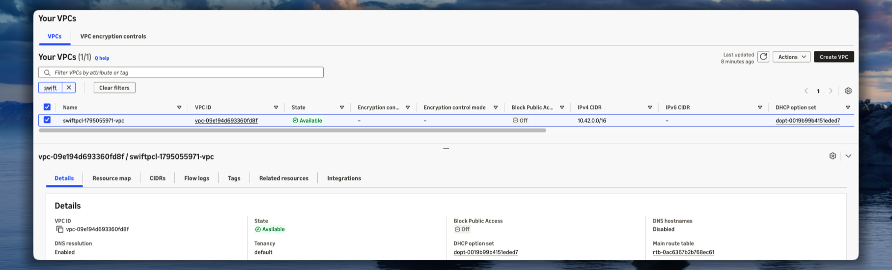

**CLI:** create the VPC, subnets, IGW, and route table:

```bash
export VPC_ID=$(aws ec2 create-vpc --cidr-block "${VPC_CIDR}" \
  --tag-specifications "ResourceType=vpc,Tags=[{Key=Name,Value=${LAB_ID}-vpc},{Key=Project,Value=${LAB_ID}}]" \
  --query Vpc.VpcId --output text)

export IGW_ID=$(aws ec2 create-internet-gateway \
  --tag-specifications "ResourceType=internet-gateway,Tags=[{Key=Project,Value=${LAB_ID}}]" \
  --query InternetGateway.InternetGatewayId --output text)
aws ec2 attach-internet-gateway --internet-gateway-id "${IGW_ID}" --vpc-id "${VPC_ID}"

export SUBNET_A=$(aws ec2 create-subnet --vpc-id "${VPC_ID}" --cidr-block "${SUBNET_A_CIDR}" \
  --availability-zone "${AZ_A}" \
  --tag-specifications "ResourceType=subnet,Tags=[{Key=Name,Value=${LAB_ID}-a},{Key=Project,Value=${LAB_ID}}]" \
  --query Subnet.SubnetId --output text)

export SUBNET_B=$(aws ec2 create-subnet --vpc-id "${VPC_ID}" --cidr-block "${SUBNET_B_CIDR}" \
  --availability-zone "${AZ_B}" \
  --tag-specifications "ResourceType=subnet,Tags=[{Key=Name,Value=${LAB_ID}-b},{Key=Project,Value=${LAB_ID}}]" \
  --query Subnet.SubnetId --output text)

export RTB_ID=$(aws ec2 create-route-table --vpc-id "${VPC_ID}" \
  --tag-specifications "ResourceType=route-table,Tags=[{Key=Project,Value=${LAB_ID}}]" \
  --query RouteTable.RouteTableId --output text)
aws ec2 create-route --route-table-id "${RTB_ID}" --destination-cidr-block 0.0.0.0/0 --gateway-id "${IGW_ID}"
aws ec2 associate-route-table --route-table-id "${RTB_ID}" --subnet-id "${SUBNET_A}"
aws ec2 associate-route-table --route-table-id "${RTB_ID}" --subnet-id "${SUBNET_B}"

echo "${VPC_ID} ${SUBNET_A} ${SUBNET_B}"
```

Expected output: `vpc-0aa11bb22cc33dd44 subnet-0a1a1a1a1a1a1a1a1 subnet-0b2b2b2b2b2b2b2b2`.

New subnets do not auto-assign public IPs by default, so instances remain private. An internet-facing NLB still requires subnets with a route to the IGW.

### 3. Create NLB and application security groups (least privilege)
{: #step-3 }

**Console:** EC2 → Security Groups → Create security group

Create two security groups:

1. **NLB SG**: inbound TCP 80 only from your laptop's IP.
2. **App SG**: inbound TCP 80 only from the NLB SG.

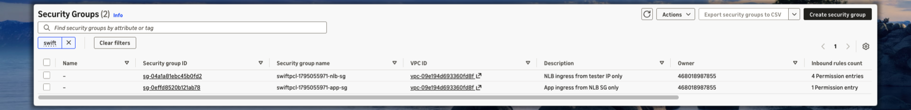

**CLI:** create both security groups and their ingress rules:

```bash
export SG_NLB=$(aws ec2 create-security-group --group-name "${LAB_ID}-nlb-sg" \
  --description "NLB ingress from tester IP only" --vpc-id "${VPC_ID}" \
  --query GroupId --output text)
aws ec2 authorize-security-group-ingress --group-id "${SG_NLB}" \
  --protocol tcp --port 80 --cidr "${MY_IP}/32"

export SG_APP=$(aws ec2 create-security-group --group-name "${LAB_ID}-app-sg" \
  --description "App ingress from NLB SG only" --vpc-id "${VPC_ID}" \
  --query GroupId --output text)
aws ec2 authorize-security-group-ingress --group-id "${SG_APP}" \
  --protocol tcp --port 80 --source-group "${SG_NLB}"

echo "${SG_NLB} ${SG_APP}"
```

Expected output: `sg-0nlb1111aaaa2222b sg-0app3333cccc4444d`.

The security group must be attached to the NLB **at creation time**. An NLB without a security group cannot have one added later (check the latest documentation).

### 4. Launch uneven instances: 1 in AZ-a, 3 in AZ-b
{: #step-4 }

**Console:** EC2 → Instances → Launch instances

Choose the **Amazon Linux 2023** AMI and **t3.micro** instance type. Under **Network settings**, select the AZ-a subnet, disable **Auto-assign public IP**, and select the App SG. Open **Advanced details**, set **Metadata version** to **V2 only (token required)**, and paste the script into **User data**. Repeat for AZ-b with **Number of instances** set to 3.

The user data script installs a systemd service that returns the AZ and instance ID. systemd is used so the service restarts automatically after stop/start during verification.

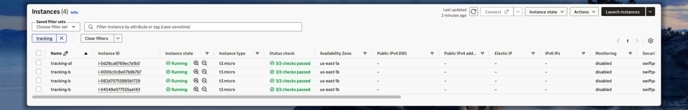

**CLI:** create the user data script, then launch the instances:

```bash
cat > userdata.sh <<'EOF'
#!/bin/bash
cat > /usr/local/bin/whoami-gen.sh <<'GEN'
#!/bin/bash
TOKEN=$(curl -s -X PUT "http://169.254.169.254/latest/api/token" -H "X-aws-ec2-metadata-token-ttl-seconds: 300")
MD="http://169.254.169.254/latest/meta-data"
IID=$(curl -s -H "X-aws-ec2-metadata-token: ${TOKEN}" "${MD}/instance-id")
AZ=$(curl -s -H "X-aws-ec2-metadata-token: ${TOKEN}" "${MD}/placement/availability-zone")
mkdir -p /srv/www
echo "${AZ} ${IID}" > /srv/www/index.html
GEN
chmod +x /usr/local/bin/whoami-gen.sh

cat > /etc/systemd/system/whoami.service <<'UNIT'
[Unit]
Description=Lab whoami responder
After=network-online.target
Wants=network-online.target

[Service]
ExecStartPre=/usr/local/bin/whoami-gen.sh
ExecStart=/usr/bin/python3 -m http.server 80 --directory /srv/www
Restart=always

[Install]
WantedBy=multi-user.target
UNIT

systemctl daemon-reload
systemctl enable --now whoami.service
EOF
```

```bash
export I_A1=$(aws ec2 run-instances --image-id "${AMI_ID}" --instance-type "${INSTANCE_TYPE}" \
  --subnet-id "${SUBNET_A}" --security-group-ids "${SG_APP}" --count 1 \
  --user-data file://userdata.sh \
  --metadata-options HttpTokens=required,HttpEndpoint=enabled \
  --tag-specifications "ResourceType=instance,Tags=[{Key=Name,Value=tracking-a1},{Key=Project,Value=${LAB_ID}}]" \
  --query 'Instances[0].InstanceId' --output text)

read -r I_B1 I_B2 I_B3 <<< "$(aws ec2 run-instances --image-id "${AMI_ID}" --instance-type "${INSTANCE_TYPE}" \
  --subnet-id "${SUBNET_B}" --security-group-ids "${SG_APP}" --count 3 \
  --user-data file://userdata.sh \
  --metadata-options HttpTokens=required,HttpEndpoint=enabled \
  --tag-specifications "ResourceType=instance,Tags=[{Key=Name,Value=tracking-b},{Key=Project,Value=${LAB_ID}}]" \
  --query 'Instances[].InstanceId' --output text)"
export I_B1 I_B2 I_B3

aws ec2 wait instance-running --instance-ids "${I_A1}" "${I_B1}" "${I_B2}" "${I_B3}"
aws ec2 describe-instances --instance-ids "${I_A1}" "${I_B1}" "${I_B2}" "${I_B3}" \
  --query 'Reservations[].Instances[].[InstanceId,Placement.AvailabilityZone,State.Name]' --output text
```

<details class="lab-fold"><summary><span class="lab-fold__title">Expected output</span><small>4 lines</small></summary><div class="lab-fold__body">
<div class="lab-term"><div class="lab-term__bar"><i></i><i></i><i></i><span>output</span><em>text</em></div><div class="lab-term__body"><span class="ln">i-0a1b2c3d4e5f60001&#9;us-east-1a&#9;running</span><span class="ln">i-0a1b2c3d4e5f60002&#9;us-east-1b&#9;running</span><span class="ln">i-0a1b2c3d4e5f60003&#9;us-east-1b&#9;running</span><span class="ln">i-0a1b2c3d4e5f60004&#9;us-east-1b&#9;running</span></div></div>
</div></details>

### 5. Create a target group and register the 4 instances
{: #step-5 }

**Console:** EC2 → Target Groups → Create target group

Choose **Instances**, protocol **TCP** port **80**, and the lab VPC. Under **Health checks**, choose protocol **HTTP** path `/`, open **Advanced health check settings**, and set:

- **Interval** 10
- **Healthy threshold** 2
- **Unhealthy threshold** 2

Register all four instances.

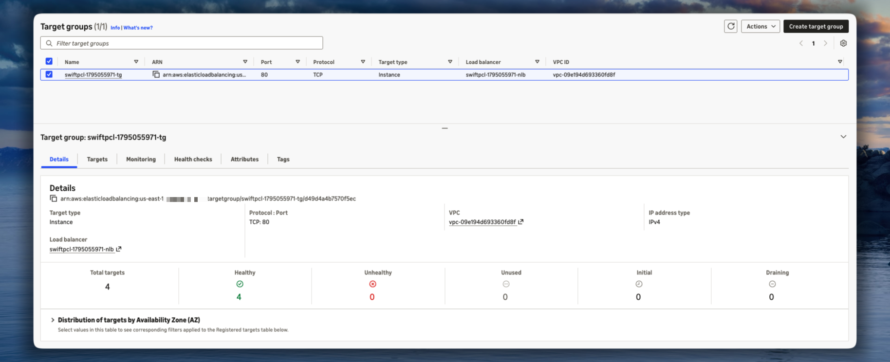

**CLI:** create the target group, shorten deregistration delay, and register targets:

```bash
export TG_ARN=$(aws elbv2 create-target-group --name "${LAB_ID}-tg" \
  --protocol TCP --port 80 --vpc-id "${VPC_ID}" --target-type instance \
  --health-check-protocol HTTP --health-check-path / \
  --health-check-interval-seconds 10 --healthy-threshold-count 2 --unhealthy-threshold-count 2 \
  --tags Key=Project,Value="${LAB_ID}" \
  --query 'TargetGroups[0].TargetGroupArn' --output text)

aws elbv2 modify-target-group-attributes --target-group-arn "${TG_ARN}" \
  --attributes Key=deregistration_delay.timeout_seconds,Value=10 > /dev/null

aws elbv2 register-targets --target-group-arn "${TG_ARN}" \
  --targets Id="${I_A1}" Id="${I_B1}" Id="${I_B2}" Id="${I_B3}"

aws elbv2 describe-target-group-attributes --target-group-arn "${TG_ARN}" \
  --query "Attributes[?Key=='load_balancing.cross_zone.enabled']" --output text
```

Expected output: `load_balancing.cross_zone.enabled	use_load_balancer_configuration`.

The target group inherits the LB setting. Deregistration delay is shortened to 10 seconds only to speed up cleanup. This setting only controls how long in-flight connections wait when a target is removed; it does **not** change traffic distribution.

### 6. Create an internet-facing NLB in two AZs + listener
{: #step-6 }

**Console:** EC2 → Load Balancers → Create load balancer → Network Load Balancer

Set:

- **Scheme**: **Internet-facing**
- **Network mapping**: select AZ-a and AZ-b with the lab subnets
- **Security groups**: NLB SG
- **Listener**: TCP 80 forwarding to the lab target group

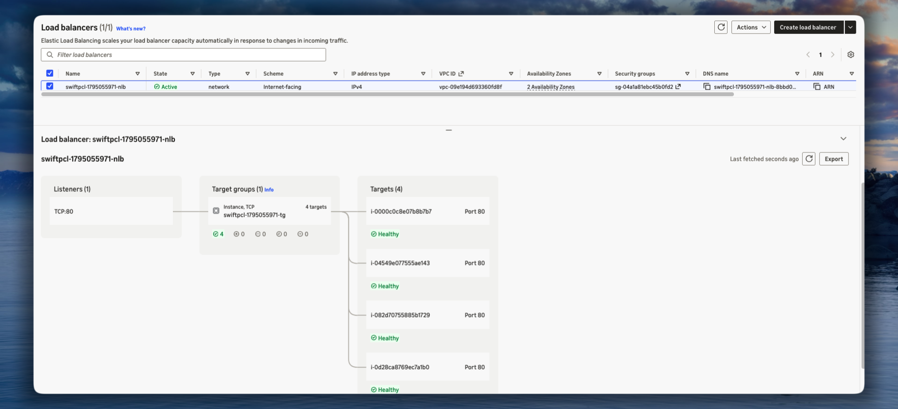

**CLI:** create the NLB, wait for it to become available, and create the listener:

```bash
export NLB_ARN=$(aws elbv2 create-load-balancer --name "${LAB_ID}-nlb" \
  --type network --scheme internet-facing \
  --subnets "${SUBNET_A}" "${SUBNET_B}" --security-groups "${SG_NLB}" \
  --tags Key=Project,Value="${LAB_ID}" \
  --query 'LoadBalancers[0].LoadBalancerArn' --output text)

aws elbv2 wait load-balancer-available --load-balancer-arns "${NLB_ARN}"

aws elbv2 create-listener --load-balancer-arn "${NLB_ARN}" --protocol TCP --port 80 \
  --default-actions Type=forward,TargetGroupArn="${TG_ARN}" > /dev/null

export NLB_DNS=$(aws elbv2 describe-load-balancers --load-balancer-arns "${NLB_ARN}" \
  --query 'LoadBalancers[0].DNSName' --output text)

aws elbv2 wait target-in-service --target-group-arn "${TG_ARN}"
aws elbv2 describe-target-health --target-group-arn "${TG_ARN}" \
  --query 'TargetHealthDescriptions[].[Target.Id,TargetHealth.State]' --output text
```

<details class="lab-fold"><summary><span class="lab-fold__title">Expected output</span><small>4 lines</small></summary><div class="lab-fold__body">
<div class="lab-term"><div class="lab-term__bar"><i></i><i></i><i></i><span>output</span><em>text</em></div><div class="lab-term__body"><span class="ln">i-0a1b2c3d4e5f60001&#9;healthy</span><span class="ln">i-0a1b2c3d4e5f60002&#9;healthy</span><span class="ln">i-0a1b2c3d4e5f60003&#9;healthy</span><span class="ln">i-0a1b2c3d4e5f60004&#9;healthy</span></div></div>
</div></details>

### 7. Check the NLB cross-zone default and get each node's IP
{: #step-7 }

**Console:** EC2 → Load Balancers → select the NLB → Attributes** tab

Look at **Cross-zone load balancing**: **Off**. Each node's IP is visible under **Network Interfaces** with the description `ELB net/...`.

**CLI:** check the LB attribute, then resolve each node's public IP:

```bash
aws elbv2 describe-load-balancer-attributes --load-balancer-arn "${NLB_ARN}" \
  --query "Attributes[?Key=='load_balancing.cross_zone.enabled']" --output text
```

Expected output: `load_balancing.cross_zone.enabled	false`.

```bash
export LB_SUFFIX="${NLB_ARN#*loadbalancer/}"
export NODE_IP_A=$(aws ec2 describe-network-interfaces \
  --filters "Name=description,Values=ELB ${LB_SUFFIX}" "Name=availability-zone,Values=${AZ_A}" \
  --query 'NetworkInterfaces[0].Association.PublicIp' --output text)
export NODE_IP_B=$(aws ec2 describe-network-interfaces \
  --filters "Name=description,Values=ELB ${LB_SUFFIX}" "Name=availability-zone,Values=${AZ_B}" \
  --query 'NetworkInterfaces[0].Association.PublicIp' --output text)
echo "node-a=${NODE_IP_A} node-b=${NODE_IP_B}"
```

Expected output: `node-a=108.X.X.Y node-b=43.X.X.Y`.

One enabled AZ produces one node (one ENI). There is no node in an AZ that is not enabled.

### 8. Measure distribution with cross-zone OFF
{: #step-8 }

The `hit` function sends N new TCP connections to one node IP, then counts which instance answered. Failed connections are recorded as `FAILED`.

```bash
hit() {
  local ip="$1" n="${2:-40}"
  for i in $(seq 1 "${n}"); do
    curl -s --max-time 2 "http://${ip}/" || echo "FAILED"
  done | sort | uniq -c
}

hit "${NODE_IP_A}"
```

<details class="lab-fold"><summary><span class="lab-fold__title">Expected output</span><small>1 lines</small></summary><div class="lab-fold__body">
<div class="lab-term"><div class="lab-term__bar"><i></i><i></i><i></i><span>output</span><em>text</em></div><div class="lab-term__body"><span class="ln">&#32;&#32;&#32;&#32;&#32;40&#32;us-east-1a&#32;i-0a1b2c3d4e5f60001</span></div></div>
</div></details>

```bash
hit "${NODE_IP_B}"
```

<details class="lab-fold"><summary><span class="lab-fold__title">Expected output</span><small>3 lines</small></summary><div class="lab-fold__body">
<div class="lab-term"><div class="lab-term__bar"><i></i><i></i><i></i><span>output</span><em>text</em></div><div class="lab-term__body"><span class="ln">&#32;&#32;&#32;&#32;&#32;13&#32;us-east-1b&#32;i-0a1b2c3d4e5f60002</span><span class="ln">&#32;&#32;&#32;&#32;&#32;14&#32;us-east-1b&#32;i-0a1b2c3d4e5f60003</span><span class="ln">&#32;&#32;&#32;&#32;&#32;13&#32;us-east-1b&#32;i-0a1b2c3d4e5f60004</span></div></div>
</div></details>

The AZ-a node sends 100% of its share to one instance. Production clients are split roughly 50:50 between nodes via DNS, so `tracking-a1` absorbs about 50% of total traffic, while each AZ-b instance gets about 16.7%. That is exactly the symptom SwiftParcel saw. Per-instance numbers are not always exact because NLB uses a per-connection flow hash.

### 9. Enable cross-zone at the NLB level, then measure again
{: #step-9 }

**Console:** EC2 → Load Balancers → select the NLB → Attributes → Edit

Turn on **Cross-zone load balancing** and click **Save changes**.

**CLI:** modify the LB attribute and verify:

```bash
aws elbv2 modify-load-balancer-attributes --load-balancer-arn "${NLB_ARN}" \
  --attributes Key=load_balancing.cross_zone.enabled,Value=true \
  --query "Attributes[?Key=='load_balancing.cross_zone.enabled']" --output text
```

Expected output: `load_balancing.cross_zone.enabled	true`.

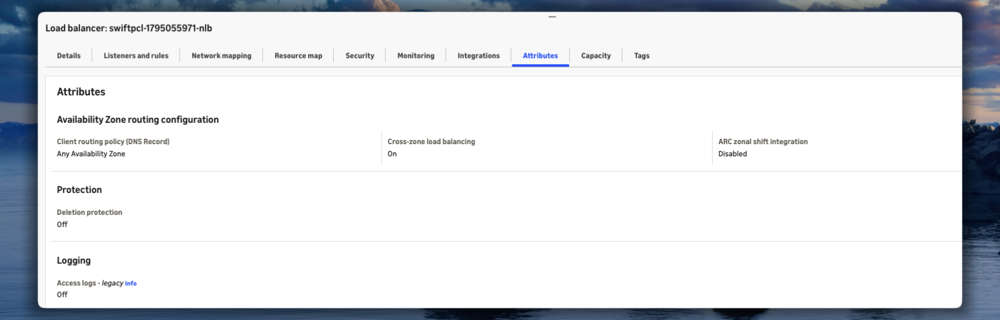

Wait about 1 minute for the change to propagate to the nodes (check the latest documentation), then measure:

```bash
sleep 60
hit "${NODE_IP_A}"
```

<details class="lab-fold"><summary><span class="lab-fold__title">Expected output</span><small>4 lines</small></summary><div class="lab-fold__body">
<div class="lab-term"><div class="lab-term__bar"><i></i><i></i><i></i><span>output</span><em>text</em></div><div class="lab-term__body"><span class="ln">&#32;&#32;&#32;&#32;&#32;11&#32;us-east-1a&#32;i-0a1b2c3d4e5f60001</span><span class="ln">&#32;&#32;&#32;&#32;&#32;&#32;9&#32;us-east-1b&#32;i-0a1b2c3d4e5f60002</span><span class="ln">&#32;&#32;&#32;&#32;&#32;10&#32;us-east-1b&#32;i-0a1b2c3d4e5f60003</span><span class="ln">&#32;&#32;&#32;&#32;&#32;10&#32;us-east-1b&#32;i-0a1b2c3d4e5f60004</span></div></div>
</div></details>

The AZ-a node now distributes to all four targets across both AZs. `hit "${NODE_IP_B}"` also shows all four instances. Total distribution becomes about 25% per instance.

## Verification

| Test | Scenario | Expected result |
|---|---|---|
| 1 | Cross-zone on, requests to AZ-a node answered by instances from both AZs | <span class="lab-pill is-ok">✓ Succeeded</span> |
| 2 | Target group override to `false` while LB is `true`, AZ-a node sends to AZ-b | <span class="lab-pill is-deny">✕ Failed</span> |
| 3 | `tracking-a1` stopped, target group cross-zone `false`, requests to AZ-a node | <span class="lab-pill is-deny">✕ Failed</span> |
| 4 | `tracking-a1` stopped, target group back to inherit LB (cross-zone on), requests to AZ-a node | <span class="lab-pill is-ok">✓ Succeeded</span> |
| 5 | Requests to NLB from an IP other than `MY_IP` | <span class="lab-pill is-deny">✕ Denied</span> |

### Test 1: Cross-zone on, AZ-a node reaches across AZs

Already proven in step 9. Repeat for the AZ-b node:

```bash
hit "${NODE_IP_B}"
```

<details class="lab-fold"><summary><span class="lab-fold__title">Expected output</span><small>4 lines</small></summary><div class="lab-fold__body">
<div class="lab-term"><div class="lab-term__bar"><i></i><i></i><i></i><span>output</span><em>text</em></div><div class="lab-term__body"><span class="ln">&#32;&#32;&#32;&#32;&#32;10&#32;us-east-1a&#32;i-0a1b2c3d4e5f60001</span><span class="ln">&#32;&#32;&#32;&#32;&#32;10&#32;us-east-1b&#32;i-0a1b2c3d4e5f60002</span><span class="ln">&#32;&#32;&#32;&#32;&#32;11&#32;us-east-1b&#32;i-0a1b2c3d4e5f60003</span><span class="ln">&#32;&#32;&#32;&#32;&#32;&#32;9&#32;us-east-1b&#32;i-0a1b2c3d4e5f60004</span></div></div>
</div></details>

### Test 2: Target group override beats the LB setting

**Console:** EC2 → Target Groups → select the target group → Attributes** tab → Edit

Under **Cross-zone load balancing**, choose **Turn off cross-zone load balancing** and click **Save changes**.

**CLI:** set the target group override to `false`:

```bash
aws elbv2 modify-target-group-attributes --target-group-arn "${TG_ARN}" \
  --attributes Key=load_balancing.cross_zone.enabled,Value=false \
  --query "Attributes[?Key=='load_balancing.cross_zone.enabled']" --output text
```

Expected output: `load_balancing.cross_zone.enabled	false`.

```bash
sleep 60
hit "${NODE_IP_A}"
```

<details class="lab-fold"><summary><span class="lab-fold__title">Expected output</span><small>1 lines</small></summary><div class="lab-fold__body">
<div class="lab-term"><div class="lab-term__bar"><i></i><i></i><i></i><span>output</span><em>text</em></div><div class="lab-term__body"><span class="ln">&#32;&#32;&#32;&#32;&#32;40&#32;us-east-1a&#32;i-0a1b2c3d4e5f60001</span></div></div>
</div></details>

The LB level is still `true`, but traffic to this target group no longer crosses AZs. The target group setting determines the effective behavior.

### Test 3: AZ-a loses its healthy target, cross-zone off

The `false` override from test 2 remains in place. Stop the only instance in AZ-a:

```bash
aws ec2 stop-instances --instance-ids "${I_A1}" > /dev/null
aws ec2 wait instance-stopped --instance-ids "${I_A1}"
aws elbv2 describe-target-health --target-group-arn "${TG_ARN}" --targets Id="${I_A1}" \
  --query 'TargetHealthDescriptions[0].TargetHealth.[State,Reason]' --output text
```

Expected output: `unused	Target.InvalidState`.

```bash
hit "${NODE_IP_A}" 10
```

<details class="lab-fold"><summary><span class="lab-fold__title">Expected output</span><small>1 lines</small></summary><div class="lab-fold__body">
<div class="lab-term"><div class="lab-term__bar"><i></i><i></i><i></i><span>output</span><em>text</em></div><div class="lab-term__body"><span class="ln"><span class="bad">&#32;&#32;&#32;&#32;&#32;10&#32;FAILED</span></span></div></div>
</div></details>

The AZ-a node has no target within its scope. The NLB also removes the IP of a node with no healthy targets from DNS answers (DNS failover), so clients that re-resolve are directed to the AZ-b node. Check after 1–2 minutes:

```bash
dig +short "${NLB_DNS}"
```

Expected output: only `43.X.X.Y` (the AZ-b node IP). NLB DNS failover details can be adjusted via target group health attributes; check the latest documentation.

Clients that still hold the old IP (DNS cache, long-lived connections) still experience disruption. This is the risk of zonal isolation without enough capacity per AZ.

### Test 4: AZ-a loses its healthy target, cross-zone on

Return the target group to inherit the LB setting (`true`):

```bash
aws elbv2 modify-target-group-attributes --target-group-arn "${TG_ARN}" \
  --attributes Key=load_balancing.cross_zone.enabled,Value=use_load_balancer_configuration \
  --query "Attributes[?Key=='load_balancing.cross_zone.enabled']" --output text
```

Expected output: `load_balancing.cross_zone.enabled	use_load_balancer_configuration`.

```bash
sleep 60
hit "${NODE_IP_A}"
```

<details class="lab-fold"><summary><span class="lab-fold__title">Expected output</span><small>3 lines</small></summary><div class="lab-fold__body">
<div class="lab-term"><div class="lab-term__bar"><i></i><i></i><i></i><span>output</span><em>text</em></div><div class="lab-term__body"><span class="ln">&#32;&#32;&#32;&#32;&#32;13&#32;us-east-1b&#32;i-0a1b2c3d4e5f60002</span><span class="ln">&#32;&#32;&#32;&#32;&#32;14&#32;us-east-1b&#32;i-0a1b2c3d4e5f60003</span><span class="ln">&#32;&#32;&#32;&#32;&#32;13&#32;us-east-1b&#32;i-0a1b2c3d4e5f60004</span></div></div>
</div></details>

The AZ-a node keeps serving by forwarding to healthy targets in AZ-b. Start `tracking-a1` again:

```bash
aws ec2 start-instances --instance-ids "${I_A1}" > /dev/null
aws ec2 wait instance-running --instance-ids "${I_A1}"
aws elbv2 wait target-in-service --target-group-arn "${TG_ARN}" --targets Id="${I_A1}"
echo "tracking-a1 is healthy again"
```

Expected output: `tracking-a1 is healthy again`.

The `whoami` service starts automatically because it is enabled in systemd.

### Test 5: Access from another IP is denied

Open AWS CloudShell (its public IP is not `MY_IP`). CloudShell may not be available in every Region; use another Region if needed (check the latest documentation). Run with the AZ-a node IP from step 7:

```bash
curl -s --max-time 5 http://108.X.X.Y/ || echo "DENIED (timeout)"
```

Expected output: `DENIED (timeout)`.

The NLB SG only allows `MY_IP/32`. Instances also have no public IP, and the App SG only accepts traffic from the NLB SG.

## Troubleshooting

| Symptom | Common cause | Solution |
|---|---|---|
| Target `unhealthy` with reason `Target.FailedHealthChecks` | App SG does not allow the NLB SG, or user data has not finished | Check App SG inbound using `--source-group`. Wait 2–3 minutes after boot |
| `curl` to node IP times out from laptop | Laptop's public IP changed (ISP, VPN) | Re-run `MY_IP`, add a new rule to the NLB SG |
| Distribution still uneven after cross-zone on | Change has not propagated, or target group override is `false` | Wait 1–2 minutes. Check `describe-target-group-attributes` |
| All requests go to one instance despite cross-zone on | Client reuses TCP connections (keep-alive); NLB routes per flow | Use a new connection per request like the `hit` function |
| `NODE_IP_A` is `None` | Wrong ENI description filter, or NLB not yet `active` | `echo "${LB_SUFFIX}"` should look like `net/name/id`. Wait for `load-balancer-available` |
| `ValidationError` when creating NLB/TG | Name longer than 32 characters | Shorten `PREFIX` |
| `run-instances` fails with `Unsupported` | Instance type not available in that AZ | Change `INSTANCE_TYPE` (e.g., `t3.small`) or AZ |
| `DependencyViolation` when deleting SG/subnet | NLB ENI or instances not fully gone | Wait a few minutes, retry the command |

ALB note: if you repeat the lab with an ALB and turn off cross-zone on the target group, an AZ without targets produces HTTP 503. Avoid empty subnets on the LB.

## Cleanup

Delete in order. These commands permanently delete all lab resources; make sure the variables still hold the lab's IDs (not production resources) before running them:

```bash
echo "${NLB_ARN}"; echo "${TG_ARN}"; echo "${VPC_ID}"
```

1. Delete the NLB (listener is deleted with it), wait until it is gone:

```bash
aws elbv2 delete-load-balancer --load-balancer-arn "${NLB_ARN}"
aws elbv2 wait load-balancers-deleted --load-balancer-arns "${NLB_ARN}"
```

2. Delete the target group:

```bash
aws elbv2 delete-target-group --target-group-arn "${TG_ARN}"
```

3. Terminate all four instances:

```bash
aws ec2 terminate-instances --instance-ids "${I_A1}" "${I_B1}" "${I_B2}" "${I_B3}" > /dev/null
aws ec2 wait instance-terminated --instance-ids "${I_A1}" "${I_B1}" "${I_B2}" "${I_B3}"
```

4. Delete the security groups. App SG first because it references the NLB SG. NLB ENIs sometimes take a few minutes to detach, so use a retry loop:

```bash
for SG in "${SG_APP}" "${SG_NLB}"; do
  until aws ec2 delete-security-group --group-id "${SG}" 2>/dev/null; do
    echo "waiting for ${SG} to be free of dependencies..."; sleep 20
  done
done
```

5. Delete the subnets (route table associations are removed with them), route table, IGW, then VPC:

```bash
aws ec2 delete-subnet --subnet-id "${SUBNET_A}"
aws ec2 delete-subnet --subnet-id "${SUBNET_B}"
aws ec2 delete-route-table --route-table-id "${RTB_ID}"
aws ec2 detach-internet-gateway --internet-gateway-id "${IGW_ID}" --vpc-id "${VPC_ID}"
aws ec2 delete-internet-gateway --internet-gateway-id "${IGW_ID}"
aws ec2 delete-vpc --vpc-id "${VPC_ID}"
rm -f userdata.sh
```

6. Verify nothing remains:

```bash
aws ec2 describe-vpcs --filters "Name=tag:Project,Values=${LAB_ID}" --query 'Vpcs[].VpcId' --output text
```

Expected output: empty.

## References

- <https://docs.aws.amazon.com/elasticloadbalancing/latest/userguide/how-elastic-load-balancing-works.html>
- <https://docs.aws.amazon.com/elasticloadbalancing/latest/network/edit-target-group-attributes.html>
- <https://docs.aws.amazon.com/elasticloadbalancing/latest/application/edit-target-group-attributes.html>
- <https://docs.aws.amazon.com/elasticloadbalancing/latest/network/edit-load-balancer-attributes.html>
- <https://docs.aws.amazon.com/elasticloadbalancing/latest/network/target-group-health-checks.html>
- <https://docs.aws.amazon.com/cli/latest/reference/elbv2/modify-load-balancer-attributes.html>
- <https://docs.aws.amazon.com/cli/latest/reference/elbv2/modify-target-group-attributes.html>
- <https://aws.amazon.com/elasticloadbalancing/pricing/>
- <https://calculator.aws/>

<!-- lab-next:start -->
<section class="lab-next" aria-label="Next lab"><div class="lab-next__kicker">Next lab</div><div class="lab-next__grid"><a class="lab-next__card" href="/posts/lab-detecting-security-groups-with-ssh-open-to-the-internet-using-aws-config-eve/"><span class="lab-next__img" style="background-image:url('/assets/img/posts/lab-detecting-security-groups-with-ssh-open-to-the-internet-using-aws-config-eve/cover.png')" aria-hidden="true"></span><span class="lab-next__body"><span class="lab-next__title">Detecting Security Groups with SSH Open to the Internet Using AWS Config, EventBridge and SNS Notifications</span><span class="lab-next__meta">Intermediate · 60–75 minutes</span><span class="lab-next__go">Start the lab →</span></span></a><a class="lab-next__card" href="/posts/lab-shared-dataset-across-azs-amazon-efs-access-points-posix/"><span class="lab-next__img" style="background-image:url('/assets/img/posts/lab-shared-dataset-across-azs-amazon-efs-access-points-posix/cover.png')" aria-hidden="true"></span><span class="lab-next__body"><span class="lab-next__title">A Shared Dataset Across AZs with Amazon EFS, Access Points, and POSIX Permissions</span><span class="lab-next__meta">Intermediate · 60–75 minutes</span><span class="lab-next__go">Start the lab →</span></span></a></div></section>
<!-- lab-next:end -->
