<section class="lab-card" data-lang="en" aria-label="Lab summary">
<ul class="lab-stats"><li><span>Level</span><b>Intermediate</b></li><li><span>Duration</span><b>60–75 minutes</b></li><li><span>Region</span><b>ap-southeast-3</b></li></ul>
<ul class="lab-services"><li><span class="lab-svc-ic" style="background-image:url('/assets/img/aws/ec2.svg')" aria-hidden="true"></span>Amazon EC2</li><li><span class="lab-svc-ic" style="background-image:url('/assets/img/aws/config.svg')" aria-hidden="true"></span>AWS Config</li><li><span class="lab-svc-ic" style="background-image:url('/assets/img/aws/s3.svg')" aria-hidden="true"></span>Amazon S3</li><li><span class="lab-svc-ic" style="background-image:url('/assets/img/aws/eventbridge.svg')" aria-hidden="true"></span>EventBridge</li><li><span class="lab-svc-ic" style="background-image:url('/assets/img/aws/sns.svg')" aria-hidden="true"></span>Amazon SNS</li><li><span class="lab-svc-ic" style="background-image:url('/assets/img/aws/ssm.svg')" aria-hidden="true"></span>Systems Manager</li></ul>
<div class="lab-actions"><a class="lab-btn" href="#step-1">Jump to the steps ↓</a></div>
</section>

# Lab: Detecting Security Groups with SSH Open to the Internet Using AWS Config + EventBridge/SNS Notifications

> **Summary**
> Developers often open SSH to `0.0.0.0/0` or move it to a custom port and leave it publicly accessible. This lab sets up AWS Config rules to detect those violations, sends email only when a resource is NON_COMPLIANT, and automatically revokes public port 22 rules. You'll verify the results through compliance status, email alerts, and the changed contents of the security group.
{: .prompt-info }

## Learning objectives

- Understand why **AWS Config** is the right answer for "detect resource configuration that violates policy + send notifications." CloudWatch metrics, Trusted Advisor, and in-instance scanners are not the right tools for this.
- Use the managed rule **`restricted-ssh`** (identifier `INCOMING_SSH_DISABLED`). This rule only checks port 22 open to `0.0.0.0/0` or `::/0`.
- See the **blind spot** firsthand: SSH on a custom port (e.g., 2202) open to the public remains COMPLIANT under `restricted-ssh`. For this case, use **`vpc-sg-open-only-to-authorized-ports`**.
- Send notifications via **EventBridge** (event `Config Rules Compliance Change`) to **SNS**, filtered to only `NON_COMPLIANT`. This approach is quieter than sending all delivery channel notifications to SNS.
- Set up **auto-remediation** using the SSM runbook `AWS-DisablePublicAccessForSecurityGroup`.
- Save on Config costs: the recorder only records `AWS::EC2::SecurityGroup`.

## Scenario

**Harvestly** is an agritech startup running a marketplace for farmers' harvests. The data team has a Linux EC2 cluster for daily batch price calculations. Their security policy states:

1. SSH **must not** be open to the internet.
2. SSH is moved to port **2202** and only allowed from the office VPN CIDR `203.0.113.0/24`.
3. The only port allowed to be public is **443** (internal dashboard over HTTPS).

Last week, an engineer opened port 22 to `0.0.0.0/0` for debugging and forgot to close it. The SRE team needs three things: automatic detection, email alerts to on-call, and automatic revocation for public port 22.

## Architecture

{: .light }
{: .dark }
*AWS Config records security group changes, evaluates rules, then EventBridge forwards NON_COMPLIANT status to SNS while SSM Automation revokes public port 22.*

Data flow:

1. An engineer adds an inbound rule to a security group (SG).
2. The configuration recorder records the change as a configuration item. Two rules (`restricted-ssh` and `vpc-sg-open-only-to-authorized-ports`) immediately evaluate that SG.
3. Config stores history/snapshots to S3 via the delivery channel. When compliance status changes, Config sends an event to the EventBridge default bus.
4. The EventBridge rule only passes `NON_COMPLIANT` events to the SNS topic. In parallel, the `restricted-ssh` rule triggers SSM Automation remediation.
5. SNS sends an email to on-call. The runbook calls `RevokeSecurityGroupIngress` to close public port 22, then Config re-evaluates the SG as COMPLIANT on `restricted-ssh`. On `authorized-ports`, the result is NOT_APPLICABLE if there is no public ingress, COMPLIANT if all public ports are authorized, or NON_COMPLIANT if unauthorized public ports remain.

{: .light }
{: .dark }
*Every SG change is evaluated by Config. Violations trigger email, and public port 22 is automatically revoked then re-evaluated. In reality, notification and remediation run in parallel.*

Comparison of the two rules used:

{: .light }
{: .dark }
*restricted-ssh only knows port 22. For custom port policies, the authorized-ports rule catches the violation.*

## Prerequisites

- An AWS account. Region **ap-southeast-3 (Jakarta)** is an opt-in Region, so enable it first under **Account → AWS Regions**. If you don't want to enable it, change `REGION` to `ap-southeast-1`.
- A default VPC exists in that Region. If not, create your own VPC and fill in `VPC_ID` manually.
- An active email address to receive alerts.
- AWS CLI v2 (latest 2.x, check latest documentation) and a bash shell. Run all steps in **the same terminal session** because they use environment variables.
- Minimum IAM permissions for the user/role running this lab:

```text
config:PutConfigurationRecorder
config:PutDeliveryChannel
config:StartConfigurationRecorder
config:StopConfigurationRecorder
config:DescribeConfigurationRecorders
config:DescribeConfigurationRecorderStatus
config:DeleteConfigurationRecorder
config:DeleteDeliveryChannel
config:PutConfigRule
config:DescribeConfigRules
config:DeleteConfigRule
config:StartConfigRulesEvaluation
config:GetComplianceDetailsByResource
config:GetComplianceDetailsByConfigRule
config:PutRemediationConfigurations
config:DeleteRemediationConfiguration
config:DescribeRemediationExecutionStatus
iam:CreateServiceLinkedRole
iam:CreateRole
iam:PutRolePolicy
iam:PassRole
iam:DeleteRolePolicy
iam:DeleteRole
s3:CreateBucket
s3:PutBucketPolicy
s3:ListBucket
s3:DeleteObject
s3:DeleteBucket
sns:CreateTopic
sns:Subscribe
sns:SetTopicAttributes
sns:DeleteTopic
events:PutRule
events:PutTargets
events:RemoveTargets
events:DeleteRule
ec2:DescribeVpcs
ec2:DescribeSecurityGroups
ec2:CreateSecurityGroup
ec2:AuthorizeSecurityGroupIngress
ec2:RevokeSecurityGroupIngress
ec2:DeleteSecurityGroup
sts:GetCallerIdentity
```

## Cost estimate

This lab doesn't use EC2 instances because the evaluated resource is the security group. Billable components:

| Component | What's billed | Notes |
|---|---|---|
| AWS Config | Per configuration item recorded + per rule evaluation | Recorder is limited to SGs only, so volume is small (check latest documentation) |
| Amazon S3 | Storage + requests for history/snapshot files | Size is in the KB range |
| Amazon SNS | Publish + email notifications | Free Tier quota applies (check latest documentation) |
| Amazon EventBridge | AWS service events on the default bus | Events from AWS services are generally free (check latest documentation) |
| SSM Automation | Runbook execution steps | Free quota per month applies (check latest documentation) |

If you clean up the lab the same day, total cost is usually only a few cents. For exact figures, use the [AWS Pricing Calculator](https://calculator.aws/).

## Steps

<ol class="lab-steps" aria-label="Step map"><li><a href="#step-1">Define variables</a></li><li><a href="#step-2">Check for an existing configuration recorder</a></li><li><a href="#step-3">Create recorder and delivery channel (only if CREATED_RECORDER=yes)</a></li><li><a href="#step-4">Create two managed Config rules</a></li><li><a href="#step-5">Create SNS topic + email subscription</a></li><li><a href="#step-6">Create EventBridge rule (NON_COMPLIANT only) + topic policy</a></li><li><a href="#step-7">Set up auto-remediation for port 22</a></li><li><a href="#step-8">Create three test security groups</a></li></ol>


### 1. Define variables
{: #step-1 }

```bash
export REGION="ap-southeast-3"
export PREFIX="harvestly-sg-lab"
export ALERT_EMAIL="oncall@example.com"
export OFFICE_CIDR="203.0.113.0/24"
export CUSTOM_SSH_PORT="2202"
export ACCOUNT_ID="$(aws sts get-caller-identity --query Account --output text)"
export LAB_ID="${PREFIX}-$(date +%s)"
export BUCKET="${LAB_ID}-config"
export RULE_SSH="${PREFIX}-restricted-ssh"
export RULE_PORTS="${PREFIX}-authorized-ports"
export EB_RULE="${PREFIX}-sg-noncompliant"
export TOPIC_NAME="${PREFIX}-alerts"
export REMEDIATION_ROLE="${PREFIX}-remediation-role"
echo "$ACCOUNT_ID $BUCKET"
```

Expected output: a 12-digit account ID followed by the bucket name, e.g., `111122223333 harvestly-sg-lab-1735000000-config`.

Replace `ALERT_EMAIL` with your own email. `OFFICE_CIDR` uses the documentation range (RFC 5737), which is safe for labs.

### 2. Check for an existing configuration recorder
{: #step-2 }

A Region can only have one customer-managed configuration recorder (check latest documentation). Check before creating one.

**Console:** AWS Config → Settings

If the page shows **Get started**, the recorder doesn't exist yet.

**CLI:**

```bash
aws configservice describe-configuration-recorders \
  --region "$REGION" \
  --query 'ConfigurationRecorders[].name' --output text
```

- **Empty output**: the recorder doesn't exist. Run `export CREATED_RECORDER="yes"` and continue to Step 3.
- **A recorder name appears** (e.g., `default`): run `export CREATED_RECORDER="no"` and skip Step 3. Make sure that recorder is active and records `AWS::EC2::SecurityGroup`:

```bash
aws configservice describe-configuration-recorder-status \
  --region "$REGION" \
  --query 'ConfigurationRecordersStatus[].[name,recording,lastStatus]' --output text
```

Expected output: `default True SUCCESS`.

### 3. Create recorder and delivery channel (only if `CREATED_RECORDER=yes`)
{: #step-3 }

**Console:** AWS Config → Get started

Under **Recording strategy**, choose **Specific resource types**, then add **AWS::EC2::SecurityGroup**. For **Delivery method**, choose to create a new S3 bucket. Skip the Rules page for now because rules will be created in Step 4.

**CLI:**

The CLI version starts with the service-linked role and S3 bucket:

```bash
# Service-linked role for Config (ignore "has been taken" error if it already exists)
aws iam create-service-linked-role --aws-service-name config.amazonaws.com || true

aws s3api create-bucket \
  --bucket "$BUCKET" \
  --region "$REGION" \
  --create-bucket-configuration LocationConstraint="$REGION"
```

Then the bucket policy, restricted to your own account via `AWS:SourceAccount`:

```bash
cat > config-bucket-policy.json <<EOF
{
  "Version": "2012-10-17",
  "Statement": [
    {
      "Sid": "AWSConfigBucketPermissionsCheck",
      "Effect": "Allow",
      "Principal": { "Service": "config.amazonaws.com" },
      "Action": "s3:GetBucketAcl",
      "Resource": "arn:aws:s3:::${BUCKET}",
      "Condition": { "StringEquals": { "AWS:SourceAccount": "${ACCOUNT_ID}" } }
    },
    {
      "Sid": "AWSConfigBucketExistenceCheck",
      "Effect": "Allow",
      "Principal": { "Service": "config.amazonaws.com" },
      "Action": "s3:ListBucket",
      "Resource": "arn:aws:s3:::${BUCKET}",
      "Condition": { "StringEquals": { "AWS:SourceAccount": "${ACCOUNT_ID}" } }
    },
    {
      "Sid": "AWSConfigBucketDelivery",
      "Effect": "Allow",
      "Principal": { "Service": "config.amazonaws.com" },
      "Action": "s3:PutObject",
      "Resource": "arn:aws:s3:::${BUCKET}/AWSLogs/${ACCOUNT_ID}/Config/*",
      "Condition": {
        "StringEquals": {
          "s3:x-amz-acl": "bucket-owner-full-control",
          "AWS:SourceAccount": "${ACCOUNT_ID}"
        }
      }
    }
  ]
}
EOF

aws s3api put-bucket-policy --bucket "$BUCKET" --policy file://config-bucket-policy.json
```

Finally, the recorder that only records security groups, the delivery channel, then start:

```bash
cat > recording-group.json <<'EOF'
{
  "allSupported": false,
  "includeGlobalResourceTypes": false,
  "resourceTypes": ["AWS::EC2::SecurityGroup"],
  "recordingStrategy": { "useOnly": "INCLUSION_BY_RESOURCE_TYPES" }
}
EOF

aws configservice put-configuration-recorder \
  --region "$REGION" \
  --configuration-recorder name=default,roleARN="arn:aws:iam::${ACCOUNT_ID}:role/aws-service-role/config.amazonaws.com/AWSServiceRoleForConfig" \
  --recording-group file://recording-group.json

aws configservice put-delivery-channel \
  --region "$REGION" \
  --delivery-channel name=default,s3BucketName="$BUCKET"

aws configservice start-configuration-recorder \
  --region "$REGION" \
  --configuration-recorder-name default
```

Verify recorder status:

```bash
aws configservice describe-configuration-recorder-status \
  --region "$REGION" \
  --query 'ConfigurationRecordersStatus[0].[recording,lastStatus]' --output text
```

Expected output: `True SUCCESS`. Initial status may be `PENDING`; wait 1–2 minutes and check again.

Note: the delivery channel is intentionally created **without** `snsTopicARN`. If set, SNS would receive all types of Config notifications (configuration item changes, snapshots, evaluation started, etc.), which is too noisy for on-call.

### 4. Create two managed Config rules
{: #step-4 }

**Console:** AWS Config → Rules → Add rule

1. Choose **Add AWS managed rule**, search for **restricted-ssh**, name it `harvestly-sg-lab-restricted-ssh`, then **Next** and **Add rule**.
2. Repeat for **vpc-sg-open-only-to-authorized-ports**. Under **Parameters**, set **authorizedTcpPorts** = `443`.
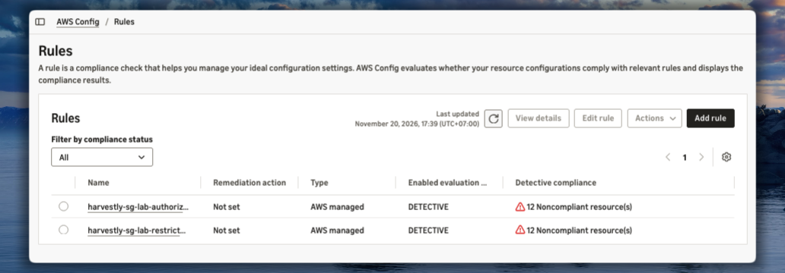

CLI version:

```bash
cat > rule-ssh.json <<EOF
{
  "ConfigRuleName": "${RULE_SSH}",
  "Description": "Port 22 must not be open to 0.0.0.0/0 or ::/0",
  "Scope": { "ComplianceResourceTypes": ["AWS::EC2::SecurityGroup"] },
  "Source": { "Owner": "AWS", "SourceIdentifier": "INCOMING_SSH_DISABLED" }
}
EOF

cat > rule-ports.json <<EOF
{
  "ConfigRuleName": "${RULE_PORTS}",
  "Description": "Only TCP 443 may be open to the internet",
  "Scope": { "ComplianceResourceTypes": ["AWS::EC2::SecurityGroup"] },
  "Source": { "Owner": "AWS", "SourceIdentifier": "VPC_SG_OPEN_ONLY_TO_AUTHORIZED_PORTS" },
  "InputParameters": "{\"authorizedTcpPorts\":\"443\"}"
}
EOF

aws configservice put-config-rule --region "$REGION" --config-rule file://rule-ssh.json
aws configservice put-config-rule --region "$REGION" --config-rule file://rule-ports.json
```

The `put-config-rule` command returns no output. Check the result:

```bash
aws configservice describe-config-rules \
  --region "$REGION" \
  --config-rule-names "$RULE_SSH" "$RULE_PORTS" \
  --query 'ConfigRules[].[ConfigRuleName,Source.SourceIdentifier,ConfigRuleState]' --output text
```

<details class="lab-fold"><summary><span class="lab-fold__title">Expected output</span><small>2 lines</small></summary><div class="lab-fold__body">
<div class="lab-term"><div class="lab-term__bar"><i></i><i></i><i></i><span>output</span><em>text</em></div><div class="lab-term__body"><span class="ln">harvestly-sg-lab-restricted-ssh&#9;INCOMING_SSH_DISABLED&#9;ACTIVE</span><span class="ln">harvestly-sg-lab-authorized-ports&#9;VPC_SG_OPEN_ONLY_TO_AUTHORIZED_PORTS&#9;ACTIVE</span></div></div>
</div></details>

Note the difference between the **rule name** (`restricted-ssh`) and the **identifier** (`INCOMING_SSH_DISABLED`). In CLI and IaC, the identifier is what you use. Port 2202 is intentionally **not** included in `authorizedTcpPorts`, because the policy says SSH must not be public at all.

Managed rule availability varies by Region; make sure these two rules are available in your chosen Region (check latest documentation).

Warning: once rules are active, **existing SGs in the account** are also evaluated. If any old SGs violate the rules, alerts may appear immediately after Step 6.

### 5. Create SNS topic + email subscription
{: #step-5 }

**Console:** Amazon SNS → Topics → Create topic

Choose type **Standard**, name it `harvestly-sg-lab-alerts`. After the topic is created, open **Create subscription**, select **Protocol** = **Email**, and fill in **Endpoint** with your email.

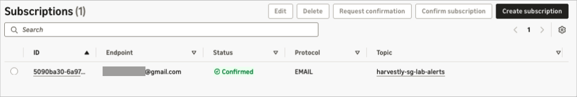

**CLI:**

```bash
export TOPIC_ARN="$(aws sns create-topic --region "$REGION" --name "$TOPIC_NAME" --query TopicArn --output text)"

aws sns subscribe \
  --region "$REGION" \
  --topic-arn "$TOPIC_ARN" \
  --protocol email \
  --notification-endpoint "$ALERT_EMAIL"
```

<details class="lab-fold"><summary><span class="lab-fold__title">Expected output</span><small>3 lines</small></summary><div class="lab-fold__body">
<div class="lab-term"><div class="lab-term__bar"><i></i><i></i><i></i><span>output</span><em>text</em></div><div class="lab-term__body"><span class="ln">{</span><span class="ln">&#32;&#32;&#32;&#32;&quot;SubscriptionArn&quot;:&#32;&quot;pending&#32;confirmation&quot;</span><span class="ln">}</span></div></div>
</div></details>

Open your inbox and click **Confirm subscription** in the "AWS Notification - Subscription Confirmation" email. The SNS topic must be in the same Region as Config.

### 6. Create EventBridge rule (NON_COMPLIANT only) + topic policy
{: #step-6 }

**Console:** Amazon EventBridge → Rules → Create rule

1. Name it `harvestly-sg-lab-sg-noncompliant` with event bus **default**.
2. Under **Creation method**, choose **Custom pattern (JSON editor)** and paste the pattern below.
3. For **Target**, choose **SNS topic**. Under **Additional settings**, choose **Input transformer**.

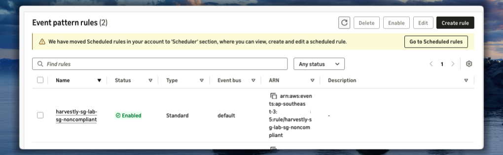

**CLI:**

Create the rule with the event pattern:

```bash
cat > event-pattern.json <<EOF
{
  "source": ["aws.config"],
  "detail-type": ["Config Rules Compliance Change"],
  "detail": {
    "messageType": ["ComplianceChangeNotification"],
    "configRuleName": ["${RULE_SSH}", "${RULE_PORTS}"],
    "newEvaluationResult": { "complianceType": ["NON_COMPLIANT"] }
  }
}
EOF

export EB_RULE_ARN="$(aws events put-rule \
  --region "$REGION" \
  --name "$EB_RULE" \
  --event-pattern file://event-pattern.json \
  --query RuleArn --output text)"
echo "$EB_RULE_ARN"
```

Expected output: `arn:aws:events:ap-southeast-3:111122223333:rule/harvestly-sg-lab-sg-noncompliant`.

The topic policy only allows this EventBridge rule to publish (least privilege):

```bash
cat > topic-policy.json <<EOF
{
  "Version": "2012-10-17",
  "Statement": [
    {
      "Sid": "OwnerManage",
      "Effect": "Allow",
      "Principal": { "AWS": "arn:aws:iam::${ACCOUNT_ID}:root" },
      "Action": [
        "sns:GetTopicAttributes",
        "sns:SetTopicAttributes",
        "sns:Subscribe",
        "sns:ListSubscriptionsByTopic",
        "sns:Publish",
        "sns:DeleteTopic"
      ],
      "Resource": "${TOPIC_ARN}"
    },
    {
      "Sid": "AllowEventBridgeRuleOnly",
      "Effect": "Allow",
      "Principal": { "Service": "events.amazonaws.com" },
      "Action": "sns:Publish",
      "Resource": "${TOPIC_ARN}",
      "Condition": { "ArnEquals": { "aws:SourceArn": "${EB_RULE_ARN}" } }
    }
  ]
}
EOF

aws sns set-topic-attributes \
  --region "$REGION" \
  --topic-arn "$TOPIC_ARN" \
  --attribute-name Policy \
  --attribute-value file://topic-policy.json
```

Attach the target with an input transformer so the email is easy to read:

```bash
cat > eb-targets.json <<EOF
[
  {
    "Id": "sns-alert",
    "Arn": "${TOPIC_ARN}",
    "InputTransformer": {
      "InputPathsMap": {
        "rule": "\$.detail.configRuleName",
        "sg": "\$.detail.resourceId",
        "region": "\$.detail.awsRegion",
        "status": "\$.detail.newEvaluationResult.complianceType"
      },
      "InputTemplate": "\"[Harvestly SRE] Security group <sg> in <region> is <status> on rule <rule>. Check SSH inbound rules now.\""
    }
  }
]
EOF

aws events put-targets --region "$REGION" --rule "$EB_RULE" --targets file://eb-targets.json
```

<details class="lab-fold"><summary><span class="lab-fold__title">Expected output</span><small>4 lines</small></summary><div class="lab-fold__body">
<div class="lab-term"><div class="lab-term__bar"><i></i><i></i><i></i><span>output</span><em>text</em></div><div class="lab-term__body"><span class="ln">{</span><span class="ln"><span class="bad">&#32;&#32;&#32;&#32;&quot;FailedEntryCount&quot;:&#32;0,</span></span><span class="ln"><span class="bad">&#32;&#32;&#32;&#32;&quot;FailedEntries&quot;:&#32;[]</span></span><span class="ln">}</span></div></div>
</div></details>

### 7. Set up auto-remediation for port 22
{: #step-7 }

The `AWS-DisablePublicAccessForSecurityGroup` runbook closes default SSH port 22 and RDP port 3389 open to all IPs. This runbook does **not** handle custom ports, so it's only attached to the `restricted-ssh` rule. Runbook parameter details are in the reference (check latest documentation).

**Console:** AWS Config → Rules → harvestly-sg-lab-restricted-ssh → Actions → Manage remediation

Choose **Automatic remediation** and action **AWS-DisablePublicAccessForSecurityGroup**. Under **Resource ID parameter**, choose **GroupId**, then fill in **AutomationAssumeRole** with the ARN of the role created below.

**CLI:**

Create the IAM role for SSM Automation with minimum permissions:

```bash
cat > ssm-trust.json <<EOF
{
  "Version": "2012-10-17",
  "Statement": [
    {
      "Effect": "Allow",
      "Principal": { "Service": "ssm.amazonaws.com" },
      "Action": "sts:AssumeRole",
      "Condition": { "StringEquals": { "aws:SourceAccount": "${ACCOUNT_ID}" } }
    }
  ]
}
EOF

cat > ssm-remediation-policy.json <<EOF
{
  "Version": "2012-10-17",
  "Statement": [
    {
      "Effect": "Allow",
      "Action": "ec2:DescribeSecurityGroups",
      "Resource": "*"
    },
    {
      "Effect": "Allow",
      "Action": "ec2:RevokeSecurityGroupIngress",
      "Resource": "arn:aws:ec2:${REGION}:${ACCOUNT_ID}:security-group/*"
    }
  ]
}
EOF

export REMEDIATION_ROLE_ARN="$(aws iam create-role \
  --role-name "$REMEDIATION_ROLE" \
  --assume-role-policy-document file://ssm-trust.json \
  --query Role.Arn --output text)"

aws iam put-role-policy \
  --role-name "$REMEDIATION_ROLE" \
  --policy-name revoke-public-ssh \
  --policy-document file://ssm-remediation-policy.json

sleep 15   # wait for IAM propagation
```

Then the remediation configuration on the `restricted-ssh` rule:

```bash
cat > remediation.json <<EOF
[
  {
    "ConfigRuleName": "${RULE_SSH}",
    "TargetType": "SSM_DOCUMENT",
    "TargetId": "AWS-DisablePublicAccessForSecurityGroup",
    "Parameters": {
      "AutomationAssumeRole": { "StaticValue": { "Values": ["${REMEDIATION_ROLE_ARN}"] } },
      "GroupId": { "ResourceValue": { "Value": "RESOURCE_ID" } }
    },
    "Automatic": true,
    "MaximumAutomaticAttempts": 3,
    "RetryAttemptSeconds": 60
  }
]
EOF

aws configservice put-remediation-configurations \
  --region "$REGION" \
  --remediation-configurations file://remediation.json
```

<details class="lab-fold"><summary><span class="lab-fold__title">Expected output</span><small>3 lines</small></summary><div class="lab-fold__body">
<div class="lab-term"><div class="lab-term__bar"><i></i><i></i><i></i><span>output</span><em>text</em></div><div class="lab-term__body"><span class="ln">{</span><span class="ln"><span class="bad">&#32;&#32;&#32;&#32;&quot;FailedBatches&quot;:&#32;[]</span></span><span class="ln">}</span></div></div>
</div></details>

### 8. Create three test security groups
{: #step-8 }

**Console:** EC2 → Network & Security → Security Groups → Create security group

Create three SGs in the default VPC with inbound rules per the table below:

| SG | Inbound rule | Expectation |
|---|---|---|
| `harvestly-sg-lab-good` | TCP 2202 from `203.0.113.0/24`, TCP 443 from `0.0.0.0/0` | Compliant with policy |
| `harvestly-sg-lab-custom-open` | TCP 2202 from `0.0.0.0/0` | Violation (public custom port) |
| `harvestly-sg-lab-ssh-open` | TCP 22 from `0.0.0.0/0` | Violation (public port 22) |

**CLI:**

Get the default VPC ID:

```bash
export VPC_ID="$(aws ec2 describe-vpcs --region "$REGION" \
  --filters Name=isDefault,Values=true \
  --query 'Vpcs[0].VpcId' --output text)"
echo "$VPC_ID"
```

Expected output: `vpc-0abc1234def567890`. If the result is `None`, the default VPC doesn't exist; fill in `VPC_ID` manually with your own VPC.

Compliant SG:

```bash
export SG_GOOD="$(aws ec2 create-security-group --region "$REGION" \
  --group-name "${PREFIX}-good" --description "Harvestly batch - SSH 2202 from VPN" \
  --vpc-id "$VPC_ID" --query GroupId --output text)"

aws ec2 authorize-security-group-ingress --region "$REGION" \
  --group-id "$SG_GOOD" --protocol tcp --port "$CUSTOM_SSH_PORT" --cidr "$OFFICE_CIDR"
aws ec2 authorize-security-group-ingress --region "$REGION" \
  --group-id "$SG_GOOD" --protocol tcp --port 443 --cidr 0.0.0.0/0
```

SG using a custom port but open to the public (the `restricted-ssh` blind spot):

```bash
export SG_CUSTOM_OPEN="$(aws ec2 create-security-group --region "$REGION" \
  --group-name "${PREFIX}-custom-open" --description "Harvestly batch - SSH 2202 public" \
  --vpc-id "$VPC_ID" --query GroupId --output text)"

aws ec2 authorize-security-group-ingress --region "$REGION" \
  --group-id "$SG_CUSTOM_OPEN" --protocol tcp --port "$CUSTOM_SSH_PORT" --cidr 0.0.0.0/0
```

SG with public port 22. Create this last, because this SG will be automatically revoked:

```bash
export SG_SSH_OPEN="$(aws ec2 create-security-group --region "$REGION" \
  --group-name "${PREFIX}-ssh-open" --description "Harvestly batch - SSH 22 public" \
  --vpc-id "$VPC_ID" --query GroupId --output text)"

aws ec2 authorize-security-group-ingress --region "$REGION" \
  --group-id "$SG_SSH_OPEN" --protocol tcp --port 22 --cidr 0.0.0.0/0
```

Each `authorize-security-group-ingress` returns JSON with `"Return": true` and a list of `SecurityGroupRules`. Save all three IDs for verification:

```bash
echo "GOOD=$SG_GOOD CUSTOM_OPEN=$SG_CUSTOM_OPEN SSH_OPEN=$SG_SSH_OPEN"
```

Expected output: three IDs in `sg-...` format, e.g., `GOOD=sg-0a1... CUSTOM_OPEN=sg-0b2... SSH_OPEN=sg-0c3...`.

Both rules are configuration-change-triggered, so evaluation runs automatically within a few minutes after Config records the new SGs. To speed things up, trigger a manual evaluation:

```bash
aws configservice start-config-rules-evaluation \
  --region "$REGION" \
  --config-rule-names "$RULE_SSH" "$RULE_PORTS"
```

This command returns no output on success. Wait 3–5 minutes before moving to Verification.

## Verification

| Test | Scenario | Expected result |
|---|---|---|
| 1 | SG `good` (2202 from VPN CIDR, 443 public) on both rules | <span class="lab-pill is-ok">✓ Allowed</span> |
| 2 | SG `custom-open` (2202 public) on rule `restricted-ssh` | <span class="lab-pill is-ok">✓ Allowed</span> |
| 3 | SG `custom-open` (2202 public) on rule `authorized-ports` | <span class="lab-pill is-deny">✕ Denied</span> |
| 4 | SG `ssh-open` (22 public) on rule `restricted-ssh` | <span class="lab-pill is-deny">✕ Denied</span> |
| 5 | NON_COMPLIANT email alert reaches on-call | <span class="lab-pill is-ok">✓ Succeeded</span> |
| 6 | SSM Automation revokes public port 22 on SG `ssh-open` | <span class="lab-pill is-ok">✓ Succeeded</span> |
| 7 | Automatic remediation for public port 2202 | <span class="lab-pill is-deny">✕ Failed</span> |

Tests 2 and 7 are intentionally included to prove the blind spot: `restricted-ssh` and its built-in runbook only know port 22.

### Tests 1–4: compliance status per SG

**Console:** AWS Config → Rules → select rule → Resources in scope

Change the filter to **All** to see both COMPLIANT and NON_COMPLIANT resources.

CLI helper to check one SG against all rules:

```bash
check_sg() {
  aws configservice get-compliance-details-by-resource \
    --region "$REGION" \
    --resource-type AWS::EC2::SecurityGroup \
    --resource-id "$1" \
    --query 'EvaluationResults[].[EvaluationResultIdentifier.EvaluationResultQualifier.ConfigRuleName,ComplianceType]' \
    --output text
}

check_sg "$SG_GOOD"
check_sg "$SG_CUSTOM_OPEN"
```

<details class="lab-fold"><summary><span class="lab-fold__title">Expected output</span><small>4 lines</small></summary><div class="lab-fold__body">
<div class="lab-term"><div class="lab-term__bar"><i></i><i></i><i></i><span>output</span><em>text</em></div><div class="lab-term__body"><span class="ln">harvestly-sg-lab-authorized-ports&#9;COMPLIANT</span><span class="ln">harvestly-sg-lab-restricted-ssh&#9;COMPLIANT</span><span class="ln">harvestly-sg-lab-authorized-ports&#9;NON_COMPLIANT</span><span class="ln">harvestly-sg-lab-restricted-ssh&#9;COMPLIANT</span></div></div>
</div></details>

The third and fourth lines are the core of this lab: SSH on port 2202 open to the internet **passes** `restricted-ssh` but is caught by `vpc-sg-open-only-to-authorized-ports`.

For SG `ssh-open`, check the evaluation history on rule `restricted-ssh` (status may already be COMPLIANT again if remediation has run):

```bash
aws configservice get-compliance-details-by-config-rule \
  --region "$REGION" \
  --config-rule-name "$RULE_SSH" \
  --compliance-types NON_COMPLIANT COMPLIANT \
  --query "EvaluationResults[?EvaluationResultIdentifier.EvaluationResultQualifier.ResourceId=='${SG_SSH_OPEN}'].[ComplianceType,ResultRecordedTime]" \
  --output text
```

Expected output: `NON_COMPLIANT` with a timestamp. If remediation has already finished and re-evaluation has run, the value is `COMPLIANT`. The NON_COMPLIANT history is still visible in the email (Test 5) and remediation execution status (Test 6).

### Test 5: email alert

Check the inbox for `ALERT_EMAIL`. There should be at least two emails: one for `custom-open` from rule `authorized-ports`, and one for `ssh-open` from rule `restricted-ssh` (possibly also from `authorized-ports`).

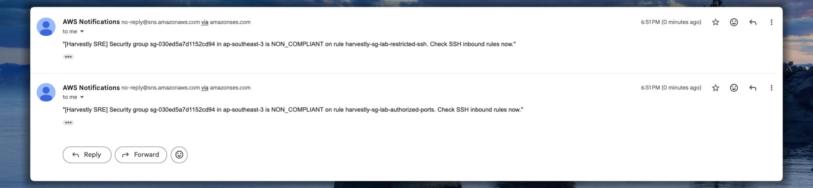

<details class="lab-fold"><summary><span class="lab-fold__title">Expected output (email body)</span><small>1 lines</small></summary><div class="lab-fold__body">
<div class="lab-term"><div class="lab-term__bar"><i></i><i></i><i></i><span>output</span><em>text</em></div><div class="lab-term__body"><span class="ln">&quot;[Harvestly&#32;SRE]&#32;Security&#32;group&#32;sg-0c3...&#32;in&#32;ap-southeast-3&#32;is&#32;NON_COMPLIANT&#32;on&#32;rule&#32;harvestly-sg-lab-restricted-ssh.&#32;Check&#32;SSH&#32;inbound&#32;rules&#32;now.&quot;</span></div></div>
</div></details>

When the SG returns to COMPLIANT after remediation, **no** new email arrives. That proves the `complianceType: NON_COMPLIANT` filter in EventBridge is working.

### Test 6: auto-remediation for port 22

**Console:** AWS Config → Rules → harvestly-sg-lab-restricted-ssh → Resources in scope → Remediation status column

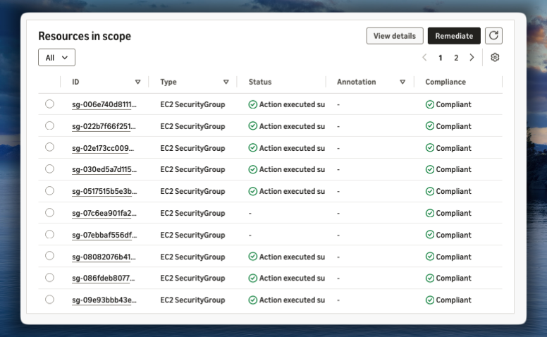

**CLI:**

```bash
aws configservice describe-remediation-execution-status \
  --region "$REGION" \
  --config-rule-name "$RULE_SSH" \
  --resource-keys resourceType=AWS::EC2::SecurityGroup,resourceId="$SG_SSH_OPEN" \
  --query 'RemediationExecutionStatuses[].[ResourceKey.resourceId,State]' --output text
```

Expected output: `sg-0c3... SUCCEEDED`. Status may still be `QUEUED` or `IN_PROGRESS`; wait 1–2 minutes.

Prove the public port 22 inbound rule is gone:

```bash
aws ec2 describe-security-groups \
  --region "$REGION" \
  --group-ids "$SG_SSH_OPEN" \
  --query 'SecurityGroups[0].IpPermissions'
```

Expected output: `[]`.

### Test 7: custom port is not auto-remediated

```bash
aws ec2 describe-security-groups \
  --region "$REGION" \
  --group-ids "$SG_CUSTOM_OPEN" \
  --query 'SecurityGroups[0].IpPermissions[].[FromPort,IpRanges[0].CidrIp]' --output text
```

Expected output: `2202 0.0.0.0/0`. This rule still exists because the runbook is attached to `restricted-ssh`, and that rule doesn't consider this SG non-compliant. For production, fix it manually or create a custom runbook attached to the `authorized-ports` rule.

Additional test (optional): add port 22 from `::/0` to SG `good`. `restricted-ssh` also flags `::/0` as NON_COMPLIANT. Whether the runbook also revokes IPv6 rules depends on the runbook parameters (check latest documentation).

## Troubleshooting

| Symptom / error | Cause | Solution |
|---|---|---|
| `MaxNumberOfConfigurationRecordersExceededException` | Region already has a recorder | Use the existing recorder (Step 2, `CREATED_RECORDER="no"`) |
| `NoAvailableConfigurationRecorderException` on `put-config-rule` | Recorder not created or not started | Complete Step 3, check `describe-configuration-recorder-status` |
| Recorder `lastStatus` = `FAILURE` / `InsufficientDeliveryPolicyException` | Bucket policy wrong or prefix mismatch | Recheck `config-bucket-policy.json`, make sure `ACCOUNT_ID` is set |
| Rule shows no SGs at all | Recorder not recording `AWS::EC2::SecurityGroup` | Check recording group, wait a few minutes, trigger `start-config-rules-evaluation` |
| `InvalidParameterValueException` on authorized-ports rule | `InputParameters` format wrong | Must be a JSON string, e.g., `{"authorizedTcpPorts":"443"}` |
| Email doesn't arrive | Subscription still `pending confirmation` | Click the confirmation link; check spam folder |
| Email still doesn't arrive | Topic policy `aws:SourceArn` wrong, or rule name in event pattern differs | Compare `EB_RULE_ARN` with policy; check `FailedInvocations` metric in EventBridge |
| Remediation `FAILED` | Role can't be assumed by SSM or insufficient permissions | Check trust policy `ssm.amazonaws.com` and `ec2:RevokeSecurityGroupIngress` permission; see details in **Systems Manager → Automation** |
| Opt-in Region error / `UnrecognizedClientException` | ap-southeast-3 not enabled | Enable the Region or change `REGION` |

## Cleanup

**Warning:** the steps below permanently delete resources. If the recorder existed before this lab (`CREATED_RECORDER="no"`), DO NOT run the recorder, delivery channel, and bucket deletion steps, as they will disable Config recording for your account/organization. Run the following sequence in the same terminal session:

1. Delete the remediation configuration (the rule can't be deleted while remediation is attached).
2. Delete both Config rules.
3. Delete the target and EventBridge rule.
4. Delete the SNS topic.
5. Delete the three test security groups.
6. Delete the remediation IAM role.
7. Only if `CREATED_RECORDER="yes"`: stop the recorder, delete the delivery channel, recorder, then empty and delete the bucket.

```bash
# 1. Remediation
aws configservice delete-remediation-configuration \
  --region "$REGION" --config-rule-name "$RULE_SSH" --resource-type AWS::EC2::SecurityGroup

# 2. Config rules
aws configservice delete-config-rule --region "$REGION" --config-rule-name "$RULE_SSH"
aws configservice delete-config-rule --region "$REGION" --config-rule-name "$RULE_PORTS"

# 3. EventBridge
aws events remove-targets --region "$REGION" --rule "$EB_RULE" --ids sns-alert
aws events delete-rule --region "$REGION" --name "$EB_RULE"

# 4. SNS (subscription is deleted with the topic)
aws sns delete-topic --region "$REGION" --topic-arn "$TOPIC_ARN"

# 5. Security groups
for SG in "$SG_GOOD" "$SG_CUSTOM_OPEN" "$SG_SSH_OPEN"; do
  aws ec2 delete-security-group --region "$REGION" --group-id "$SG"
done

# 6. IAM role
aws iam delete-role-policy --role-name "$REMEDIATION_ROLE" --policy-name revoke-public-ssh
aws iam delete-role --role-name "$REMEDIATION_ROLE"
```

Step 7, only if the recorder was created by this lab:

```bash
if [ "$CREATED_RECORDER" = "yes" ]; then
  aws configservice stop-configuration-recorder --region "$REGION" --configuration-recorder-name default
  aws configservice delete-delivery-channel --region "$REGION" --delivery-channel-name default
  aws configservice delete-configuration-recorder --region "$REGION" --configuration-recorder-name default
  aws s3 rm "s3://${BUCKET}" --recursive
  aws s3api delete-bucket --bucket "$BUCKET" --region "$REGION"
fi

rm -f config-bucket-policy.json recording-group.json rule-ssh.json rule-ports.json \
  event-pattern.json topic-policy.json eb-targets.json ssm-trust.json ssm-remediation-policy.json remediation.json
```

Check that no rules remain:

```bash
aws configservice describe-config-rules --region "$REGION" \
  --query "ConfigRules[?starts_with(ConfigRuleName, '${PREFIX}')].ConfigRuleName" --output text
```

Expected output: empty. Rules may remain in `DELETING` status for a while before fully disappearing.

The service-linked role `AWSServiceRoleForConfig` can be left in place; it costs nothing and may be used by other Config features.

## Key exam takeaways

- The keyword "resource configuration violates policy + automatic notification" points to **AWS Config rules**. CloudWatch custom metrics can't read SG configuration, Trusted Advisor refreshes periodically and isn't based on your own policy rules, and third-party scanners add operational overhead.
- `restricted-ssh` = identifier `INCOMING_SSH_DISABLED`, resource `AWS::EC2::SecurityGroup`, trigger configuration change + periodic, **no parameters**, only port 22 from `0.0.0.0/0` or `::/0`.
- Custom port policies (SSH moved to another port) or "only specific ports may be public" use `vpc-sg-open-only-to-authorized-ports` or a custom rule (Lambda/Guard).
- Notifications: delivery channel + SNS sends **all** types of Config notifications. To filter NON_COMPLIANT only, use EventBridge with `detail-type` `Config Rules Compliance Change`. The SNS topic must be in the same Region as Config.
- Auto-remediation uses Config remediation + **SSM Automation** (`AWS-DisablePublicAccessForSecurityGroup` for ports 22/3389).
- Multi-account uses **Conformance packs** or organization rules via AWS Organizations.
- Long-term solution: eliminate SSH entirely with **Session Manager**.
- Config costs are billed per configuration item + rule evaluation. Limit recording to relevant resource types.

## References

- <https://docs.aws.amazon.com/config/latest/developerguide/notifications-for-AWS-Config.html>
- <https://docs.aws.amazon.com/config/latest/developerguide/restricted-ssh.html>
- <https://docs.aws.amazon.com/config/latest/developerguide/vpc-sg-open-only-to-authorized-ports.html>
- <https://docs.aws.amazon.com/config/latest/developerguide/remediation.html>
- <https://docs.aws.amazon.com/config/latest/developerguide/monitor-config-with-cloudwatchevents.html>
- <https://docs.aws.amazon.com/config/latest/developerguide/select-resources.html>
- <https://docs.aws.amazon.com/config/latest/developerguide/s3-bucket-policy.html>
- <https://docs.aws.amazon.com/systems-manager-automation-runbooks/latest/userguide/automation-aws-disablepublicaccessforsecuritygroup.html>
- <https://repost.aws/knowledge-center/config-resource-non-compliant>
- <https://aws.amazon.com/blogs/mt/implement-aws-config-rule-remediation-with-systems-manager-change-manager/>
- <https://docs.aws.amazon.com/cli/latest/reference/ec2/describe-security-groups.html>

<!-- lab-next:start -->
<section class="lab-next" aria-label="Next lab"><div class="lab-next__kicker">Next lab</div><div class="lab-next__grid"><a class="lab-next__card" href="/posts/lab-balancing-nlb-traffic-across-azs-with-cross-zone-load-balancing/"><span class="lab-next__img" style="background-image:url('/assets/img/posts/lab-balancing-nlb-traffic-across-azs-with-cross-zone-load-balancing/cover.png')" aria-hidden="true"></span><span class="lab-next__body"><span class="lab-next__title">Balancing NLB Traffic Across AZs with Cross-Zone Load Balancing</span><span class="lab-next__meta">Intermediate · 50–70 minutes</span><span class="lab-next__go">Start the lab →</span></span></a><a class="lab-next__card" href="/posts/lab-shared-dataset-across-azs-amazon-efs-access-points-posix/"><span class="lab-next__img" style="background-image:url('/assets/img/posts/lab-shared-dataset-across-azs-amazon-efs-access-points-posix/cover.png')" aria-hidden="true"></span><span class="lab-next__body"><span class="lab-next__title">A Shared Dataset Across AZs with Amazon EFS, Access Points, and POSIX Permissions</span><span class="lab-next__meta">Intermediate · 60–75 minutes</span><span class="lab-next__go">Start the lab →</span></span></a></div></section>
<!-- lab-next:end -->
