<section class="lab-card" data-lang="en" aria-label="Lab summary">
<ul class="lab-stats"><li><span>Level</span><b>Intermediate</b></li><li><span>Duration</span><b>40–55 minutes</b></li><li><span>Region</span><b>us-east-1</b></li></ul>
<ul class="lab-services"><li><span class="lab-svc-ic" style="background-image:url('/assets/img/aws/s3.svg')" aria-hidden="true"></span>Amazon S3</li></ul>
<div class="lab-actions"><a class="lab-btn" href="#step-1">Jump to the steps ↓</a></div>
</section>

> **Summary**
>
> A logistics document store needs lower storage costs without adding a restore step to downloads. This lab configures a 30-day transition to S3 Standard-IA plus automatic expiration, then verifies the saved rule, size eligibility, and immediate Standard-IA reads.
{: .prompt-info }

## Learning objectives

By the end of this lab, you will be able to:

- Create an S3 Lifecycle configuration scoped to an object prefix.
- Explain why S3 Standard-IA fits infrequently read objects that still require millisecond access across multiple Availability Zones.
- Apply the minimum 30-day transition age and the default 128 KB small-object transition restriction.
- Distinguish storage savings from transition-request, data-retrieval, and minimum-storage-duration charges.
- Add an expiration action that enforces a retention deadline.
- Verify lifecycle configuration without incorrectly assuming that transitions are synchronous.

## Scenario

A logistics company stores signed delivery documents and supporting photographs in Amazon S3. The bucket contains approximately **9 TB across 1.8 million objects**, with an average object size of **5 MB**.

Customer-support applications generate most reads during the first three weeks after upload. Older documents are read occasionally, but the application cannot submit an archive-restore request and wait for it to complete. Downloads must continue through the existing application code, and the documents cannot be economically recreated if a storage location fails.

The company establishes these requirements:

- Keep new objects in S3 Standard while demand is high.
- Reduce storage cost after objects reach 30 days of age.
- Preserve online reads without changing bucket names or object keys.
- Store the only copy of each document redundantly across multiple Availability Zones.
- Permanently remove documents 540 days after creation.
- Avoid lifecycle-transitioning tiny metadata objects where request charges can outweigh storage savings.

## How it works

An S3 Lifecycle configuration contains **transition** and **expiration** actions. A transition changes an object's storage class; expiration makes the object eligible for permanent deletion. Rules apply to existing objects and objects uploaded later. Both operations are asynchronous, so eligibility does not mean that the physical operation has already finished. For Standard-IA transitions and expiration, billing changes begin when the object becomes eligible, even if processing finishes later.

Objects must remain in S3 Standard for at least **30 days** before Lifecycle can transition them to S3 Standard-IA or S3 One Zone-IA. Standard-IA provides millisecond access and stores data across multiple Availability Zones, but adds per-GB retrieval charges, a 30-day minimum storage-duration charge, and a 128 KB minimum capacity charge per object. By default, Lifecycle does not transition objects smaller than 128 KB; this default also prevents many small-object transition requests from costing more than the expected storage savings.

| Storage class | Read behavior | Storage resilience | Appropriate use in this design |
|---|---|---|---|
| S3 Standard | Immediate | Multiple Availability Zones | New documents with frequent reads |
| S3 Standard-IA | Immediate; retrieval charges apply | Multiple Availability Zones | Cooler documents that remain online |
| S3 One Zone-IA | Immediate; retrieval charges apply | One Availability Zone | Recreatable data or secondary copies |
| S3 Glacier Flexible Retrieval | Restore required before a normal download | Multiple Availability Zones | Archival data that can tolerate restore delay |

A short lab cannot observe a genuine 30-day transition. Instead, you will verify the exact rule stored by S3, inspect the age-and-size starting state, and separately demonstrate that a Standard-IA object can be downloaded without restoration. An optional long-running check is included in Verification.

{: .light }
{: .dark }
*For an eligible object, Lifecycle first reduces storage cost and later enforces the retention deadline.*

## Architecture

{: .light }
{: .dark }
*Objects keep the same S3 URI while Lifecycle changes their storage class and eventually expires them.*

1. The application uploads new documents under `documents/` using S3 Standard.
2. When an eligible object reaches 30 days of age, Lifecycle queues its transition to S3 Standard-IA.
3. The application continues to call `GetObject` with the same bucket and key. No restore operation or application rewrite is required.
4. At 540 days of age, objects under `documents/` become eligible for expiration. Processing and deletion are asynchronous.

## Prerequisites

You need:

- An AWS account with permission to create a general-purpose S3 bucket.
- AWS CLI v2.
- A Bash environment with `dd`, `cmp`, `sed`, and standard file utilities. AWS CloudShell provides a suitable Linux environment.
- A Region that supports the required S3 storage classes. This lab uses `us-east-1`; confirm current storage-class availability before substituting another Region.
- A bucket name that is unique across the global S3 namespace. Step 1 generates one automatically.

The following policy grants access only to buckets matching the default lab prefix and to the objects inside them. If you change `PREFIX`, update the two S3 resource patterns accordingly.

```json
{
    "Version": "2012-10-17",
    "Statement": [
        {
            "Sid": "ManageLabBucket",
            "Effect": "Allow",
            "Action": [
                "s3:CreateBucket",
                "s3:DeleteBucket",
                "s3:GetBucketLocation",
                "s3:GetBucketPublicAccessBlock",
                "s3:GetBucketTagging",
                "s3:GetLifecycleConfiguration",
                "s3:ListBucket",
                "s3:PutBucketPublicAccessBlock",
                "s3:PutBucketTagging",
                "s3:PutLifecycleConfiguration"
            ],
            "Resource": "arn:aws:s3:::s3-lifecycle-ia-lab-*"
        },
        {
            "Sid": "ManageLabObjects",
            "Effect": "Allow",
            "Action": [
                "s3:DeleteObject",
                "s3:GetObject",
                "s3:PutObject"
            ],
            "Resource": "arn:aws:s3:::s3-lifecycle-ia-lab-*/*"
        },
        {
            "Sid": "CheckIdentityAndTaggedResources",
            "Effect": "Allow",
            "Action": [
                "resourcegroupstaggingapi:GetResources",
                "sts:GetCallerIdentity"
            ],
            "Resource": "*"
        }
    ]
}
```

### Check prerequisites

Run these commands before creating resources:

```bash
aws --version
aws sts get-caller-identity --output json
```

<details class="lab-fold"><summary><span class="lab-fold__title">Expected output</span><small>6 lines</small></summary><div class="lab-fold__body">
<div class="lab-term"><div class="lab-term__bar"><i></i><i></i><i></i><span>output</span><em>text</em></div><div class="lab-term__body"><span class="ln">aws-cli/2.x&#32;Python/3.x&#32;Linux/x86_64</span><span class="ln">{</span><span class="ln">&#32;&#32;&#32;&#32;&quot;UserId&quot;:&#32;&quot;AIDAXXXXXXXXXXXXXXXXX&quot;,</span><span class="ln">&#32;&#32;&#32;&#32;&quot;Account&quot;:&#32;&quot;111122223333&quot;,</span><span class="ln">&#32;&#32;&#32;&#32;&quot;Arn&quot;:&#32;&quot;arn:aws:iam::111122223333:user/s3-lab-operator&quot;</span><span class="ln">}</span></div></div>
</div></details>

The identity values will differ. The account ID shown here is also incorporated into the bucket name in Step 1.

## Cost estimate

This lab stores approximately **3.1 MiB** across three objects and normally runs for less than an hour. The total charge should be small, but it is not guaranteed to be zero.

Cost components are:

- S3 Standard storage for the two objects under `documents/`.
- S3 Standard-IA storage for the 1 MiB retrieval-test object.
- A small number of `PUT`, `GET`, `HEAD`, `LIST`, and bucket-configuration requests.
- Standard-IA data retrieval for the 1 MiB download test.
- Possible internet data-transfer charges, depending on where the lab is run.

The directly uploaded Standard-IA object is deleted during Cleanup, but Standard-IA has a **30-day minimum storage-duration charge**. Because the test object is only 1 MiB, this charge remains small. No Lifecycle transition requests should occur during the lab because none of the objects reaches 30 days of age.

Do not assume that your account has Free Tier coverage. Check current S3 pricing for your Region and use the AWS Pricing Calculator if you need an account-specific estimate.

## Steps

<ol class="lab-steps" aria-label="Step map"><li><a href="#step-1">Set lab variables</a></li><li><a href="#step-2">Create a private, tagged bucket</a></li><li><a href="#step-3">Upload objects that represent different eligibility cases</a></li><li><a href="#step-4">Apply the transition and expiration rule</a></li><li><a href="#step-5">Download the Standard-IA object without a restore</a></li></ol>


### 1. Set lab variables
{: #step-1 }

Define the Region, naming prefix, generated bucket name, and lifecycle-file name so that every later command can be run without editing placeholders.

**Console:** Open **CloudShell** from the AWS Management Console, or use a local terminal configured for the same AWS account.

**CLI:**

```bash
export REGION="us-east-1"
export PREFIX="s3-lifecycle-ia-lab"
export AWS_REGION="$REGION"
export AWS_DEFAULT_REGION="$REGION"
export ACCOUNT_ID="$(aws sts get-caller-identity --query Account --output text)"
export LAB_ID="${PREFIX}-$(date +%s)"
export BUCKET="${LAB_ID}-${ACCOUNT_ID}"
export LIFECYCLE_FILE="lifecycle.json"
export LAB_TAG_VALUE="${LAB_ID}"

printf 'REGION=%s\nBUCKET=%s\nLAB_TAG_VALUE=%s\n' \
  "$REGION" "$BUCKET" "$LAB_TAG_VALUE"
```

<details class="lab-fold"><summary><span class="lab-fold__title">Expected output</span><small>3 lines</small></summary><div class="lab-fold__body">
<div class="lab-term"><div class="lab-term__bar"><i></i><i></i><i></i><span>output</span><em>text</em></div><div class="lab-term__body"><span class="ln">REGION=us-east-1</span><span class="ln">BUCKET=s3-lifecycle-ia-lab-1741190400-111122223333</span><span class="ln">LAB_TAG_VALUE=s3-lifecycle-ia-lab-1741190400</span></div></div>
</div></details>

**Why:** The timestamp and account ID make the bucket name globally unique while retaining a prefix that can be matched by the IAM policy. Keep this shell session open because later steps and Cleanup depend on these variables.

### 2. Create a private, tagged bucket
{: #step-2 }

Create the general-purpose bucket, explicitly enable all four S3 Block Public Access settings, and attach the tag used by the final resource check.

**Console:** S3 → Buckets → Create bucket

1. Select **General purpose** and enter the generated value of `BUCKET`.
2. Select **US East (N. Virginia) us-east-1**.
3. Leave **ACLs disabled** and **Bucket Versioning** disabled.
4. Enable **Block all public access**.
5. Leave default encryption enabled and add the tag `lab` with the generated value of `LAB_TAG_VALUE`.
6. Choose **Create bucket**.

**CLI:**

```bash
if [ "$REGION" = "us-east-1" ]; then
  aws s3api create-bucket \
    --bucket "$BUCKET" \
    --region "$REGION" >/dev/null
else
  aws s3api create-bucket \
    --bucket "$BUCKET" \
    --region "$REGION" \
    --create-bucket-configuration LocationConstraint="$REGION" >/dev/null
fi

aws s3api put-public-access-block \
  --bucket "$BUCKET" \
  --public-access-block-configuration \
  BlockPublicAcls=true,IgnorePublicAcls=true,BlockPublicPolicy=true,RestrictPublicBuckets=true

aws s3api put-bucket-tagging \
  --bucket "$BUCKET" \
  --tagging "TagSet=[{Key=lab,Value=${LAB_TAG_VALUE}}]"

aws s3api get-public-access-block \
  --bucket "$BUCKET" \
  --query 'PublicAccessBlockConfiguration' \
  --output json

aws s3api get-bucket-tagging \
  --bucket "$BUCKET" \
  --query 'TagSet[0].Value' \
  --output text
```

<details class="lab-fold"><summary><span class="lab-fold__title">Expected output</span><small>7 lines</small></summary><div class="lab-fold__body">
<div class="lab-term"><div class="lab-term__bar"><i></i><i></i><i></i><span>output</span><em>text</em></div><div class="lab-term__body"><span class="ln">{</span><span class="ln">&#32;&#32;&#32;&#32;&quot;BlockPublicAcls&quot;:&#32;true,</span><span class="ln">&#32;&#32;&#32;&#32;&quot;IgnorePublicAcls&quot;:&#32;true,</span><span class="ln">&#32;&#32;&#32;&#32;&quot;BlockPublicPolicy&quot;:&#32;true,</span><span class="ln">&#32;&#32;&#32;&#32;&quot;RestrictPublicBuckets&quot;:&#32;true</span><span class="ln">}</span><span class="ln">s3-lifecycle-ia-lab-1741190400</span></div></div>
</div></details>

**Why:** The `us-east-1` branch is required because that Region must not be supplied as a `LocationConstraint`. The four public-access settings protect against public exposure through both ACLs and bucket policies, while the unique tag supports an account-wide leftover-resource check.

### 3. Upload objects that represent different eligibility cases
{: #step-3 }

Create two objects under the lifecycle-managed prefix and a separate Standard-IA object for the immediate-download test.

**Console:** S3 → Buckets → your bucket

1. Create the folders `documents/` and `retrieval-check/`.
2. Under `documents/`, upload a 2 MiB file and a 64 KiB file using **S3 Standard**.
3. Under `retrieval-check/`, upload a 1 MiB file and select **S3 Standard-IA** in the upload properties.

**CLI:**

```bash
dd if=/dev/urandom of=large-object.bin bs=1M count=2 status=none
dd if=/dev/urandom of=small-object.bin bs=64K count=1 status=none
dd if=/dev/urandom of=ia-source.bin bs=1M count=1 status=none

aws s3api put-object \
  --bucket "$BUCKET" \
  --key documents/large-object.bin \
  --body large-object.bin \
  --storage-class STANDARD >/dev/null

aws s3api put-object \
  --bucket "$BUCKET" \
  --key documents/small-object.bin \
  --body small-object.bin \
  --storage-class STANDARD >/dev/null

aws s3api put-object \
  --bucket "$BUCKET" \
  --key retrieval-check/ia-object.bin \
  --body ia-source.bin \
  --storage-class STANDARD_IA >/dev/null

aws s3api list-objects-v2 \
  --bucket "$BUCKET" \
  --query 'Contents[].{Key:Key,Bytes:Size,Class:StorageClass}' \
  --output json
```

<details class="lab-fold"><summary><span class="lab-fold__title">Expected output</span><small>17 lines</small></summary><div class="lab-fold__body">
<div class="lab-term"><div class="lab-term__bar"><i></i><i></i><i></i><span>output</span><em>text</em></div><div class="lab-term__body"><span class="ln">[</span><span class="ln">&#32;&#32;&#32;&#32;{</span><span class="ln">&#32;&#32;&#32;&#32;&#32;&#32;&#32;&#32;&quot;Key&quot;:&#32;&quot;documents/large-object.bin&quot;,</span><span class="ln">&#32;&#32;&#32;&#32;&#32;&#32;&#32;&#32;&quot;Bytes&quot;:&#32;2097152,</span><span class="ln">&#32;&#32;&#32;&#32;&#32;&#32;&#32;&#32;&quot;Class&quot;:&#32;&quot;STANDARD&quot;</span><span class="ln">&#32;&#32;&#32;&#32;},</span><span class="ln">&#32;&#32;&#32;&#32;{</span><span class="ln">&#32;&#32;&#32;&#32;&#32;&#32;&#32;&#32;&quot;Key&quot;:&#32;&quot;documents/small-object.bin&quot;,</span><span class="ln">&#32;&#32;&#32;&#32;&#32;&#32;&#32;&#32;&quot;Bytes&quot;:&#32;65536,</span><span class="ln">&#32;&#32;&#32;&#32;&#32;&#32;&#32;&#32;&quot;Class&quot;:&#32;&quot;STANDARD&quot;</span><span class="ln">&#32;&#32;&#32;&#32;},</span><span class="ln">&#32;&#32;&#32;&#32;{</span><span class="ln">&#32;&#32;&#32;&#32;&#32;&#32;&#32;&#32;&quot;Key&quot;:&#32;&quot;retrieval-check/ia-object.bin&quot;,</span><span class="ln">&#32;&#32;&#32;&#32;&#32;&#32;&#32;&#32;&quot;Bytes&quot;:&#32;1048576,</span><span class="ln">&#32;&#32;&#32;&#32;&#32;&#32;&#32;&#32;&quot;Class&quot;:&#32;&quot;STANDARD_IA&quot;</span><span class="ln">&#32;&#32;&#32;&#32;}</span><span class="ln">]</span></div></div>
</div></details>

**Why:** The 2 MiB object is large enough for the default lifecycle size behavior, whereas the 64 KiB object is below the default 128 KB transition threshold. The third object is uploaded directly to Standard-IA only to test its read behavior; uploading frequently accessed production data directly to Standard-IA could increase retrieval costs.

### 4. Apply the transition and expiration rule
{: #step-4 }

Create a lifecycle configuration that transitions eligible current objects after 30 days and expires them after 540 days.

**Console:** S3 → Buckets → your bucket → Management → Lifecycle rules → Create lifecycle rule

1. Name the rule `documents-transition-and-expire`.
2. Choose **Limit the scope of this rule using one or more filters** and enter the prefix `documents/`.
3. Select **Transition current versions of objects between storage classes** and **Expire current versions of objects**.
4. Select **S3 Standard-IA**, enter **30** days after object creation, and set expiration to **540** days after object creation.
5. Review the small-object and storage-duration notices, then create the rule.

**CLI:**

```bash
cat > "$LIFECYCLE_FILE" <<'JSON'
{
    "Rules": [
        {
            "ID": "documents-transition-and-expire",
            "Filter": {
                "Prefix": "documents/"
            },
            "Status": "Enabled",
            "Transitions": [
                {
                    "Days": 30,
                    "StorageClass": "STANDARD_IA"
                }
            ],
            "Expiration": {
                "Days": 540
            }
        }
    ]
}
JSON

aws s3api put-bucket-lifecycle-configuration \
  --bucket "$BUCKET" \
  --lifecycle-configuration "file://${LIFECYCLE_FILE}"

aws s3api get-bucket-lifecycle-configuration \
  --bucket "$BUCKET" \
  --output json
```

<details class="lab-fold"><summary><span class="lab-fold__title">Expected output</span><small>20 lines</small></summary><div class="lab-fold__body">
<div class="lab-term"><div class="lab-term__bar"><i></i><i></i><i></i><span>output</span><em>text</em></div><div class="lab-term__body"><span class="ln">{</span><span class="ln">&#32;&#32;&#32;&#32;&quot;Rules&quot;:&#32;[</span><span class="ln">&#32;&#32;&#32;&#32;&#32;&#32;&#32;&#32;{</span><span class="ln">&#32;&#32;&#32;&#32;&#32;&#32;&#32;&#32;&#32;&#32;&#32;&#32;&quot;Expiration&quot;:&#32;{</span><span class="ln">&#32;&#32;&#32;&#32;&#32;&#32;&#32;&#32;&#32;&#32;&#32;&#32;&#32;&#32;&#32;&#32;&quot;Days&quot;:&#32;540</span><span class="ln">&#32;&#32;&#32;&#32;&#32;&#32;&#32;&#32;&#32;&#32;&#32;&#32;},</span><span class="ln">&#32;&#32;&#32;&#32;&#32;&#32;&#32;&#32;&#32;&#32;&#32;&#32;&quot;ID&quot;:&#32;&quot;documents-transition-and-expire&quot;,</span><span class="ln">&#32;&#32;&#32;&#32;&#32;&#32;&#32;&#32;&#32;&#32;&#32;&#32;&quot;Filter&quot;:&#32;{</span><span class="ln">&#32;&#32;&#32;&#32;&#32;&#32;&#32;&#32;&#32;&#32;&#32;&#32;&#32;&#32;&#32;&#32;&quot;Prefix&quot;:&#32;&quot;documents/&quot;</span><span class="ln">&#32;&#32;&#32;&#32;&#32;&#32;&#32;&#32;&#32;&#32;&#32;&#32;},</span><span class="ln">&#32;&#32;&#32;&#32;&#32;&#32;&#32;&#32;&#32;&#32;&#32;&#32;&quot;Status&quot;:&#32;&quot;Enabled&quot;,</span><span class="ln">&#32;&#32;&#32;&#32;&#32;&#32;&#32;&#32;&#32;&#32;&#32;&#32;&quot;Transitions&quot;:&#32;[</span><span class="ln">&#32;&#32;&#32;&#32;&#32;&#32;&#32;&#32;&#32;&#32;&#32;&#32;&#32;&#32;&#32;&#32;{</span><span class="ln">&#32;&#32;&#32;&#32;&#32;&#32;&#32;&#32;&#32;&#32;&#32;&#32;&#32;&#32;&#32;&#32;&#32;&#32;&#32;&#32;&quot;Days&quot;:&#32;30,</span><span class="ln">&#32;&#32;&#32;&#32;&#32;&#32;&#32;&#32;&#32;&#32;&#32;&#32;&#32;&#32;&#32;&#32;&#32;&#32;&#32;&#32;&quot;StorageClass&quot;:&#32;&quot;STANDARD_IA&quot;</span><span class="ln">&#32;&#32;&#32;&#32;&#32;&#32;&#32;&#32;&#32;&#32;&#32;&#32;&#32;&#32;&#32;&#32;}</span><span class="ln">&#32;&#32;&#32;&#32;&#32;&#32;&#32;&#32;&#32;&#32;&#32;&#32;]</span><span class="ln">&#32;&#32;&#32;&#32;&#32;&#32;&#32;&#32;}</span><span class="ln">&#32;&#32;&#32;&#32;]</span><span class="ln">}</span></div></div>
</div></details>

**Why:** `Filter.Prefix` keeps the retrieval-test object outside the rule, while `Transitions[0].Days` measures object age rather than time since the rule was created. Because no size override is supplied, the default small-object behavior remains in effect; `Expiration.Days` applies the retention deadline independently of whether an object was eligible for transition.

### 5. Download the Standard-IA object without a restore
{: #step-5 }

Read the separate Standard-IA test object and compare its contents with the local source file.

**Console:** S3 → Buckets → your bucket → retrieval-check/ → ia-object.bin. Confirm that **Storage class** is **S3 Standard-IA**, then choose **Download**. The object should download without a restore request.

**CLI:**

```bash
aws s3api get-object \
  --bucket "$BUCKET" \
  --key retrieval-check/ia-object.bin \
  ia-download.bin \
  --query '{StorageClass:StorageClass,ContentLength:ContentLength}' \
  --output json

cmp ia-source.bin ia-download.bin && \
  printf 'Download integrity: matched (%s bytes)\n' \
  "$(wc -c < ia-download.bin)"
```

<details class="lab-fold"><summary><span class="lab-fold__title">Expected output</span><small>5 lines</small></summary><div class="lab-fold__body">
<div class="lab-term"><div class="lab-term__bar"><i></i><i></i><i></i><span>output</span><em>text</em></div><div class="lab-term__body"><span class="ln">{</span><span class="ln">&#32;&#32;&#32;&#32;&quot;StorageClass&quot;:&#32;&quot;STANDARD_IA&quot;,</span><span class="ln">&#32;&#32;&#32;&#32;&quot;ContentLength&quot;:&#32;1048576</span><span class="ln">}</span><span class="ln">Download&#32;integrity:&#32;matched&#32;(1048576&#32;bytes)</span></div></div>
</div></details>

**Why:** A successful `GetObject` with matching bytes demonstrates the online Standard-IA read path; no temporary restored copy is involved. This test validates storage-class behavior, not the completion of the 30-day lifecycle transition.

## Verification

The first three tests validate configuration and observable behavior immediately. The final test deliberately checks S3's minimum-transition-age guardrail.

| Test | Scenario | Expected result |
|---|---|---|
| Lifecycle rule is stored | Read the bucket's active lifecycle configuration | <span class="lab-pill is-ok">✓ Succeeded</span> |
| Fresh objects have the expected starting state | Inspect sizes and storage classes under the managed prefix | <span class="lab-pill is-ok">✓ Succeeded</span> |
| Standard-IA reads need no restore | Download and compare the Standard-IA test object | <span class="lab-pill is-ok">✓ Succeeded</span> |
| A day-29 transition is rejected | Submit an invalid transition age and confirm that the valid rule remains | <span class="lab-pill is-deny">✕ Denied</span> |

### Test 1: Lifecycle rule is stored

This test proves that S3 saved the intended scope, transition age, destination class, and retention deadline.

**Console:** S3 → Buckets → your bucket → Management → Lifecycle rules → documents-transition-and-expire. Inspect the rule scope and actions.

**CLI:**

```bash
aws s3api get-bucket-lifecycle-configuration \
  --bucket "$BUCKET" \
  --query 'Rules[0].{
    Id:ID,
    Prefix:Filter.Prefix,
    Status:Status,
    TransitionDays:Transitions[0].Days,
    Class:Transitions[0].StorageClass,
    ExpireDays:Expiration.Days
  }' \
  --output json
```

<details class="lab-fold"><summary><span class="lab-fold__title">Expected output</span><small>8 lines</small></summary><div class="lab-fold__body">
<div class="lab-term"><div class="lab-term__bar"><i></i><i></i><i></i><span>output</span><em>text</em></div><div class="lab-term__body"><span class="ln">{</span><span class="ln">&#32;&#32;&#32;&#32;&quot;Id&quot;:&#32;&quot;documents-transition-and-expire&quot;,</span><span class="ln">&#32;&#32;&#32;&#32;&quot;Prefix&quot;:&#32;&quot;documents/&quot;,</span><span class="ln">&#32;&#32;&#32;&#32;&quot;Status&quot;:&#32;&quot;Enabled&quot;,</span><span class="ln">&#32;&#32;&#32;&#32;&quot;TransitionDays&quot;:&#32;30,</span><span class="ln">&#32;&#32;&#32;&#32;&quot;Class&quot;:&#32;&quot;STANDARD_IA&quot;,</span><span class="ln">&#32;&#32;&#32;&#32;&quot;ExpireDays&quot;:&#32;540</span><span class="ln">}</span></div></div>
</div></details>

**Pass if:** The rule is enabled, its prefix is `documents/`, the transition is `STANDARD_IA` at day 30, and expiration is set to day 540.

### Test 2: Fresh objects have the expected starting state

This test confirms that newly uploaded objects have not transitioned prematurely and records the size distinction used by the lifecycle configuration.

**Console:** S3 → Buckets → your bucket → documents/. Open each object's properties and inspect its size and storage class.

**CLI:**

```bash
aws s3api list-objects-v2 \
  --bucket "$BUCKET" \
  --prefix documents/ \
  --query 'Contents[].{Key:Key,Bytes:Size,Class:StorageClass}' \
  --output json
```

<details class="lab-fold"><summary><span class="lab-fold__title">Expected output</span><small>12 lines</small></summary><div class="lab-fold__body">
<div class="lab-term"><div class="lab-term__bar"><i></i><i></i><i></i><span>output</span><em>text</em></div><div class="lab-term__body"><span class="ln">[</span><span class="ln">&#32;&#32;&#32;&#32;{</span><span class="ln">&#32;&#32;&#32;&#32;&#32;&#32;&#32;&#32;&quot;Key&quot;:&#32;&quot;documents/large-object.bin&quot;,</span><span class="ln">&#32;&#32;&#32;&#32;&#32;&#32;&#32;&#32;&quot;Bytes&quot;:&#32;2097152,</span><span class="ln">&#32;&#32;&#32;&#32;&#32;&#32;&#32;&#32;&quot;Class&quot;:&#32;&quot;STANDARD&quot;</span><span class="ln">&#32;&#32;&#32;&#32;},</span><span class="ln">&#32;&#32;&#32;&#32;{</span><span class="ln">&#32;&#32;&#32;&#32;&#32;&#32;&#32;&#32;&quot;Key&quot;:&#32;&quot;documents/small-object.bin&quot;,</span><span class="ln">&#32;&#32;&#32;&#32;&#32;&#32;&#32;&#32;&quot;Bytes&quot;:&#32;65536,</span><span class="ln">&#32;&#32;&#32;&#32;&#32;&#32;&#32;&#32;&quot;Class&quot;:&#32;&quot;STANDARD&quot;</span><span class="ln">&#32;&#32;&#32;&#32;}</span><span class="ln">]</span></div></div>
</div></details>

**Pass if:** Both objects are still `STANDARD`, the large object is `2097152` bytes, and the small object is `65536` bytes. Neither object is old enough to transition; additionally, the small object is below the default transition-size threshold.

For an optional long-running soak test, leave the bucket in place until the large object is more than 30 days old, allow additional time for asynchronous processing, and run:

```bash
aws s3api list-objects-v2 \
  --bucket "$BUCKET" \
  --prefix documents/large-object.bin \
  --query 'Contents[0].StorageClass' \
  --output text
```

After processing, the expected output is `STANDARD_IA`. Do not interpret a short delay after eligibility as a failed rule.

### Test 3: Standard-IA reads need no restore

This test proves that a Standard-IA object supports a normal download and that the downloaded content is intact.

**Console:** S3 → Buckets → your bucket → retrieval-check/ → ia-object.bin → Download. There should be no archive-restore workflow

**CLI:**

```bash
aws s3api get-object \
  --bucket "$BUCKET" \
  --key retrieval-check/ia-object.bin \
  verification-ia-download.bin \
  --query '{StorageClass:StorageClass,ContentLength:ContentLength}' \
  --output json

cmp --silent ia-source.bin verification-ia-download.bin
printf 'cmp exit code: %s\n' "$?"
```

<details class="lab-fold"><summary><span class="lab-fold__title">Expected output</span><small>5 lines</small></summary><div class="lab-fold__body">
<div class="lab-term"><div class="lab-term__bar"><i></i><i></i><i></i><span>output</span><em>text</em></div><div class="lab-term__body"><span class="ln">{</span><span class="ln">&#32;&#32;&#32;&#32;&quot;StorageClass&quot;:&#32;&quot;STANDARD_IA&quot;,</span><span class="ln">&#32;&#32;&#32;&#32;&quot;ContentLength&quot;:&#32;1048576</span><span class="ln">}</span><span class="ln">cmp&#32;exit&#32;code:&#32;0</span></div></div>
</div></details>

**Pass if:** `GetObject` succeeds without `InvalidObjectState`, the reported class is `STANDARD_IA`, and `cmp` returns exit code `0`.

### Test 4: A day-29 transition is rejected

> **Warning:** This negative test deliberately submits an invalid write request. Run it only against the disposable lab bucket. If the invalid configuration is unexpectedly accepted, the command immediately reapplies the valid configuration.

This test checks the minimum transition age without changing the intended day-30 rule.

**CLI:**

```bash
sed 's/"Days": 30/"Days": 29/' \
  "$LIFECYCLE_FILE" > invalid-lifecycle.json

if aws s3api put-bucket-lifecycle-configuration \
  --bucket "$BUCKET" \
  --lifecycle-configuration file://invalid-lifecycle.json \
  2>invalid-rule-error.txt
then
  echo "Invalid configuration was unexpectedly accepted; restoring the valid rule"
  aws s3api put-bucket-lifecycle-configuration \
    --bucket "$BUCKET" \
    --lifecycle-configuration "file://${LIFECYCLE_FILE}"
else
  cat invalid-rule-error.txt
fi

aws s3api get-bucket-lifecycle-configuration \
  --bucket "$BUCKET" \
  --query 'Rules[0].Transitions[0].Days' \
  --output text
```

<details class="lab-fold"><summary><span class="lab-fold__title">Expected output</span><small>2 lines</small></summary><div class="lab-fold__body">
<div class="lab-term"><div class="lab-term__bar"><i></i><i></i><i></i><span>output</span><em>text</em></div><div class="lab-term__body"><span class="ln"><span class="bad">An&#32;error&#32;occurred&#32;(InvalidArgument)&#32;when&#32;calling&#32;the&#32;PutBucketLifecycleConfiguration&#32;operation:&#32;'Days'&#32;in&#32;Transition&#32;action&#32;must&#32;be&#32;at&#32;least&#32;30&#32;for&#32;storageClass&#32;'STANDARD_IA'</span></span><span class="ln">30</span></div></div>
</div></details>

**Pass if:** S3 returns `InvalidArgument` for the day-29 configuration and the stored transition age remains `30`. If the request was unexpectedly accepted, confirm that the restoration command completed before continuing.

## Troubleshooting

| Symptom | Most likely cause | How to confirm | Solution |
|---|---|---|---|
| `An error occurred (AccessDenied) when calling the PutBucketLifecycleConfiguration operation: Access Denied` | The caller lacks `s3:PutLifecycleConfiguration`, or the bucket ARN does not match the policy | `aws sts get-caller-identity` and `aws s3api get-bucket-lifecycle-configuration --bucket "$BUCKET"` | Add the missing bucket-level permission or correct the resource pattern |
| `An error occurred (InvalidArgument) when calling the PutBucketLifecycleConfiguration operation` | The configuration uses an invalid transition age or storage-class value | `cat "$LIFECYCLE_FILE"` | Use at least 30 days for `STANDARD_IA` and validate the JSON before reapplying it |
| `An error occurred (NoSuchLifecycleConfiguration) when calling the GetBucketLifecycleConfiguration operation: The lifecycle configuration does not exist` | The rule was not applied, or a different bucket is being inspected | `printf '%s\n' "$BUCKET"` and `aws s3api get-bucket-lifecycle-configuration --bucket "$BUCKET"` | Reapply the configuration to the intended bucket |
| Objects remain in Standard immediately after the rule is created | Objects are not yet eligible, or asynchronous processing is still pending | `aws s3api list-objects-v2 --bucket "$BUCKET" --prefix documents/` | Check object age and allow time after eligibility; do not expect an immediate transition |
| An object older than 30 days remains in Standard | The object is below the default size threshold or its key does not match the prefix | `aws s3api head-object --bucket "$BUCKET" --key documents/small-object.bin --query 'ContentLength'` | Use appropriately sized objects and verify the key prefix; consider size filters only after modeling request costs |
| `An error occurred (InvalidObjectState) when calling the GetObject operation: The operation is not valid for the object's storage class` | The object is in an archive class rather than Standard-IA | `aws s3api head-object --bucket "$BUCKET" --key retrieval-check/ia-object.bin --query '{Class:StorageClass,Restore:Restore}'` | Use an online storage class for immediate reads, or restore the archived object before downloading it |
| `An error occurred (BucketNotEmpty) when calling the DeleteBucket operation: The bucket you tried to delete is not empty` | One or more objects remain in the bucket | `aws s3api list-objects-v2 --bucket "$BUCKET"` | Remove the remaining lab objects, then retry bucket deletion |
| `An error occurred (BucketAlreadyExists) when calling the CreateBucket operation` | The generated bucket name is already in use | `printf '%s\n' "$BUCKET"` | Choose a different `PREFIX` and regenerate the lab variables before creating resources |

## Production considerations

### Security

- Keep S3 Block Public Access enabled and grant application roles only the object actions and prefixes they require. Lifecycle administration should be a separate, tightly controlled permission because changing an expiration rule can cause permanent deletion.
- S3 default encryption protects newly uploaded objects, and objects remain encrypted during storage-class transitions. Use AWS KMS when organizational requirements call for customer-managed keys, key-usage auditing, or explicit key-policy controls.
- Audit `PutBucketLifecycleConfiguration` and `DeleteBucketLifecycleConfiguration` through CloudTrail management events. For general-purpose buckets, a bucket policy cannot be relied upon to block deletions or transitions initiated by an S3 Lifecycle configuration.
- If the 540-day retention period is a legal hold rather than an operational policy, evaluate S3 Object Lock with versioning instead of relying only on lifecycle administration permissions.

### Reliability

- Standard-IA retains online, multi-AZ storage, but its availability design and pricing differ from S3 Standard. One Zone-IA is better reserved for reproducible data or secondary copies because an Availability Zone failure can affect access to its data.
- Lifecycle operations do not run at an exact per-object timestamp. Applications must not depend on an object changing class at midnight or immediately when it becomes eligible.
- Objects deleted, overwritten, or transitioned out of Standard-IA before 30 days are still charged for the full minimum storage duration. Objects stored in Standard-IA also have a 128 KB minimum capacity charge.
- Versioned buckets need explicit rules for noncurrent versions and, where appropriate, expired-object delete markers. Add an incomplete-multipart-upload expiration rule, commonly seven days for short-lived uploads, so abandoned parts do not accumulate.

### Observability

- Use the daily CloudWatch metrics `BucketSizeBytes` and `NumberOfObjects`, grouped by their available storage-type dimensions, to track the migration. These daily metrics are unsuitable for minute-by-minute transition alarms.
- Create an S3 request-metrics configuration for the production read path. A practical starting alarm is `5xxErrors` with **Sum ≥ 5 for two consecutive 5-minute periods**, treating missing data as not breaching; tune the threshold against normal traffic.
- Track `GetRequests` and `BytesDownloaded` to identify unexpected retrieval volume. Complement this with S3 Storage Lens for storage-class distribution and Cost Explorer for Standard-IA retrieval charges.
- During rollout, sample object metadata after the first eligibility window and record the time between eligibility and observed transition. This establishes a realistic operational expectation without treating asynchronous processing as an incident.

### Cost at real scale

- The current backlog could generate roughly **1.8 million transition requests**, excluding ineligible objects. Model the per-request transition price before applying the rule to the entire bucket.
- Standard-IA savings depend on how much data remains stored and how many gigabytes users later retrieve. A small number of large reads can materially change the result.
- Tiny objects are especially sensitive to request charges and minimum capacity charges. Retain the default small-object exclusion unless measurements justify overriding it.
- When access patterns differ substantially between objects and cannot be predicted by age, evaluate S3 Intelligent-Tiering. Archive classes become appropriate only when the application and its users can tolerate the restore workflow.

### Automation

For repeatable deployments, manage the lifecycle configuration as a standalone Terraform resource. The bucket referenced below must already be defined in the same configuration.

```hcl
resource "aws_s3_bucket_lifecycle_configuration" "documents" {
  bucket = aws_s3_bucket.documents.id

  rule {
    id     = "documents-transition-and-expire"
    status = "Enabled"

    filter {
      prefix = "documents/"
    }

    transition {
      days          = 30
      storage_class = "STANDARD_IA"
    }

    expiration {
      days = 540
    }
  }
}
```

Review the plan carefully before applying this to an existing bucket: the configuration can affect objects that are already older than either threshold.

## Cleanup

Remove the lifecycle configuration first, delete the three lab objects, delete the bucket, and remove local files. The final commands confirm both bucket deletion and the absence of resources carrying this run's unique tag.

```bash
aws s3api delete-bucket-lifecycle-configuration \
  --bucket "$BUCKET"

aws s3 rm "s3://${BUCKET}" --recursive >/dev/null

aws s3api delete-bucket \
  --bucket "$BUCKET" \
  --region "$REGION"

rm -f \
  large-object.bin \
  small-object.bin \
  ia-source.bin \
  ia-download.bin \
  verification-ia-download.bin \
  "$LIFECYCLE_FILE" \
  invalid-lifecycle.json \
  invalid-rule-error.txt

if aws s3api head-bucket --bucket "$BUCKET" 2>/dev/null; then
  echo "Bucket still exists: $BUCKET"
else
  echo "Bucket not found; deletion confirmed"
fi

aws resourcegroupstaggingapi get-resources \
  --region "$REGION" \
  --tag-filters Key=lab,Values="$LAB_TAG_VALUE" \
  --query 'ResourceTagMappingList' \
  --output json
```

<details class="lab-fold"><summary><span class="lab-fold__title">Expected output</span><small>2 lines</small></summary><div class="lab-fold__body">
<div class="lab-term"><div class="lab-term__bar"><i></i><i></i><i></i><span>output</span><em>text</em></div><div class="lab-term__body"><span class="ln">Bucket&#32;not&#32;found;&#32;deletion&#32;confirmed</span><span class="ln">[]</span></div></div>
</div></details>

Early deletion does not cancel the Standard-IA minimum-storage-duration charge described in Cost estimate. If the tagged-resource response is temporarily stale, rerun it after a short delay; `HeadBucket` remains the direct confirmation that the lab bucket is gone.

## Summary

- S3 Lifecycle can reduce storage cost by object age while preserving the bucket, key, and application read path.
- Standard-IA supports immediate downloads across multiple Availability Zones, but introduces retrieval, minimum-capacity, and minimum-duration charges.
- Standard-IA transitions require at least 30 days of object age, and objects smaller than 128 KB are excluded by default.
- Lifecycle transitions and expirations are asynchronous, so configuration validation and post-eligibility observation must be treated separately.
- An expiration action can enforce the retention deadline without building a separate deletion job.

Further challenges:

1. Enable versioning in a new lab bucket and add rules for noncurrent versions, delete markers, and incomplete multipart uploads.
2. Build a cost model comparing a fixed Standard-IA transition with S3 Intelligent-Tiering for objects with highly variable read patterns.
3. Run a 31-day soak test and use CloudWatch storage metrics or S3 Storage Lens to document when storage-class distribution changes.

## References

- [Managing the lifecycle of objects](https://docs.aws.amazon.com/AmazonS3/latest/userguide/object-lifecycle-mgmt.html)
- [Transitioning objects using Amazon S3 Lifecycle](https://docs.aws.amazon.com/AmazonS3/latest/userguide/lifecycle-transition-general-considerations.html)
- [Understanding and managing Amazon S3 storage classes](https://docs.aws.amazon.com/AmazonS3/latest/userguide/storage-class-intro.html)
- [Examples of S3 Lifecycle configurations](https://docs.aws.amazon.com/AmazonS3/latest/userguide/lifecycle-configuration-examples.html)
- [Troubleshooting Amazon S3 Lifecycle issues](https://docs.aws.amazon.com/AmazonS3/latest/userguide/troubleshoot-lifecycle.html)
- [Monitoring Amazon S3 with CloudWatch](https://docs.aws.amazon.com/AmazonS3/latest/userguide/cloudwatch-monitoring.html)
- [AWS CLI: put-bucket-lifecycle-configuration](https://docs.aws.amazon.com/cli/latest/reference/s3api/put-bucket-lifecycle-configuration.html)
- [Amazon S3 pricing](https://aws.amazon.com/s3/pricing/)

<!-- lab-next:start -->
<section class="lab-next" aria-label="Next lab"><div class="lab-next__kicker">Next lab</div><div class="lab-next__grid"><a class="lab-next__card" href="/posts/lab-detecting-security-groups-with-ssh-open-to-the-internet-using-aws-config-eve/"><span class="lab-next__img" style="background-image:url('/assets/img/posts/lab-detecting-security-groups-with-ssh-open-to-the-internet-using-aws-config-eve/cover.png')" aria-hidden="true"></span><span class="lab-next__body"><span class="lab-next__title">Detecting Security Groups with SSH Open to the Internet Using AWS Config, EventBridge and SNS Notifications</span><span class="lab-next__meta">Intermediate · 60–75 minutes</span><span class="lab-next__go">Start the lab →</span></span></a><a class="lab-next__card" href="/posts/lab-balancing-nlb-traffic-across-azs-with-cross-zone-load-balancing/"><span class="lab-next__img" style="background-image:url('/assets/img/posts/lab-balancing-nlb-traffic-across-azs-with-cross-zone-load-balancing/cover.png')" aria-hidden="true"></span><span class="lab-next__body"><span class="lab-next__title">Balancing NLB Traffic Across AZs with Cross-Zone Load Balancing</span><span class="lab-next__meta">Intermediate · 50–70 minutes</span><span class="lab-next__go">Start the lab →</span></span></a></div></section>
<!-- lab-next:end -->
