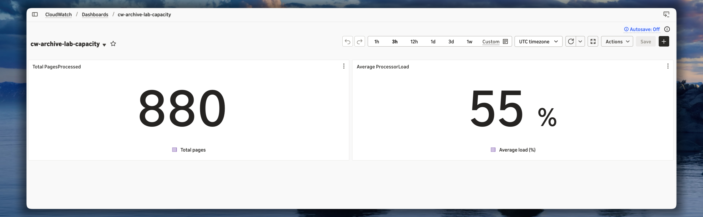

<section class="lab-card" data-lang="en" aria-label="Lab summary">
<ul class="lab-stats"><li><span>Level</span><b>Intermediate</b></li><li><span>Duration</span><b>35–50 minutes</b></li></ul>
<ul class="lab-services"><li><span class="lab-svc-ic" style="background-image:url('/assets/img/aws/cloudwatch.svg')" aria-hidden="true"></span>CloudWatch</li></ul>
<div class="lab-actions"><a class="lab-btn" href="#step-1">Jump to the steps ↓</a></div>
</section>

> **Summary**
>
> An archive digitization company needs to combine telemetry from four workers across two Regions without building an additional collection service. This lab creates a cross-Region CloudWatch dashboard using metric math, then proves the result of **880 pages** and an average load of **55%** from deterministic sample data.
{: .prompt-info }

## Learning objectives

After completing this lab, you will be able to:

- Explain that CloudWatch metrics are identified by namespace, metric name, dimensions, and Region.
- Create a dashboard that pulls metrics from more than one Region.
- Use `SUM` and `AVG` in metric math to form new time series.
- Distinguish cross-metric aggregation from statistics such as `Sum` or `Average` applied to a single metric.
- Validate metric math results through `GetMetricData`.
- Diagnose empty widgets caused by mismatched namespace, dimensions, timestamp, or Region.

## Scenario

An archive digitization company processes roughly **200,000 pages per day** using four OCR workers: two in Jakarta and two in Singapore. The operational target is to complete 95% of batches in under 20 minutes. Before the weekly capacity review, the operations team needs a single view showing total pages processed and average processor load across all workers.

To avoid running four servers continuously for this lab, you will publish one custom metric sample per worker. The sample data represents a single five-minute interval:

| Region | Worker | PagesProcessed | ProcessorLoad |
|---|---|---:|---:|
| Jakarta | worker-j1 | 140 | 35% |
| Jakarta | worker-j2 | 260 | 65% |
| Singapore | worker-s1 | 180 | 45% |
| Singapore | worker-s2 | 300 | 75% |

Results to prove:

- Total `PagesProcessed`: `140 + 260 + 180 + 300 = 880`.
- Average `ProcessorLoad`: `(35 + 65 + 45 + 75) / 4 = 55%`.

The same pattern applies to built-in metrics such as `AWS/EC2` `CPUUtilization`. A custom namespace is used only so lab results are predictable.

## How it works

CloudWatch stores metrics regionally. A dashboard does not copy data from Singapore to Jakarta; the dashboard definition only stores references to metrics along with their Region. The `region` property on each metric row lets a single widget read sources from different Regions.

Metric math computes new time series when data is requested. No additional aggregate metric needs to be published. In this lab, `SUM` adds up throughput across all workers, while `AVG` computes the average load. Summing load percentages would produce 220%, which does not represent the fleet's average utilization.

| Requirement | Expression | Sample result |
|---|---|---:|
| Total pages | `SUM([jp1,jp2,sp1,sp2])` | 880 |
| Average load | `AVG([jl1,jl2,sl1,sl2])` | 55 |

Math operations are performed on time-aligned points. That is why all lab samples use the same timestamp and widgets use a consistent period. Missing points do not automatically mean zero; do not add `FILL(...,0)` unless zero genuinely matches the workload's meaning.

Resolution and aggregation are two different things. Publishing data more frequently improves granularity but does not combine multiple series. If the namespace or dimensions are wrong, the API can still return `Complete` with an empty `Values` array.

## Architecture

{: .light }
{: .dark }
*Two Regions store their own metrics, while the dashboard in Jakarta reads both and computes aggregate series.*

Data flow:

1. The lab script publishes four series in each Region: two `PagesProcessed` series and two `ProcessorLoad` series.
2. The dashboard in Jakarta stores references to all eight series.
3. Singapore metric rows use the `region: ap-southeast-1` property.
4. Metric math computes total throughput and average load without publishing derived metrics.
5. The operations team reads the results through a single dashboard.

## Prerequisites

- One AWS account with access to `ap-southeast-3` and `ap-southeast-1`.
- AWS CLI v2, Bash, `jq` 1.6 or newer, and Python 3.
- The namespace `Lab/ArchiveCapacity` is not already used by another workload. If it is, change the namespace consistently in the policy and all commands.
- No EC2 instances, VPC, new IAM roles, Lambda, or schedulers are required.

Here is the minimum policy for the identity running this lab. Replace `111122223333` with the Account ID from STS. If you change `PREFIX` or `NAMESPACE`, adjust the resource ARN and condition accordingly.

```json
{
  "Version": "2012-10-17",
  "Statement": [
    {
      "Sid": "PublishOnlyLabNamespace",
      "Effect": "Allow",
      "Action": "cloudwatch:PutMetricData",
      "Resource": "*",
      "Condition": {
        "StringEquals": {
          "cloudwatch:namespace": "Lab/ArchiveCapacity"
        }
      }
    },
    {
      "Sid": "ReadLabMetrics",
      "Effect": "Allow",
      "Action": [
        "cloudwatch:GetMetricData",
        "cloudwatch:GetMetricStatistics",
        "cloudwatch:ListMetrics"
      ],
      "Resource": "*"
    },
    {
      "Sid": "ManageOnlyLabDashboard",
      "Effect": "Allow",
      "Action": [
        "cloudwatch:PutDashboard",
        "cloudwatch:GetDashboard",
        "cloudwatch:DeleteDashboards"
      ],
      "Resource": "arn:aws:cloudwatch::111122223333:dashboard/cw-archive-lab-capacity"
    },
    {
      "Sid": "ListDashboardInventory",
      "Effect": "Allow",
      "Action": "cloudwatch:ListDashboards",
      "Resource": "*"
    }
  ]
}
```

`PutMetricData` requires `Resource: "*"` because it does not use metric ARNs for resource-level permissions. The namespace condition restricts the identity from writing to other workload namespaces.

### Check prerequisites

```bash
aws --version
jq --version
python3 --version

aws sts get-caller-identity \
  --query '{Account:Account,Arn:Arn}' \
  --output json

for r in ap-southeast-3 ap-southeast-1; do
  aws cloudwatch list-dashboards \
    --region "$r" \
    --query 'length(DashboardEntries)' \
    --output text >/dev/null || exit 1
  echo "$r: CloudWatch is reachable"
done
```

<details class="lab-fold"><summary><span class="lab-fold__title">Expected output</span><small>6 lines</small></summary><div class="lab-fold__body">
<div class="lab-term"><div class="lab-term__bar"><i></i><i></i><i></i><span>output</span><em>text</em></div><div class="lab-term__body"><span class="ln">{</span><span class="ln">&#32;&#32;&#32;&#32;&quot;Account&quot;:&#32;&quot;111122223333&quot;,</span><span class="ln">&#32;&#32;&#32;&#32;&quot;Arn&quot;:&#32;&quot;arn:aws:iam::111122223333:user/lab-operator&quot;</span><span class="ln">}</span><span class="ln">ap-southeast-3:&#32;CloudWatch&#32;is&#32;reachable</span><span class="ln">ap-southeast-1:&#32;CloudWatch&#32;is&#32;reachable</span></div></div>
</div></details>

The `aws-cli` version must start with `aws-cli/2`. The ARN name reflects the identity you are using.

## Cost estimate

This lab creates:

- One CloudWatch dashboard.
- Eight custom metrics: four in Jakarta and four in Singapore.
- A few `PutMetricData`, `GetMetricData`, `ListMetrics`, and dashboard API calls.
- No EC2, NAT Gateway, Lambda, or compute data transfer costs.

This small usage may fit within the CloudWatch free allocation, but remaining account quota and per-user pricing terms vary. Components to check are **custom metrics**, **dashboards**, and **API requests** on the CloudWatch pricing page or AWS Pricing Calculator *(check latest documentation)*.

Custom metric history continues to follow CloudWatch retention after the dashboard is deleted.

## Steps

<ol class="lab-steps" aria-label="Step map"><li><a href="#step-1">Set lab variables</a></li><li><a href="#step-2">Publish sample metrics in Jakarta</a></li><li><a href="#step-3">Publish sample metrics in Singapore</a></li><li><a href="#step-4">Create a cross-Region dashboard with two expressions</a></li><li><a href="#step-5">Audit the stored dashboard definition</a></li></ol>


### 1. Set lab variables
{: #step-1 }

The following variables are used by all commands, including verification and cleanup.

```bash
export PREFIX="cw-archive-lab"
export REGION_A="ap-southeast-3"
export REGION_B="ap-southeast-1"
export NAMESPACE="Lab/ArchiveCapacity"
export DASHBOARD_NAME="${PREFIX}-capacity"
export TS="$(date -u +%Y-%m-%dT%H:%M:%SZ)"
```

Run the lab in a single shell session so `TS` and other variables do not change midway.

### 2. Publish sample metrics in Jakarta
{: #step-2 }

This step creates four series for the two Jakarta workers with the same timestamp.

**Console:** CloudWatch → Metrics → All metrics. After the CLI command succeeds, select Region **Jakarta (ap-southeast-3)**, then open the namespace **Lab/ArchiveCapacity**.

**CLI:** create the payload and send the Jakarta metrics.

```bash
cat > "/tmp/${PREFIX}-${REGION_A}.json" <<EOF
[
  {
    "MetricName": "PagesProcessed",
    "Dimensions": [
      {
        "Name": "NodeId",
        "Value": "worker-j1"
      }
    ],
    "Timestamp": "${TS}",
    "Value": 140,
    "Unit": "Count"
  },
  {
    "MetricName": "PagesProcessed",
    "Dimensions": [
      {
        "Name": "NodeId",
        "Value": "worker-j2"
      }
    ],
    "Timestamp": "${TS}",
    "Value": 260,
    "Unit": "Count"
  },
  {
    "MetricName": "ProcessorLoad",
    "Dimensions": [
      {
        "Name": "NodeId",
        "Value": "worker-j1"
      }
    ],
    "Timestamp": "${TS}",
    "Value": 35,
    "Unit": "Percent"
  },
  {
    "MetricName": "ProcessorLoad",
    "Dimensions": [
      {
        "Name": "NodeId",
        "Value": "worker-j2"
      }
    ],
    "Timestamp": "${TS}",
    "Value": 65,
    "Unit": "Percent"
  }
]
EOF

aws cloudwatch put-metric-data \
  --region "$REGION_A" \
  --namespace "$NAMESPACE" \
  --metric-data "file:///tmp/${PREFIX}-${REGION_A}.json"
```

Expected output: no output when the command succeeds.

**Why:** `NodeId` makes each worker a separate series. `PagesProcessed` uses the `Count` unit while `ProcessorLoad` uses `Percent`, so statistics and graph axes do not mix two different measurement meanings.

### 3. Publish sample metrics in Singapore
{: #step-3 }

This step creates four more series in the second Region.

**Console:** CloudWatch → Metrics → All metrics. After publishing, select Region **Singapore (ap-southeast-1)** and check the namespace **Lab/ArchiveCapacity**.

**CLI:** create the payload and send the Singapore metrics with the same timestamp as Jakarta.

```bash
cat > "/tmp/${PREFIX}-${REGION_B}.json" <<EOF
[
  {
    "MetricName": "PagesProcessed",
    "Dimensions": [
      {
        "Name": "NodeId",
        "Value": "worker-s1"
      }
    ],
    "Timestamp": "${TS}",
    "Value": 180,
    "Unit": "Count"
  },
  {
    "MetricName": "PagesProcessed",
    "Dimensions": [
      {
        "Name": "NodeId",
        "Value": "worker-s2"
      }
    ],
    "Timestamp": "${TS}",
    "Value": 300,
    "Unit": "Count"
  },
  {
    "MetricName": "ProcessorLoad",
    "Dimensions": [
      {
        "Name": "NodeId",
        "Value": "worker-s1"
      }
    ],
    "Timestamp": "${TS}",
    "Value": 45,
    "Unit": "Percent"
  },
  {
    "MetricName": "ProcessorLoad",
    "Dimensions": [
      {
        "Name": "NodeId",
        "Value": "worker-s2"
      }
    ],
    "Timestamp": "${TS}",
    "Value": 75,
    "Unit": "Percent"
  }
]
EOF

aws cloudwatch put-metric-data \
  --region "$REGION_B" \
  --namespace "$NAMESPACE" \
  --metric-data "file:///tmp/${PREFIX}-${REGION_B}.json"
```

Expected output: no output when the command succeeds.

**Why:** Singapore data is sent to the Singapore endpoint, not copied from Jakarta. Therefore, the dashboard must state the source Region explicitly.

### 4. Create a cross-Region dashboard with two expressions
{: #step-4 }

This step creates one widget for total throughput and one widget for average load.

**Console:** CloudWatch → Dashboards. After the CLI command succeeds, open the dashboard **cw-archive-lab-capacity**.

**CLI:** build the dashboard body and save the dashboard in Jakarta.

```bash
cat > "/tmp/${PREFIX}-dashboard.json" <<EOF
{
  "start": "-PT3H",
  "end": "P0D",
  "widgets": [
    {
      "type": "metric",
      "x": 0,
      "y": 0,
      "width": 12,
      "height": 6,
      "properties": {
        "title": "Total PagesProcessed",
        "region": "${REGION_A}",
        "view": "singleValue",
        "stat": "Sum",
        "period": 300,
        "setPeriodToTimeRange": true,
        "sparkline": false,
        "metrics": [
          [
            "${NAMESPACE}",
            "PagesProcessed",
            "NodeId",
            "worker-j1",
            {
              "id": "jp1",
              "region": "${REGION_A}",
              "visible": false
            }
          ],
          [
            "${NAMESPACE}",
            "PagesProcessed",
            "NodeId",
            "worker-j2",
            {
              "id": "jp2",
              "region": "${REGION_A}",
              "visible": false
            }
          ],
          [
            "${NAMESPACE}",
            "PagesProcessed",
            "NodeId",
            "worker-s1",
            {
              "id": "sp1",
              "region": "${REGION_B}",
              "visible": false
            }
          ],
          [
            "${NAMESPACE}",
            "PagesProcessed",
            "NodeId",
            "worker-s2",
            {
              "id": "sp2",
              "region": "${REGION_B}",
              "visible": false
            }
          ],
          [
            {
              "expression": "SUM([jp1,jp2,sp1,sp2])",
              "label": "Total pages",
              "id": "totalpages"
            }
          ]
        ]
      }
    },
    {
      "type": "metric",
      "x": 12,
      "y": 0,
      "width": 12,
      "height": 6,
      "properties": {
        "title": "Average ProcessorLoad",
        "region": "${REGION_A}",
        "view": "singleValue",
        "stat": "Average",
        "period": 300,
        "setPeriodToTimeRange": true,
        "sparkline": false,
        "metrics": [
          [
            "${NAMESPACE}",
            "ProcessorLoad",
            "NodeId",
            "worker-j1",
            {
              "id": "jl1",
              "region": "${REGION_A}",
              "visible": false
            }
          ],
          [
            "${NAMESPACE}",
            "ProcessorLoad",
            "NodeId",
            "worker-j2",
            {
              "id": "jl2",
              "region": "${REGION_A}",
              "visible": false
            }
          ],
          [
            "${NAMESPACE}",
            "ProcessorLoad",
            "NodeId",
            "worker-s1",
            {
              "id": "sl1",
              "region": "${REGION_B}",
              "visible": false
            }
          ],
          [
            "${NAMESPACE}",
            "ProcessorLoad",
            "NodeId",
            "worker-s2",
            {
              "id": "sl2",
              "region": "${REGION_B}",
              "visible": false
            }
          ],
          [
            {
              "expression": "AVG([jl1,jl2,sl1,sl2])",
              "label": "Average load (%)",
              "id": "avgload"
            }
          ]
        ]
      }
    }
  ]
}
EOF

aws cloudwatch put-dashboard \
  --region "$REGION_A" \
  --dashboard-name "$DASHBOARD_NAME" \
  --dashboard-body "file:///tmp/${PREFIX}-dashboard.json"
```

<details class="lab-fold"><summary><span class="lab-fold__title">Expected output</span><small>3 lines</small></summary><div class="lab-fold__body">
<div class="lab-term"><div class="lab-term__bar"><i></i><i></i><i></i><span>output</span><em>text</em></div><div class="lab-term__body"><span class="ln">{</span><span class="ln">&#32;&#32;&#32;&#32;&quot;DashboardValidationMessages&quot;:&#32;[]</span><span class="ln">}</span></div></div>
</div></details>

**Why:** Each source metric has an `id` starting with a lowercase letter so expressions can reference it. `visible: false` only hides the source lines; those metrics remain inputs to metric math. `setPeriodToTimeRange: true` is suitable for summarizing a single lab sample, while production trends are usually clearer with `timeSeries` and a fixed period.

### 5. Audit the stored dashboard definition
{: #step-5 }

This step confirms the expressions are stored on the dashboard, not just written to a local file.

**Console:** CloudWatch → Dashboards → cw-archive-lab-capacity. Confirm the widgets **Total PagesProcessed** and **Average ProcessorLoad** are present.



**CLI:** read the dashboard back and extract only the expressions.

```bash
aws cloudwatch get-dashboard \
  --region "$REGION_A" \
  --dashboard-name "$DASHBOARD_NAME" \
  --query DashboardBody \
  --output text |
jq -r '.widgets[].properties.metrics[][] | objects | select(has("expression")) | .expression'
```

<details class="lab-fold"><summary><span class="lab-fold__title">Expected output</span><small>2 lines</small></summary><div class="lab-fold__body">
<div class="lab-term"><div class="lab-term__bar"><i></i><i></i><i></i><span>output</span><em>text</em></div><div class="lab-term__body"><span class="ln">SUM([jp1,jp2,sp1,sp2])</span><span class="ln">AVG([jl1,jl2,sl1,sl2])</span></div></div>
</div></details>

**Why:** `GetDashboard` proves the definition was stored, but does not prove source data is available. Source values and final results are checked separately in the Verification section.

## Verification

| Test | Scenario | Expected result |
|---|---|---|
| Source metrics per Region | Four active series found in each Region | <span class="lab-pill is-ok">✓ Succeeded</span> |
| Metric math arithmetic | Regional totals and averages match sample data | <span class="lab-pill is-ok">✓ Succeeded</span> |
| Cross-Region widget | Dashboard shows total 880 and average 55 | <span class="lab-pill is-ok">✓ Succeeded</span> |
| Mismatched dimension | Wrong NodeId produces an empty series | <span class="lab-pill is-deny">✕ Failed</span> |

### Test 1: Source metrics per Region

This test proves each Region has four active series, not eight series all located in Jakarta.

**Console:** CloudWatch → Metrics → All metrics. Check the namespace **Lab/ArchiveCapacity** while the Region selector is on Jakarta, then repeat for Singapore.

**CLI:** count metrics active in the last three hours.

```bash
for r in "$REGION_A" "$REGION_B"; do
  printf '%s: ' "$r"
  aws cloudwatch list-metrics \
    --region "$r" \
    --namespace "$NAMESPACE" \
    --recently-active PT3H \
    --query 'length(Metrics)' \
    --output text
done
```

<details class="lab-fold"><summary><span class="lab-fold__title">Expected output</span><small>2 lines</small></summary><div class="lab-fold__body">
<div class="lab-term"><div class="lab-term__bar"><i></i><i></i><i></i><span>output</span><em>text</em></div><div class="lab-term__body"><span class="ln">ap-southeast-3:&#32;4</span><span class="ln">ap-southeast-1:&#32;4</span></div></div>
</div></details>

**Pass if:** each Region returns `4`. If the result is `0`, wait a moment and retry; if more than `4`, the namespace was likely used before.

### Test 2: Metric math arithmetic

This test proves the `SUM` and `AVG` results through `GetMetricData`, while also providing regional numbers to audit the dashboard result.

**Console:** CloudWatch → Metrics → All metrics → Lab/ArchiveCapacity. You can compare raw values per worker with the CLI results below.

**CLI:** build a query for each Region and run `GetMetricData`.

```bash
export START_TIME="$(python3 -c 'from datetime import datetime, timedelta, timezone; print((datetime.now(timezone.utc) - timedelta(hours=1)).strftime("%Y-%m-%dT%H:%M:%SZ"))')"
export END_TIME="$(python3 -c 'from datetime import datetime, timezone; print(datetime.now(timezone.utc).strftime("%Y-%m-%dT%H:%M:%SZ"))')"

make_regional_query() {
  local suffix="$1"
  local file="$2"

  cat > "$file" <<EOF
[
  {
    "Id": "${suffix}p1",
    "MetricStat": {
      "Metric": {
        "Namespace": "${NAMESPACE}",
        "MetricName": "PagesProcessed",
        "Dimensions": [
          {
            "Name": "NodeId",
            "Value": "worker-${suffix}1"
          }
        ]
      },
      "Period": 3600,
      "Stat": "Sum"
    },
    "ReturnData": false
  },
  {
    "Id": "${suffix}p2",
    "MetricStat": {
      "Metric": {
        "Namespace": "${NAMESPACE}",
        "MetricName": "PagesProcessed",
        "Dimensions": [
          {
            "Name": "NodeId",
            "Value": "worker-${suffix}2"
          }
        ]
      },
      "Period": 3600,
      "Stat": "Sum"
    },
    "ReturnData": false
  },
  {
    "Id": "${suffix}l1",
    "MetricStat": {
      "Metric": {
        "Namespace": "${NAMESPACE}",
        "MetricName": "ProcessorLoad",
        "Dimensions": [
          {
            "Name": "NodeId",
            "Value": "worker-${suffix}1"
          }
        ]
      },
      "Period": 3600,
      "Stat": "Average"
    },
    "ReturnData": false
  },
  {
    "Id": "${suffix}l2",
    "MetricStat": {
      "Metric": {
        "Namespace": "${NAMESPACE}",
        "MetricName": "ProcessorLoad",
        "Dimensions": [
          {
            "Name": "NodeId",
            "Value": "worker-${suffix}2"
          }
        ]
      },
      "Period": 3600,
      "Stat": "Average"
    },
    "ReturnData": false
  },
  {
    "Id": "totalpages",
    "Expression": "SUM([${suffix}p1,${suffix}p2])",
    "Period": 3600,
    "ReturnData": true
  },
  {
    "Id": "avgload",
    "Expression": "AVG([${suffix}l1,${suffix}l2])",
    "Period": 3600,
    "ReturnData": true
  }
]
EOF
}

make_regional_query "j" "/tmp/${PREFIX}-query-a.json"
make_regional_query "s" "/tmp/${PREFIX}-query-b.json"

echo "Jakarta results:"
aws cloudwatch get-metric-data \
  --region "$REGION_A" \
  --metric-data-queries "file:///tmp/${PREFIX}-query-a.json" \
  --start-time "$START_TIME" \
  --end-time "$END_TIME" \
  --query 'MetricDataResults[].[Id,Values]' \
  --output json

echo "Singapore results:"
aws cloudwatch get-metric-data \
  --region "$REGION_B" \
  --metric-data-queries "file:///tmp/${PREFIX}-query-b.json" \
  --start-time "$START_TIME" \
  --end-time "$END_TIME" \
  --query 'MetricDataResults[].[Id,Values]' \
  --output json
```

<details class="lab-fold"><summary><span class="lab-fold__title">Expected output</span><small>30 lines</small></summary><div class="lab-fold__body">
<div class="lab-term"><div class="lab-term__bar"><i></i><i></i><i></i><span>output</span><em>text</em></div><div class="lab-term__body"><span class="ln">Jakarta&#32;results:</span><span class="ln">[</span><span class="ln">&#32;&#32;&#32;&#32;[</span><span class="ln">&#32;&#32;&#32;&#32;&#32;&#32;&#32;&#32;&quot;totalpages&quot;,</span><span class="ln">&#32;&#32;&#32;&#32;&#32;&#32;&#32;&#32;[</span><span class="ln">&#32;&#32;&#32;&#32;&#32;&#32;&#32;&#32;&#32;&#32;&#32;&#32;400.0</span><span class="ln">&#32;&#32;&#32;&#32;&#32;&#32;&#32;&#32;]</span><span class="ln">&#32;&#32;&#32;&#32;],</span><span class="ln">&#32;&#32;&#32;&#32;[</span><span class="ln">&#32;&#32;&#32;&#32;&#32;&#32;&#32;&#32;&quot;avgload&quot;,</span><span class="ln">&#32;&#32;&#32;&#32;&#32;&#32;&#32;&#32;[</span><span class="ln">&#32;&#32;&#32;&#32;&#32;&#32;&#32;&#32;&#32;&#32;&#32;&#32;50.0</span><span class="ln">&#32;&#32;&#32;&#32;&#32;&#32;&#32;&#32;]</span><span class="ln">&#32;&#32;&#32;&#32;]</span><span class="ln">]</span><span class="ln">Singapore&#32;results:</span><span class="ln">[</span><span class="ln">&#32;&#32;&#32;&#32;[</span><span class="ln">&#32;&#32;&#32;&#32;&#32;&#32;&#32;&#32;&quot;totalpages&quot;,</span><span class="ln">&#32;&#32;&#32;&#32;&#32;&#32;&#32;&#32;[</span><span class="ln">&#32;&#32;&#32;&#32;&#32;&#32;&#32;&#32;&#32;&#32;&#32;&#32;480.0</span><span class="ln">&#32;&#32;&#32;&#32;&#32;&#32;&#32;&#32;]</span><span class="ln">&#32;&#32;&#32;&#32;],</span><span class="ln">&#32;&#32;&#32;&#32;[</span><span class="ln">&#32;&#32;&#32;&#32;&#32;&#32;&#32;&#32;&quot;avgload&quot;,</span><span class="ln">&#32;&#32;&#32;&#32;&#32;&#32;&#32;&#32;[</span><span class="ln">&#32;&#32;&#32;&#32;&#32;&#32;&#32;&#32;&#32;&#32;&#32;&#32;60.0</span><span class="ln">&#32;&#32;&#32;&#32;&#32;&#32;&#32;&#32;]</span><span class="ln">&#32;&#32;&#32;&#32;]</span><span class="ln">]</span></div></div>
</div></details>

Result order may differ. Use `Id` to match values.

**Pass if:** Jakarta yields `totalpages = 400` and `avgload = 50`, while Singapore yields `totalpages = 480` and `avgload = 60`. The combined total is `400 + 480 = 880`. The combined average is computed from four raw values and must yield `55`.

### Test 3: Cross-Region widget

This test proves the dashboard combines Jakarta and Singapore sources, not just one Region.

**Console:** CloudWatch → Dashboards → cw-archive-lab-capacity. Set the dashboard time range to include the `TS` value from Step 1. Look at the values on **Total PagesProcessed** and **Average ProcessorLoad**.

**CLI:** confirm the widget definition contains both expressions and both Regions.

```bash
aws cloudwatch get-dashboard \
  --region "$REGION_A" \
  --dashboard-name "$DASHBOARD_NAME" \
  --query DashboardBody \
  --output text |
jq '{
  expressions: [
    .widgets[].properties.metrics[][]
    | objects
    | select(has("expression"))
    | .expression
  ],
  regions: (
    [
      .widgets[].properties.metrics[]
      | arrays
      | .[4].region? // empty
    ]
    | unique
  )
}'
```

<details class="lab-fold"><summary><span class="lab-fold__title">Expected output</span><small>10 lines</small></summary><div class="lab-fold__body">
<div class="lab-term"><div class="lab-term__bar"><i></i><i></i><i></i><span>output</span><em>text</em></div><div class="lab-term__body"><span class="ln">{</span><span class="ln">&#32;&#32;&quot;expressions&quot;:&#32;[</span><span class="ln">&#32;&#32;&#32;&#32;&quot;SUM([jp1,jp2,sp1,sp2])&quot;,</span><span class="ln">&#32;&#32;&#32;&#32;&quot;AVG([jl1,jl2,sl1,sl2])&quot;</span><span class="ln">&#32;&#32;],</span><span class="ln">&#32;&#32;&quot;regions&quot;:&#32;[</span><span class="ln">&#32;&#32;&#32;&#32;&quot;ap-southeast-1&quot;,</span><span class="ln">&#32;&#32;&#32;&#32;&quot;ap-southeast-3&quot;</span><span class="ln">&#32;&#32;]</span><span class="ln">}</span></div></div>
</div></details>

**Pass if:** the dashboard shows a total around `880` and an average around `55` or `55.0`, and the CLI result lists both Regions. Decimal formatting or percent symbol differences do not affect the result.

### Test 4: Mismatched dimension

This test deliberately uses a nonexistent `NodeId`. The command is read-only and does not modify the dashboard, so no recovery is needed.

**Console:** CloudWatch → Metrics → All metrics → Lab/ArchiveCapacity. Confirm there is no `PagesProcessed` with dimension `NodeId = worker-j9`.

**CLI:** query a series whose dimension is intentionally wrong.

```bash
cat > "/tmp/${PREFIX}-query-missing.json" <<EOF
[
  {
    "Id": "missing",
    "MetricStat": {
      "Metric": {
        "Namespace": "${NAMESPACE}",
        "MetricName": "PagesProcessed",
        "Dimensions": [
          {
            "Name": "NodeId",
            "Value": "worker-j9"
          }
        ]
      },
      "Period": 3600,
      "Stat": "Sum"
    },
    "ReturnData": true
  }
]
EOF

aws cloudwatch get-metric-data \
  --region "$REGION_A" \
  --metric-data-queries "file:///tmp/${PREFIX}-query-missing.json" \
  --start-time "$START_TIME" \
  --end-time "$END_TIME" \
  --query 'MetricDataResults[0].[Id,Values,StatusCode]' \
  --output json
```

<details class="lab-fold"><summary><span class="lab-fold__title">Expected output</span><small>5 lines</small></summary><div class="lab-fold__body">
<div class="lab-term"><div class="lab-term__bar"><i></i><i></i><i></i><span>output</span><em>text</em></div><div class="lab-term__body"><span class="ln">[</span><span class="ln">&#32;&#32;&#32;&#32;&quot;missing&quot;,</span><span class="ln">&#32;&#32;&#32;&#32;[],</span><span class="ln">&#32;&#32;&#32;&#32;&quot;Complete&quot;</span><span class="ln">]</span></div></div>
</div></details>

**Pass if:** `Values` is an empty array. `StatusCode = Complete` means the request was processed, not that data was found. This is why empty widgets must be traced through namespace, metric name, dimensions, Region, and time range.

## Troubleshooting

| Symptom | Most likely cause | How to confirm | Solution |
|---|---|---|---|
| `An error occurred (AccessDenied) when calling the PutMetricData operation` | Identity lacks permission or namespace does not match the condition | `aws sts get-caller-identity` | Check the identity in use, then align `NAMESPACE` with `cloudwatch:namespace` in the policy. |
| `An error occurred (AccessDenied) when calling the PutDashboard operation` | Dashboard ARN in the policy does not match the Account ID or dashboard name | `aws cloudwatch list-dashboards --region "$REGION_A" --dashboard-name-prefix "$PREFIX"` | Adjust the resource ARN and ensure `DASHBOARD_NAME` is `cw-archive-lab-capacity`. |
| `DashboardValidationMessages` is not empty | Invalid JSON, duplicate `id`, or expression references a missing ID | `jq empty "/tmp/${PREFIX}-dashboard.json"` | Fix the validation messages, then rerun `put-dashboard`. |
| Widget shows `No data available` | Time range does not include `TS`, or one metric points to the wrong Region | `aws cloudwatch list-metrics --region "$REGION_A" --namespace "$NAMESPACE" --recently-active PT3H` | Adjust the dashboard time range and check the `region` property on each metric row. |
| `Values` is empty but `StatusCode` is `Complete` | Namespace, `MetricName`, or `NodeId` is not an exact match | `aws cloudwatch list-metrics --region "$REGION_A" --namespace "$NAMESPACE" --recently-active PT3H` | Copy names and dimensions from `list-metrics` output; lookups are case-sensitive. |
| Numbers grow larger after republishing the payload | Query range includes more than one sample | `aws cloudwatch get-metric-data --region "$REGION_A" --metric-data-queries "file:///tmp/${PREFIX}-query-a.json" --start-time "$START_TIME" --end-time "$END_TIME"` | Limit the query to one interval or rerun the lab with a new namespace to keep results deterministic. |
| `bash: jq: command not found` | `jq` is not installed or not on `PATH` | `command -v jq` | Install `jq`, then rerun the dashboard audit command. |

## Production considerations

### Security

- Workers publishing metrics should use an IAM role with `PutMetricData` restricted through a namespace condition. Do not grant write access to all namespaces just to simplify deployment.
- Avoid dimensions such as document numbers, customer names, or per-transaction batch IDs. Besides increasing series count, such dimensions can leak operational metadata to dashboard readers.
- If metrics span multiple accounts, use **CloudWatch cross-account observability** or the classic cross-account/cross-Region console sharing mechanism as appropriate. Restrict the monitoring account and choose which data types are shared.
- The classic cross-account/cross-Region console does not provide cross-account log visibility and does not support creating alarms on another account's metrics from the monitoring account. Place alarms and notification permissions according to those limitations *(check latest documentation for cross-account observability features)*.

### Reliability

- Align `Period` when summing multiple series. Five-minute throughput cannot be directly summed with hourly throughput without normalization.
- Define the meaning of missing data. A worker that processed no pages is not necessarily down; it may simply have no backlog. Filling empty points with zero can make capacity look healthy or unhealthy for the wrong reasons.
- An explicit metric list like the one in this lab does not automatically discover new workers. For a changing fleet, use one `SEARCH` per Region with a strict schema, for example `SUM(SEARCH('{Lab/ArchiveCapacity,NodeId} MetricName="PagesProcessed"', 'Sum', 300))`. Test the result before relying on it because an overly broad search can include test series or workers outside the report scope.
- A single graph is limited to a maximum of **500 metrics and expressions**, while `GetMetricData` accepts up to **500 `MetricDataQueries`** per request *(check latest documentation)*. Split large reports into multiple widgets or queries, and do not assume very broad search results are always complete.
- Store `Period`, statistic, time range, and time zone alongside the report definition. A monthly report using UTC can produce different results from one using local-time day boundaries.
- Metric math does not replace a FinOps pipeline. For example, total `CPUUtilization` cannot be directly interpreted as vCPU-hours or cost; that calculation also requires instance type, vCPU count, and running duration.

### Observability

Separate capacity review dashboards from alarms that trigger operational action:

- Set a high-load alarm per Region on the `AVG` result of `ProcessorLoad`, for example above **80% for three consecutive five-minute periods**. This threshold should be tuned from baseline results and load tests, not adopted without measurement.
- Monitor `SUM(PagesProcessed)` together with backlog and application errors. Zero throughput when the queue is empty is normal, while zero throughput when backlog keeps growing may indicate a stalled pipeline.
- Metric math alarms must produce **a single time series**. Create alarms on metrics or expressions in the Region where their sources live; do not assume a regional alarm automatically reads metrics from another Region.
- Handle `INSUFFICIENT_DATA` status explicitly. A worker that stops sending metrics should not let a telemetry outage pass unnoticed just because the graph is empty.
- For daily operations, use `timeSeries` widgets so trends and sudden changes are visible. `singleValue` widgets are better suited for summarizing a value over a time range.

### Cost at real scale

Four workers in this lab produce eight custom metrics. At 500 workers with two metrics per worker, that becomes 1,000 custom metrics. Adding high-cardinality dimensions such as `BatchId` or `CustomerId` can multiply the series count because every unique combination of name, namespace, and dimensions counts as a separate metric.

Cost components to monitor:

- Custom metrics in each Region.
- Number of dashboards beyond the free allocation.
- API requests such as `PutMetricData` and `GetMetricData`.
- Refresh frequency or automated report exports.

Metric math does not publish additional aggregate metrics, so you do not pay for new custom series just to store `SUM` or `AVG` results. However, all source metrics and their read requests remain usage components. Check the latest details on the CloudWatch pricing page and use AWS Pricing Calculator for production-scale estimates *(check latest documentation)*.

### Automation

Store the dashboard definition in IaC so expression changes can be reviewed and rolled back. Source metrics are still published by the application; CloudFormation does not publish metric samples for you.

The following example intentionally uses two workers for brevity. A production source list can be generated from fleet configuration, while the dashboard is created in the Jakarta Region.

```yaml
Resources:
  CapacityDashboard:
    Type: AWS::CloudWatch::Dashboard
    Properties:
      DashboardName: cw-archive-capacity-prod
      DashboardBody: |
        {
          "widgets": [
            {
              "type": "metric",
              "x": 0,
              "y": 0,
              "width": 12,
              "height": 6,
              "properties": {
                "title": "Total pages per 5 minutes",
                "region": "ap-southeast-3",
                "view": "timeSeries",
                "period": 300,
                "stat": "Sum",
                "metrics": [
                  [
                    "Lab/ArchiveCapacity",
                    "PagesProcessed",
                    "NodeId",
                    "worker-j1",
                    {
                      "id": "jp1",
                      "region": "ap-southeast-3",
                      "visible": false
                    }
                  ],
                  [
                    "Lab/ArchiveCapacity",
                    "PagesProcessed",
                    "NodeId",
                    "worker-s1",
                    {
                      "id": "sp1",
                      "region": "ap-southeast-1",
                      "visible": false
                    }
                  ],
                  [
                    {
                      "expression": "SUM([jp1,sp1])",
                      "label": "Total pages",
                      "id": "totalpages"
                    }
                  ]
                ]
              }
            }
          ]
        }
```

Add tests against the dashboard body in the CI pipeline, then deploy to a non-production account first. JSON syntax checks alone are not enough because `id` references, Regions, and dimensions must also match the metrics actually published.

## Cleanup

Delete the dashboard first, then remove all local working files.

```bash
aws cloudwatch delete-dashboards \
  --region "$REGION_A" \
  --dashboard-names "$DASHBOARD_NAME"

rm -f \
  "/tmp/${PREFIX}-${REGION_A}.json" \
  "/tmp/${PREFIX}-${REGION_B}.json" \
  "/tmp/${PREFIX}-dashboard.json" \
  "/tmp/${PREFIX}-query-a.json" \
  "/tmp/${PREFIX}-query-b.json" \
  "/tmp/${PREFIX}-query-missing.json"
```

Expected output: no output when both commands succeed.

CloudWatch does not provide an operation to delete custom metric history directly. Stop publishing data to the lab namespace and let history follow CloudWatch retention. Since this lab creates no EC2 instances, Lambda functions, IAM roles, or schedulers, none of those resources need to be deleted.

Confirm the dashboard and working files are gone:

```bash
echo "Dashboards still matching:"
aws cloudwatch list-dashboards \
  --region "$REGION_A" \
  --dashboard-name-prefix "$DASHBOARD_NAME" \
  --query 'DashboardEntries[].DashboardName' \
  --output json

echo "Working files remaining:"
find /tmp -maxdepth 1 -type f -name "${PREFIX}-*.json" -print
```

<details class="lab-fold"><summary><span class="lab-fold__title">Expected output</span><small>3 lines</small></summary><div class="lab-fold__body">
<div class="lab-term"><div class="lab-term__bar"><i></i><i></i><i></i><span>output</span><em>text</em></div><div class="lab-term__body"><span class="ln">Dashboards&#32;still&#32;matching:</span><span class="ln">[]</span><span class="ln">Working&#32;files&#32;remaining:</span></div></div>
</div></details>

Metric history may still be found temporarily through `ListMetrics`; this does not indicate the dashboard or publisher process is still running.

## Summary

- A CloudWatch dashboard can display metrics from multiple Regions by storing the source Region on each metric row.
- Metric math forms computed time series when data is requested, without requiring additional aggregate metrics.
- `SUM` is suitable for adding up throughput, while `AVG` computes the average load across all workers.
- `GetMetricData` allows expression results to be tested programmatically, including checking whether the `Values` array actually contains data.
- Empty widgets must be traced through Region, namespace, metric name, dimensions, timestamp, and aggregation period.

Advanced challenges:

1. Replace the static worker list with one `SEARCH` per Region, add a fifth worker, and prove whether the aggregation changes without manually editing the ID list.
2. Change the widget to `timeSeries`, publish several five-minute samples, and create a regional alarm on average load that produces a single time series.
3. Replicate the dashboard pattern to a second account using cross-account sharing, then document the permission and limitation differences compared to this single-account lab.

## References

- [Math expressions with metrics](https://docs.aws.amazon.com/AmazonCloudWatch/latest/monitoring/using-metric-math.html)
- [Using Amazon CloudWatch dashboards](https://docs.aws.amazon.com/AmazonCloudWatch/latest/monitoring/CloudWatch_Dashboards.html)
- [CloudWatch dashboard body structure and syntax](https://docs.aws.amazon.com/AmazonCloudWatch/latest/APIReference/CloudWatch-Dashboard-Body-Structure.html)
- [Cross-account cross-Region CloudWatch console](https://docs.aws.amazon.com/AmazonCloudWatch/latest/monitoring/Cross-Account-Cross-Region.html)
- [CloudWatch cross-account observability](https://docs.aws.amazon.com/AmazonCloudWatch/latest/monitoring/CloudWatch-Unified-Cross-Account.html)
- [GetMetricData API](https://docs.aws.amazon.com/AmazonCloudWatch/latest/APIReference/API_GetMetricData.html)
- [PutMetricData API](https://docs.aws.amazon.com/AmazonCloudWatch/latest/APIReference/API_PutMetricData.html)
- [CloudWatch service quotas](https://docs.aws.amazon.com/AmazonCloudWatch/latest/monitoring/cloudwatch_limits.html)
- [Amazon CloudWatch pricing](https://aws.amazon.com/cloudwatch/pricing/)

<!-- lab-next:start -->
<section class="lab-next" aria-label="Next lab"><div class="lab-next__kicker">Next lab</div><div class="lab-next__grid"><a class="lab-next__card" href="/posts/lab-detecting-security-groups-with-ssh-open-to-the-internet-using-aws-config-eve/"><span class="lab-next__img" style="background-image:url('/assets/img/posts/lab-detecting-security-groups-with-ssh-open-to-the-internet-using-aws-config-eve/cover.png')" aria-hidden="true"></span><span class="lab-next__body"><span class="lab-next__title">Detecting Security Groups with SSH Open to the Internet Using AWS Config, EventBridge and SNS Notifications</span><span class="lab-next__meta">Intermediate · 60–75 minutes</span><span class="lab-next__go">Start the lab →</span></span></a><a class="lab-next__card" href="/posts/lab-balancing-nlb-traffic-across-azs-with-cross-zone-load-balancing/"><span class="lab-next__img" style="background-image:url('/assets/img/posts/lab-balancing-nlb-traffic-across-azs-with-cross-zone-load-balancing/cover.png')" aria-hidden="true"></span><span class="lab-next__body"><span class="lab-next__title">Balancing NLB Traffic Across AZs with Cross-Zone Load Balancing</span><span class="lab-next__meta">Intermediate · 50–70 minutes</span><span class="lab-next__go">Start the lab →</span></span></a></div></section>
<!-- lab-next:end -->
